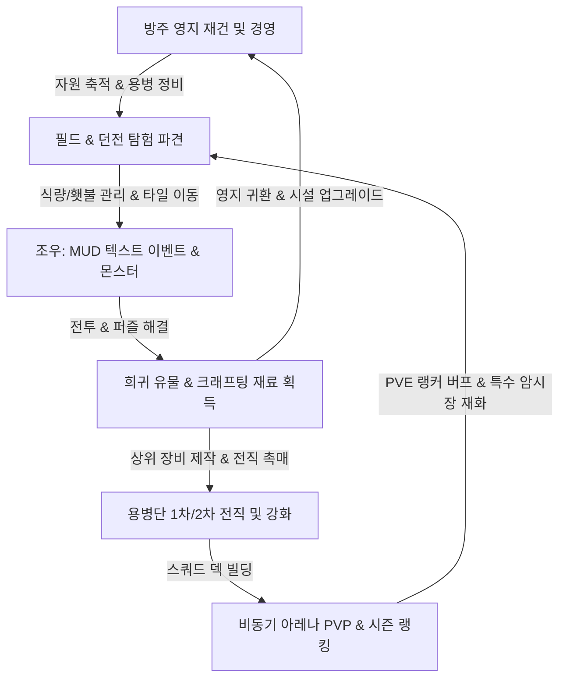

# [GDD] 프로젝트 코드네임: 림보 아카데미아 (Project: Limbo Academia / 심연의 탐색자들)
> **MUD의 감성과 서브컬쳐 비주얼의 결합, 모바일 세로형 다크 텍스트 RPG**

---

## 1. 프로젝트 개요

| 항목 | 내용 |
| :--- | :--- |
| **게임 제목 (가제)** | **프로젝트: 림보 테일즈 (Project: Limbo Tales)** / **심연의 생존자들** |
| **장르** | 세로형 텍스트 기반 다크 판타지 머드(MUD) RPG + 영지 경영 시뮬레이션 |
| **타겟 플랫폼** | 모바일 웹 / 하이브리드 앱 (세로 모드 고정 9:16 ~ 9:19.5 해상도 최적화) |
| **핵심 기술 스택** | **Phaser 3**, **TypeScript**, **Vite**, **Firebase Realtime Database** |
| **핵심 레퍼런스** | **던전 서바이버 2: 다크 타이드** (코어 루프), **어두운 방(A Dark Room)** (영지 점진적 해금), **다키스트 던전** (공포와 심연의 내러티브), **블루 아카이브** (비주얼 스타일 & 캐릭터 아트 톤앤매너) |
| **개발 철학** | 20년 경력의 RPG 감성과 최신 트렌드의 결합. 복잡한 텍스트 입력은 직관적인 터치 인터랙션으로 재해석하고, 고전 MUD 특유의 상상력과 텍스트 서사에 고품질 서브컬쳐 일러스트를 융합. |

---

## 2. 세계관 및 시나리오 컨셉

### 2.1 세계관: ‘황혼의 균열과 가라앉은 성채’
* 갑작스러운 천벌(天罰) 혹은 차원 붕괴로 인해 세계의 90%가 '흑무(Black Fog)'와 괴수들로 가득 찬 **림보(Limbo, 연옥)** 에 잠겼습니다.
* 플레이어는 마지막 피난처인 고대 부유 거점 **'방주 성채(Ark Citadel)'** 의 지휘관(단장)이 되어, 흩어진 생존자들을 모아 영지를 재건하고 심연 속으로 용병단을 파견해야 합니다.
* 심연 깊은 곳에는 차원 붕괴의 원인인 '원초의 모노리스'가 잠들어 있으며, 층을 내려갈수록 밝혀지는 진실과 광기, 그리고 영지 내의 비밀이 드러납니다.

### 2.2 비주얼 톤앤매너: ‘다크 판타지 속 청량한 서브컬쳐 감성’
* 배경과 스토리는 무겁고 깊이 있는 다크 판타지 MUD의 텍스트이지만, 캐릭터 비주얼은 **‘블루 아카이브’풍의 청명하고 세련된 셀 셰이딩 아니메 스타일**을 적용.
* 절망적인 심연 속에서도 개성 넘치는 전술 장비, 무기, 마법 아티팩트를 장착한 매력적인 용병 캐릭터들이 플레이어의 몰입도를 극대화합니다.

---

## 3. UI / UX 레이아웃 구조 (세로형 스마트폰 최적화)

모바일 한 손 조작과 MUD 텍스트, 고해상도 비주얼의 균형을 극대화한 **휠 내비게이션 & 합체 인터랙션 패널 인터페이스**:

### 3.1 평상시 (기본 뷰)
```
+-------------------------------------------------------------+ (Y: 0~50)
|  [슬림 헤더] 자원 바 (목재/석재/철/식량/골드/에테르) + 랭커 버프 |
+-------------------------------------------------------------+ (Y: 55~395)
|                                                             |
|             [1. 메인 비주얼 카드 프레임 (340px)]             |
|       - 고해상도 캐릭터/배경/몬스터 서브컬쳐 일러스트       |
|       - [🎨 AI 프롬프트] 토글 뷰어                          |
|                                                             |
+-------------------------------------------------------------+ (Y: 405~675)
|  [2. 중단 6~7줄 MUD 텍스트 로그창 (270px)]                   |
|  - 롤링 실시간 내러티브 & 상태별 하이라이트 로그             |
+-------------------------------------------------------------+ (Y: 685~890)
|  [3. 하단 휠(Wheel) 인터랙티브 내비게이션 (205px)]           |
|  - 좌우 회전/스와이프 가능한 원형 아크/캐러셀 휠 메뉴         |
|  - [🏰 영지] [⚔️ 용병] [📜 퀘스트] [🌌 탐험] [🏆 아레나]      |
+-------------------------------------------------------------+
```

### 3.2 휠 메뉴 선택 시 (합체 확장 드로어 뷰)
```
+-------------------------------------------------------------+ (Y: 0~50)
|  [슬림 헤더] 자원 바 + 랭커 버프                             |
+-------------------------------------------------------------+ (Y: 55~395)
|             [1. 메인 비주얼 카드 프레임 (340px)]             |
|       - 현재 선택된 항목의 대형 비주얼 카드/일러스트 뷰어   |
+-------------------------------------------------------------+ (Y: 405~890)
|                                                             |
|  [2+3. 합체된 상세 인터랙션 패널 (통합 높이: 485px)]        |
|  +-------------------------------------------------------+  |
|  | 📜 [현재 메뉴 타이틀]            [ ✕ 돌아가기 / 닫기 ] |  |
|  +-------------------------------------------------------+  |
|  |  (드래그 / 마우스 휠 스크롤 지원 상세 콘텐츠 영역)      |  |
|  |  * 영지: 모닥불 피우기 & 전체 시설 건설/강화 리스트     |  |
|  |  * 용병: 4인 파티 탭, 전신 스탯, 1·2차 전직 각성 모달  |  |
|  |  * 퀘스트: 메인/연계 퀘스트 진행도 및 보상 수령 카드    |  |
|  |  * 탐험: 심연 나침반 이동 패드 & MUD 3지선다 선택지      |  |
|  |  * 아레나: 대전 매칭표, 랭킹 보드, 명예 상점           |  |
|  +-------------------------------------------------------+  |
+-------------------------------------------------------------+
```

1. **상단 메인 이미지 창 (Visual Frame)**
   - 비율: 1:1 또는 4:5 사각 카드 형태.
   - 현재 위치(영지 건물, 던전 심연 타일), 조우한 NPC, 몬스터, 이벤트 씬을 고품질 카드로 출력.
   - 개발 초기에는 테마 색상과 카드 테두리 + **AI 생성 프롬프트 가이드**를 표시하고, 단계적으로 일러스트 에셋을 적용.
2. **중단 텍스트 로그창 (MUD Log Area)**
   - 3~4줄의 콤팩트하고 가독성 높은 폰트(Pretendard / Noto Sans KR).
   - 타자기 효과(Typewriter effect)와 키워드 하이라이팅으로 고전 텍스트 머드의 몰입감 제공.
3. **하단 적응형 액션 컨트롤러 (Adaptive Wheel & Grid Menu)**
   - 키보드 타이핑 대신 1~2회의 탭으로 직관적 조작.
   - 휠 스크롤 또는 스마트 그리드 메뉴 형태로 상황(영지/탐험/전투/대화)에 맞춰 자동 전환.

---

## 4. 코어 게임 시스템 및 루프



### 4.1 영지 경영 시스템 (Inspired by 'A Dark Room')
* **단계적 해금 구조**:
  - 시작은 불씨 하나(모닥불)를 지피는 텍스트로부터 시작.
  - 모닥불 피우기 -> 피난민 유입 -> 나무/돌 채집 -> 식량 수급 -> 대장간 건설 -> 주점(용병 고용) -> 연금술 학회 -> 탐험대 결성으로 점진적 확장.
* **시설 연계 퀘스트 시스템**:
  - 건물이 그냥 지어지지 않으며, 모든 신규 시설(예: 지하 묘지 정화소, 고대 도서관)은 **특정 필드 탐험 및 스토리 퀘스트 완료**를 통해서만 설계도와 권한을 획득.
* **자원 흐름**:
  - 기본 자원: 목재, 석재, 철광석, 식량
  - 희귀 자원: 에테르 파편, 심연의 정수, 마도 코어, 고대 각인석

### 4.2 필드 탐험 & 던전 크롤링 (Inspired by 'Dungeon Survivor 2')
* **보급 시스템 (식량 & 횃불)**:
  - 1걸음(타일) 이동 시마다 식량 소모. 식량 고갈 시 체력 감소 및 패널티.
  - 횃불(시야/정신도) 수치가 낮아질수록 기습 확률 증가, 적의 능력치 상승(다키스트 던전 기믹).
* **MUD식 분기 선택지 이벤트**:
  - "피 묻은 제단을 발견했다. [기도한다 / 성수를 뿌린다 / 부수고 보석을 캔다]"
  - 선택에 따라 파티원의 능력치 변동, 저주 부여, 숨겨진 보스 조우 등 다양한 결과 도출.

### 4.3 4인 용병단 전술 전투 시스템
* **전투 방식**: 틱(Tick) 기반 ATB(Active Time Battle) 또는 반자동 턴제.
* **포지션 배치**: 전열(1, 2열 - 탱커/근접딜러), 후열(3, 4열 - 원거리/서포터/힐러).
* **스킬 연계 & 속성**:
  - 물리(참격/관통/타격) 및 마법(화염/빙결/전격/신성/암흑).
  - 상태이상(출혈, 중독, 기절, 도발, 방어막, 침묵)의 전략적 조합.

---


3. 원소 학도 (Apprentice) ----> 3-1. 대마도사 (Elementalist) ---> 3-1-A. 아크 메이지 (Calamity Mage)
                       |                                  +-> 3-1-B. 크로노스 마스터 (Chrono Arcanist)
                       +------> 3-2. 소환술사 (Summoner) -------> 3-2-A. 영혼 계약자 (Soul Binder)
                                                          +-> 3-2-B. 마도 골렘사 (Golem Meister)

4. 견습 사제 (Acolyte) -------> 4-1. 치유사 (Cleric) ----------> 4-1-A. 성령의 구원자 (High Saintess)
                       |                                  +-> 4-1-B. 세인트 오라클 (Saint Oracle)
                       +------> 4-2. 이단 심문관 (Zealot) ------> 4-2-A. 혈화의 복수자 (Blood Avenger)
                                                          +-> 4-2-B. 칠흑의 주술사 (Void Shaman)
```

* **전직 효과**:
  - 기본 스탯의 비약적 상승 (HP, ATK, DEF, SPD 대폭 증가).
  - **전용 특수 스킬(Ultimate & Passive)** 해금.
  - 전직 시 외형 카드 프레임 및 캐릭터 일러스트가 더욱 화려하고 세련된 서브컬쳐 일러스트로 진화.

---

## 6. 비동기 PVP 아레나 & 랭킹 시스템

### 6.1 아레나 구조 (Asynchronous Arena)
* 플레이어가 사전에 세팅한 **4인 방어 덱(Defense Deck)** 과 상대 유저가 AI로 매칭되어 비동기 자동 전술 배틀 수행.
* 전투 결과에 따라 **레이팅 점수(ELO Rating)** 및 **투사의 인장(Arena Coin)** 획득.

### 5. 마도 대장간 (Blacksmith) 장비 제작 & 강화 시스템

### 5.1 3대 장비 슬롯
- **무기 (Weapon)**: 물리/마법 공격력(ATK), 치명타율(CRIT), 속도(SPD)
- **방어구 (Armor)**: 물리/마법 방어력(DEF), 최대 체력(HP), 최대 마나(MP)
- **장신구 (Accessory)**: 속도(SPD), 마나(MP), 공격력/치명타 등 복합 스탯

### 5.2 장비 강화 (+0 ~ +7)
- 철광석과 골드를 소모하여 강화 단계별로 주 스탯 15% 영구 증폭.
- 용병 관리 화면에서 슬롯별 원터치 장착 및 해제 지원.

---

## 6. 황혼의 주점 (Tavern) 용병 고용 시스템

- 골드(200G)를 소모하여 랜덤 6대 직업 및 고유 특성을 가진 방랑 용병 3인 영입 풀 갱신.
- 용병 고용 시 보관소(Barracks)로 영입되어 3인 원정 파티로 즉시 교체 편성 가능.

---

## 7. 3종 샘플 몬스터 및 심연 5계층 보스전

### 7.1 3종 샘플 몬스터 스펙 및 보상
1. **[일반 몬스터] 공허의 잠복자 (Void Stalker)**
   - **출현**: 1F ~ 2F
   - **스펙**: HP 280, 공격력 22, 방어력 8, 속도 14
   - **스킬**: 그림자 기습 (130%), 출혈 발톱 (110% + 출혈)
   - **격파 보상**: 🪙 120 골드, ✨ 6 에테르, 🪨 10 석재, 🪵 8 목재
2. **[정예 몬스터] 심연의 망령 기사 (Phantom Dread Knight)**
   - **출현**: 3F ~ 4F
   - **스펙**: HP 520, 공격력 32, 방어력 20, 속도 9
   - **스킬**: 암흑의 일도양단 (160% 2열 관통), 망령의 방벽 (40% 보호막), 공포의 사자후 (공격력 20% 디버프)
   - **격파 보상**: 🪙 320 골드, ✨ 18 에테르, ⛓️ 15 철광석, 🪨 20 석재, 희귀 장비 도안
3. **[Chapter 1 최종 보스] 공허의 침식자 (Void Overlord)**
   - **출현**: 5F 원초의 제단
   - **스펙**: HP 850, 공격력 42, 방어력 22, 속도 12
   - **기믹**: HP 40% 이하 시 **2페이즈 광폭화 (공격력 50% 폭증)** 발동
   - **스킬**: 파멸의 공허 폭풍 (220% 광역 마법), 시공간 붕괴격 (320% 방어무시), 흑무의 잠식 (마나 흡수)
   - **격파 보상**: 🪙 1200 골드, ✨ 60 에테르, ⛓️ 30 철광석, 🪨 40 석재, **전설 장비 '심연의 에테르 반지' 완제**, Chapter 1 엔딩 퀘스트 완료

---

## 8. 자원 자동 생산 루프 ('A Dark Room' 식 영지 루프)

- **벌목장 (Lumber Camp)**: 레벨당 `+2 목재 / 2초`
- **채석장 (Quarry)**: 레벨당 `+2 석재 / 3초`
- **연금술 연구소 (Alchemy Lab)**: 레벨당 `+1 에테르 / 5초`
- 실시간 타이머 틱에 의해 자원이 자동 누적되며 상단 상태바에 즉각 반영.

* **랭킹 및 혜택**:
* **주간 랭킹 / 시즌 랭킹(4주 주기)** 운영.
* **Top 10 랭커 한정 PVE 특수 버프**:
  - 예: *‘승리자의 영광’* - 던전 내 전 파티원 공격력/체력 +15%, 식량 소모량 20% 감소, 희귀 아이템 드랍률 +25% (차주 정산 전까지 유지).
* **명예의 암시장(Black Market of Glory)**:
  - 아레나 코인으로만 구매 가능한 고대 2차 전직 비급서, 전설 전용 무기 설계도, 한정 서브컬쳐 코스튬/카드 스킨 판매.

---

## 7. AI 이미지 프롬프트 표준 가이드라인 ('블루 아카이브'풍 서브컬쳐)

비주얼의 일관성과 서브컬쳐 테마 완성을 위한 정형화된 프롬프트 템플릿:

### 7.1 표준 프롬프트 구조 (Prompt Architecture)
```text
[Subject & Character Detail], [Outfit & Tactical Fantasy Gear], [Pose & Expression], [Environment & Background], [Art Style & Quality Modifiers]
```

### 7.2 마스터 키워드 셋 (Master Style Modifiers)
* **스타일 키워드**: `anime style, Blue Archive aesthetic, highly detailed anime illustration, sharp clean lineart, soft cel shading, vibrant soft pastel lighting, high contrast highlights, cinematic lighting, masterpiece, best quality, 8k resolution`
* **네거티브 키워드**: `lowres, bad anatomy, bad hands, blurry, dark messy shading, 3d, realistic photograph, western comic style, deformed, watermark, text`

### 7.3 예시 프롬프트 세트

1. **팔라딘 2차 전직 - 발키리 성녀 (Aegis Valkyrie)**
   - **프롬프트**: `1girl, solo, holy knight paladin, white and gold tactical high-tech armor with glowing halo, long silver hair with blue highlights, confident gentle smile, holding a massive radiant crystal shield and light rapier, floating feather particles, ancient cathedral sanctuary ruins background, anime style, Blue Archive aesthetic, sharp cel shading, vibrant lighting, masterpiece, 8k`
2. **필드 배경 - 안개 낀 심연의 고대 폐허 (Limbo Ruins)**
   - **프롬프트**: `scenery, mysterious fantasy ruins swallowed by glowing cyan mist, colossal gothic pillars, glowing ancient runes on stone pavement, distant ruined citadel silhouette under twilight sky, anime game concept art, Blue Archive style background, clean atmosphere, cinematic depth of field, 8k`

---

## 8. 기술 아키텍처 및 데이터 구조

### 8.1 클라이언트 아키텍처 (Phaser 3 + TypeScript)
* **Scene 구조**:
  - `BootScene`: 초기 에셋 로드, 폰트 및 세이브 데이터 검증.
  - `CitadelScene` (영지): 자원 수급, 건물 관리, 용병단 관리, 크래프팅.
  - `ExplorationScene` (탐험): 타일 맵 이동, 보급품/횃불 관리, 텍스트 이벤트 처리.
  - `BattleScene` (전투): 4v4 턴제/ATB 전술 전투, 스킬 시퀀스 연출.
  - `ArenaScene` (PVP): 랭킹 조회, 대전 상대 검색, 비동기 대전 리플레이/시뮬레이션.
* **Core Managers**:
  - `GameManager`: 전역 상태 머신(FSM) 및 라이프사이클.
  - `QuestManager`: 시설/필드 해금 및 메인 시나리오 퀘스트 트리 관리.
  - `CombatEngine`: 스킬 공식, 대미지 계산, 버프/디버프 틱 처리.
  - `DatabaseService`: Firebase Realtime DB 연동 (동기화, 유저 덱 저장, 아레나 랭킹).

### 8.2 Firebase Realtime Database 데이터 스키마 (JSON 설계)
```json
{
  "users": {
    "USER_UID_001": {
      "profile": { "nickname": "지휘관", "level": 15, "lastLogin": 1770982800 },
      "resources": { "gold": 12000, "wood": 350, "stone": 180, "food": 50 },
      "citadel": {
        "bonfire": 3,
        "barracks": 2,
        "forge": 1,
        "alchemy": 0
      },
      "party": ["HERO_001", "HERO_002", "HERO_003", "HERO_004"],
      "questProgress": { "main_chapter": 2, "activeQuests": ["Q_FORGE_01", "Q_DUNGEON_02"] }
    }
  },
  "arena": {
    "season": 1,
    "leaderboard": {
      "USER_UID_001": { "rating": 1540, "rank": 3, "defenseDeck": [...] }
    }
  }
}
```

---

## 9. 단계별 개발 로드맵 및 버전 관리 (SemVer)

| 버전 | 마일스톤 명칭 | 핵심 구현 목표 |
| :--- | :--- | :--- |
| **v0.1.0-alpha** | **기초 프레임워크 & UI 프로토타입** | • Phaser + TS + Vite 기본 세팅<br>• 3단 UI 레이아웃(카드 프레임, 텍스트 로그, 적응형 메뉴)<br>• '어두운 방'식 모닥불 및 기초 영지 루프 구축 |
| **v0.2.0-alpha** | **용병 관리 & 영지 확장** | • 주점 및 대장간 시스템 (용병 고용, 기본 스탯 관리)<br>• 영지 건물 건설 연계 퀘스트 시스템 구축 |
| **v0.3.0-alpha** | **탐험 & MUD 이벤트 엔진** | • 타일형 던전 탐험 엔진 (식량/횃불 소모)<br>• MUD 텍스트 이벤트 선택지 및 분기 처리 시스템 |
| **v0.4.0-beta** | **전술 전투 & 전직 시스템** | • 4v4 턴제 전투 엔진 및 스킬/상태이상 메커니즘<br>• 기본 4직업 -> 1차 전직(8종) 트리 및 전직 퀘스트 구현 |
| **v0.5.0-beta** | **2차 전직 & 심연 던전 확장** | • 2차 전직(16종) 및 궁극기/패시브 시스템<br>• 다키스트 던전 스타일의 보스전 및 심연 메인 시나리오 |
| **v0.6.0-rc** | **Firebase 연동 & 비동기 아레나** | • Firebase Realtime DB 클라우드 세이브<br>• 비동기 PVP 아레나 매칭, 랭킹, 상위 10위 PVE 버프, 아레나 상점 |
| **v1.0.0** | **공식 릴리스 & 풀 아트워크 적용** | • AI 생성 일러스트 에셋 일괄 적용 및 사운드/이펙트 폴리싱<br>• 밸런스 튜닝 및 라이브 서비스 파이프라인 완성 |

---

## 10. 개발 및 테스트 협업 프로토콜
1. **주도적 구현 및 검증**: 각 마일스톤별 핵심 기능을 우선 구현하고 자체 기능 검증 완료 후 배포.
2. **SemVer 버전 명기**: 각 업데이트 단계마다 명확한 버전(예: `v0.1.0-alpha`)을 부여.
3. **사용자 테스트 가이드 및 릴리스 노트 제공**: 업데이트 완료 시마다 변경점, 테스트 방법, 확인 포인트가 정리된 `RELEASE_NOTES.md`를 함께 제공하여 피드백 및 다음 수정 방향을 긴밀히 협의.
