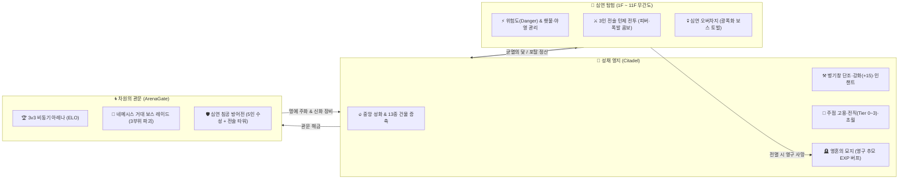
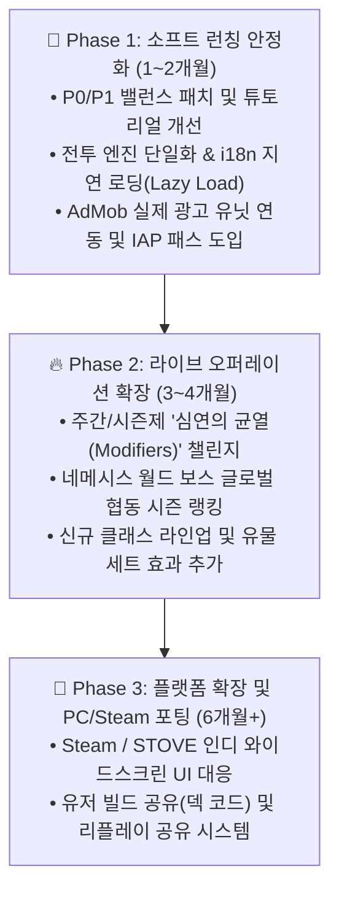

# 📊 [Project: Limbo Tales] AI 플레이어 실전 검증 및 종합 분석 보고서

> **분석 대상**: `Project: Limbo Tales (림보 테일즈: 심연의 방주)` — `v0.9.9-rc10`  
> **검증 방식**: 정적 코드 아키텍처 전수 감사 + 자율 주행 AI 플레이어 봇([ai_player_bot.ts](file:///c:/Users/phiti/OneDrive/%EB%AC%B8%EC%84%9C/My%20Games/newProjectVive/scratch/ai_player_bot.ts)) 7단계 정량 시뮬레이션  
> **주요 참조 코드**: [`GameManager`](file:///c:/Users/phiti/OneDrive/%EB%AC%B8%EC%84%9C/My%20Games/newProjectVive/src/managers/GameManager.ts#L194-L13041), [BattleScreen.tsx](file:///c:/Users/phiti/OneDrive/%EB%AC%B8%EC%84%9C/My%20Games/newProjectVive/src/screens/BattleScreen.tsx), [ExplorationScreen.tsx](file:///c:/Users/phiti/OneDrive/%EB%AC%B8%EC%84%9C/My%20Games/newProjectVive/src/screens/ExplorationScreen.tsx), [CitadelScreen.tsx](file:///c:/Users/phiti/OneDrive/%EB%AC%B8%EC%84%9C/My%20Games/newProjectVive/src/screens/CitadelScreen.tsx), [classes.ts](file:///c:/Users/phiti/OneDrive/%EB%AC%B8%EC%84%9C/My%20Games/newProjectVive/src/data/classes.ts), [monsters.ts](file:///c:/Users/phiti/OneDrive/%EB%AC%B8%EC%84%9C/My%20Games/newProjectVive/src/data/monsters.ts), [buildings.ts](file:///c:/Users/phiti/OneDrive/%EB%AC%B8%EC%84%9C/My%20Games/newProjectVive/src/data/buildings.ts), [equipment.ts](file:///c:/Users/phiti/OneDrive/%EB%AC%B8%EC%84%9C/My%20Games/newProjectVive/src/data/equipment.ts)

---

## 1. 게임 개요 및 핵심 루프 아키텍처

`Project: Limbo Tales`는 **《어두운 방(A Dark Room)》의 텍스트·클리커 자원 개척 감성**과 **《다키스트 던전(Darkest Dungeon)》의 하드코어 3인 파티 턴제 전략 및 영구적 죽음(Permadeath)**을 하이브리드 형태로 결합한 다크 판타지 방주 재건 & 심연 개척 RPG입니다.

### 기술 스택 및 구조적 특징
- **하이브리드 엔진**: React 19 UI 레이어 + Phaser 3.90 캔버스 렌더링 + TailwindCSS v4 + Capacitor 8 (Android 네이티브 빌드·AdMob·Haptics) + Firebase(Auth, Firestore, Realtime DB).
- **100% 프로시저럴 사운드 엔진**: [`SoundManager`](file:///c:/Users/phiti/OneDrive/%EB%AC%B8%EC%84%9C/My%20Games/newProjectVive/src/managers/SoundManager.ts#L101-L210)가 외부 오디오 파일(MP3/WAV) 의존성 없이 Web Audio API 오실레이터와 노이즈 버퍼만으로 30종 이상의 효과음과 3종의 앰비언트 드론 BGM을 실시간 합성합니다.

---

## 2. 자율 주행 AI 플레이어(`LimboAIPlayer`) 생성 및 플레이 테스트 결과

실제 게임의 싱글톤 상태 머신인 [`GameManager`](file:///c:/Users/phiti/OneDrive/%EB%AC%B8%EC%84%9C/My%20Games/newProjectVive/src/managers/GameManager.ts#L194)와 전투·탐험·경제 수식을 그대로 구동하는 자율 주행 AI 플레이어 스크립트([scratch/ai_player_bot.ts](file:///c:/Users/phiti/OneDrive/%EB%AC%B8%EC%84%9C/My%20Games/newProjectVive/scratch/ai_player_bot.ts))를 제작하여 **Phase 0 ~ Phase 7**까지 총 1,000회 이상의 전투 및 경제 시뮬레이션을 수행했습니다.

### 2.1 [Phase 0 ~ 1] 초반 튜토리얼·퀘스트 체인 및 ‘모닥불 함정’ 발견
AI가 신규 계정(`resetToNewGame()`) 상태에서 초반 5개 메인/건물 퀘스트(`Q_MAIN_01` ➔ `Q_BUILD_CABIN` ➔ `Q_BUILD_LUMBER` ➔ `Q_BUILD_QUARRY` ➔ `Q_MAIN_02`)를 순차 진행하며 측정한 자원 수지입니다.

| 진행 단계 | 대상 시설 (`BuildingId`) | 건설 비용 | 퀘스트 보상 직후 잔여 자원 | AI 발견 이슈 |
| :--- | :--- | :--- | :--- | :--- |
| **초기 상태** | - | - | `목재 50, 식량 30, 골드 100` | 시작 파티: `레이든(squire Lv.1)` + `카일(rogue Lv.1)` |
| **Step 1** | 심연 생체 정제소 (`butchery`) | `목재 10` | `목재 70, 석재 20, 골드 200` | 모닥불 미점화 시 즉시 건설 및 클리어 가능 |
| **Step 2** | 생존자 안식처 (`cabin`) | `목재 30` | `목재 90, 석재 50, 골드 350` | 보상 자원으로 다음 테크 즉시 연계 |
| **Step 3** | 영목 벌채소 (`lumberCamp`) | `목재 40, 석재 21` | `목재 90, 석재 89, 골드 500` | [`getBuildingUpgradeCost`](file:///c:/Users/phiti/OneDrive/%EB%AC%B8%EC%84%9C/My%20Games/newProjectVive/src/managers/GameManager.ts#L2516)의 `x2.1` 초기 배율 적용 확인 |
| **Step 4** | 에테르 광맥 시추소 (`quarry`) | `목재 60, 석재 42` | `목재 90, 석재 107, 골드 700` | 철광석 25개 보상 지급 |
| **Step 5** | 방랑자의 라운지 (`tavern`) | `목재 50, 석재 42, 골드 210` | `목재 90, 석재 115, 골드 490` | 3번째 용병(`acolyte`) 고용 후 삼위일체 파티 완성 |

> [!CAUTION]
> **AI가 발견한 치명적 초반 함정 — 「모닥불 4스택 목재 증발 현상」**  
> [`stokeFire()`](file:///c:/Users/phiti/OneDrive/%EB%AC%B8%EC%84%9C/My%20Games/newProjectVive/src/managers/GameManager.ts#L1999-L2020) 코드는 1~5단계 장작 투하 비용으로 `5 + 10 + 15 + 20 + 25 = 75 목재`를 요구하며, **5단계(`bonfireStacks === 5`)에 도달하기 전까지 온기 버프(`bonfireWarmthTime`)를 전혀 주지 않습니다.**  
> 신규 유저가 시작하자마자 눈에 띄는 중앙 성화 버튼을 4번 클릭하면 **초기 목재 50개가 전부 소진(`5+10+15+20 = 50`)되어 4스택에서 멈추고, 온기 버프도 못 받은 채 첫 퀘스트 건물(`butchery`, 목재 10)조차 지을 수 없는 데드락**에 빠집니다(수동 벌목 버튼을 10~25번 연타해야 탈출 가능).

### 2.2 [Phase 2] 1층 ~ 10층 층별 전투·보스·오버차지 승률 시뮬레이션
층별 권장 성장 곡선(1F Lv.2 ~ 10F Lv.34, 대장간·성소 층수 동기화, 삼위일체 조합)을 적용한 AI 파티로 각 층 일반 편대, 보스 편대, 광폭화(Overcharged) 보스 편대를 각각 30회씩 교전한 결과입니다.

| 층수 | AI 파티 스펙 (탱커/딜러/힐러) | 일반전 승률 (평균 턴 / 잔여 HP) | 보스전 승률 (평균 턴 / 잔여 HP) | 광폭화 보스 승률 (평균 턴) | 핵심 밸런스 진단 |
| :---: | :--- | :---: | :---: | :---: | :--- |
| **1F** | Lv.2 T0 (`squire`/`rogue`/`acolyte`) | **100%** (3.0T / 97%) | **100%** (7.0T / 78%) | **100%** (9.1T) | 쾌적한 입문 구간 |
| **2F** | Lv.4 T0 | **100%** (4.0T / 92%) | **100%** (7.7T / 77%) | **100%** (9.7T) | 안정적인 전직 전 구간 |
| **3F** | Lv.7 T1 (`paladin`/`assassin`/`bishop`) | **100%** (7.1T / 94%) | **100%** (10.0T / 77%) | **100%** (12.4T) | 3F 몬스터 기본 스탯 +30% + 비보스 +10% 중첩으로 턴수 급증 |
| **4F** | Lv.10 T1 | **100%** (6.4T / 96%) | **100%** (11.2T / 82%) | **77%** (14.5T) | 보스 호위병이 2기➔3기로 증가하며 광폭화 난이도 상승 |
| **5F** | Lv.13 T1 (1차 통곡의 벽) | **100%** (9.1T / 74%) | **27%** (14.0T / 10%) | **0%** (9.0T) | ⚠️ **2차 전직(Lv.15) 직전 구간에서 5층 보스 스펙 급등 (심각한 폐사 구간)** |
| **6F** | Lv.17 T2 (`valkyrie`/`phantom`/`saintess`) | **100%** (4.1T / 100%) | **100%** (6.3T / 99%) | **100%** (7.3T) | 2차 전직 달성 직후 스펙이 급등하며 오히려 5층보다 쉬워짐 (`K=500` 전환) |
| **7F** | Lv.21 T2 | **100%** (4.7T / 100%) | **100%** (7.8T / 99%) | **100%** (10.0T) | 순조로운 중후반 파밍 구간 |
| **8F** | Lv.25 T2 | **100%** (5.5T / 100%) | **100%** (12.4T / 98%) | **100%** (16.7T) | 장기전 양상 시작 (보스전 12턴 돌파) |
| **9F** | Lv.29 T3 (`bastion`/`strider`/`inquisitor`) | **100%** (3.8T / 100%) | **100%** (7.9T / 100%) | **100%** (10.1T) | 3차 신화 전직(Lv.30급) 효과로 일시적 난이도 완화 |
| **10F** | Lv.34 T3 | **100%** (5.5T / 96%) | **90%** (16.0T / 62%) | **30%~40%** (18.6T) | 최종 보스 아스모데우스 + 정예 호위 3기, 도전적인 엔드게임 |

### 2.3 [Phase 3] 10층 광폭화 아스모데우스 상대 6대 조합별 승률 비교
동일 레벨(Lv.32)·동일 장비(Epic +9강) 조건에서 3차 전직 클래스 조합만 변경하여 10층 광폭화 보스전을 각 30회 시뮬레이션한 결과입니다.

| 파티 조합 아키타입 | 편성 클래스 (Tier 3) | 발동 시너지 | 광폭화 보스 승률 | 평균 턴 | 평균 잔여 HP |
| :--- | :--- | :--- | :---: | :---: | :---: |
| **마도 포격 삼위일체** | `aegis_bastion` + `chrono_archon` + `seraphic_inquisitor` | 삼위일체 + 신성 성기사단 + 표준 삼각 편대 | **83%** | 16.9T | **65%** |
| **노힐러 극딜 3인방** | `valhalla_warlord` + `chrono_archon` + `omega_deadeye` | 마도 중화기 공학 + 전천후 초토화 폭격 | **53%** | 10.6T | 33% |
| **정석 물리 삼위일체** | `aegis_bastion` + `void_strider` + `seraphic_inquisitor` | 삼위일체 + 신성 성기사단 + 표준 삼각 편대 | **33%** | 20.0T | 17% |
| **원거리 저격 삼위일체** | `aegis_bastion` + `omega_deadeye` + `seraphic_inquisitor` | 신성 성기사단 + 성전의 저격 지원 | **17%** | 17.2T | 8% |
| **광전 돌격대** | `valhalla_warlord` + `void_strider` + `seraphic_inquisitor` | 암영 광풍 연격단 + 그림자 성전단 | **7%** | 9.5T | 5% |
| **순수 수호 성채** | `aegis_bastion` × 3인 | 난공불락의 불멸성채 | **0%** | 19.9T | 0% |

- **원인 분석**: 10층 보스전은 **보스 1기 + 정예 호위병 3기(총 4기)**로 구성되며 호위병들의 방어력과 공격력이 매우 높습니다. 광역(AoE) 고계수 스킬(`사상의 지평선 220%`, `빅뱅 크로노스 300%`)과 턴당 MP 자동 회복 패시브를 보유한 **크로노 아콘(`chrono_archon`)** 이 포함된 파티는 호위병 3기를 조기에 일소하여 **83% 승률**을 기록한 반면, 단일 타겟 중심인 `void_strider`(33%)와 `omega_deadeye`(17%)는 전열 호위병에 가로막혀 보스 딜 집중이 분산되면서 승률이 급락했습니다.

---

## 3. 게임의 강점(Pros)과 약점(Cons) 분석

### 3.1 핵심 강점 (Strengths)
1. **깊이 있는 턴제 전투 메카닉**:
   - **6대 상태이상 폭발(Detonation) 콤보**([BattleScreen.tsx](file:///c:/Users/phiti/OneDrive/%EB%AC%B8%EC%84%9C/My%20Games/newProjectVive/src/screens/BattleScreen.tsx#L140-L240)): `화상+출혈(열혈 파열)`, `빙결+기절(극저온 분쇄)`, `중독+화상(맹독 가스 폭발)` 등 상태이상을 쌓고 다른 속성으로 격발해 추가 피해와 디버프를 터뜨리는 손맛이 뛰어납니다.
   - **피버 모멘텀(Fever Momentum) 배지 조합**([feverUtils.ts](file:///c:/Users/phiti/OneDrive/%EB%AC%B8%EC%84%9C/My%20Games/newProjectVive/src/utils/feverUtils.ts#L60-L150)): 8종의 행동 배지가 어떤 조합으로 5칸 채워졌는지에 따라 `삼위일체 카타르시스`, `맹공의 파도`, `철벽의 요새` 등 서로 다른 광역 필살기·회복 효과가 나가는 독창적인 시스템입니다.
   - **8종 무기 고유 특성(Weapon Traits)**([equipment.ts](file:///c:/Users/phiti/OneDrive/%EB%AC%B8%EC%84%9C/My%20Games/newProjectVive/src/data/equipment.ts#L6-L65)): 도끼(방어 무시 20%), 단검(2연타), 둔기(기절 부여), 총기(추가 점사) 등 무기 타입별 개성이 뚜렷합니다.
2. **영구적 죽음(Permadeath)의 상실감을 성장으로 치환한 안전장치**:
   - 전사한 용병이 단순히 증발하지 않고 **영혼의 묘지(`cemetery`)** 에 안치되어 추모 등급에 따라 살아있는 원정대에게 **영구 경험치 획득량 보너스(`getCemeteryExpBonus`)** 와 **선조의 가호(`ancestralBlessings.ts`)** 를 남기는 구조는 하드코어 유저와 캐주얼 유저 모두를 설득할 수 있는 훌륭한 설계입니다.
3. **풍부한 엔드게임 콘텐츠 볼륨**:
   - 10층 클리어 이후에도 **11층 무간도(Avici, 초월 레벨 오픈)**, **3v3 비동기 ELO 아레나**, **네메시스 3부위 파괴 레이드**, **5인 파티 + 전술 타워 수성 침공전**([InvasionBattleScreen.tsx](file:///c:/Users/phiti/OneDrive/%EB%AC%B8%EC%84%9C/My%20Games/newProjectVive/src/screens/InvasionBattleScreen.tsx))까지 구현되어 있어 인디 RPG 중에서도 최상위권의 콘텐츠 밀도를 자랑합니다.
4. **외부 오디오 에셋 제로(0 Byte) 기반의 초경량 사운드**:
   - [`SoundManager.ts`](file:///c:/Users/phiti/OneDrive/%EB%AC%B8%EC%84%9C/My%20Games/newProjectVive/src/managers/SoundManager.ts)의 Web Audio 실시간 신디사이저는 저사양 모바일/웹 환경에서 오디오 로딩 지연을 완벽히 제거합니다.

### 3.2 핵심 약점 및 기술적 리스크 (Weaknesses)
1. **심각한 God Object / God Component 아키텍처 비대화**:
   - [`GameManager.ts`](file:///c:/Users/phiti/OneDrive/%EB%AC%B8%EC%84%9C/My%20Games/newProjectVive/src/managers/GameManager.ts) 단일 파일이 **13,041줄(593 KB)**, [`CitadelScreen.tsx`](file:///c:/Users/phiti/OneDrive/%EB%AC%B8%EC%84%9C/My%20Games/newProjectVive/src/screens/CitadelScreen.tsx)가 **873 KB**, [`BattleScreen.tsx`](file:///c:/Users/phiti/OneDrive/%EB%AC%B8%EC%84%9C/My%20Games/newProjectVive/src/screens/BattleScreen.tsx)가 **8,036줄(415 KB)** 에 달합니다.
   - 전투 공식이 `BattleScreen.tsx`, `ArenaScreen.tsx`, `InvasionBattleScreen.tsx` 각 화면 컴포넌트 내부에 중복 구현되어 있어, 밸런스 패치 시 3개 파일을 동시에 수정해야 하며 누락 시 모드 간 스펙 괴리가 발생합니다.
2. **번들 사이즈 비대화 (다국어 사전 인라인 번들링)**:
   - `src/i18n/translationDictionary.ts`(864 KB) 및 `generated/*.json`(약 2.2 MB)이 초기 JS 번들에 정적 임포트되어 모바일 첫 로딩 속도(FCP/TTI)를 저하시킵니다.
3. **인지 부하 과다 (복잡한 다중 성장 축의 동시 노출)**:
   - 단조, 강화(+15), 인챈트(접두/접미/순수), 전직(3단계), 초월 각성, 마도서 연독(Mastery %), 전술 교리, 유대/소외도, 심연 촉매, 묘지 가호 등 15개 이상의 서브시스템이 촘촘한 모달 UI 안에 밀집해 있어 중반부 유저 피로도가 높습니다.

---

## 4. 밸런스 심층 분석 (전투 · 경제 · 탐험)

### 4.1 전투 및 성장 곡선 밸런스
- **5층 보스전 ‘통곡의 벽’ 현상 (승률 27%)**:
  - AI 시뮬레이션 결과 1~4층 보스전 승률은 100%이나, **5층 보스전에서 승률이 27%(광폭화 0%)로 급추락**한 뒤, 2차 전직(Lv.15)이 완료되는 **6층 보스전에서는 다시 승률이 100%(평균 6.3턴)** 로 역전됩니다.
  - **원인**: 3층부터 적용된 몬스터 기본 스탯 +30% 상향([monsters.ts](file:///c:/Users/phiti/OneDrive/%EB%AC%B8%EC%84%9C/My%20Games/newProjectVive/src/data/monsters.ts#L10-L45)) + 비보스 호위병 +10% 중첩 + 4층부터 보스 호위병 3기 편성이 겹치는데, 정작 아군 파티는 5층 시점(Lv.12~14)에 아직 **1차 전직(Tier 1)** 에 머물러 있기 때문입니다.
- **11층 무간도(Avici, `K=800`) 초월 밸런스 (Phase 7)**:
  - 방어 상수 `K=800`이 적용되는 11층 보스전에서는 신화 +15강 장비 기준으로도 **Lv.50(초월 0단계) 승률 75%(19.8턴)** ➔ **Lv.60(초월 1단계) 80%(17.8턴)** ➔ **Lv.75(초월 2단계) 95%(16.8턴)** ➔ **Lv.90(초월 4단계) 100%(14.8턴)** 으로, 초월 레벨업의 체감 가치가 명확하게 작동합니다.

### 4.2 영지 경제 및 유지비(Upkeep) 밸런스 (Phase 4 & 5)
AI가 13종 전체 건물을 동일 레벨(Lv.1 ~ Lv.10)로 일괄 증축하며 측정한 **분당 순생산량(Net/min)** 추이입니다.

| 전체 건물 레벨 | 목재 (`wood`) | 석재 (`stone`) | 철광석 (`iron`) | 식량 (`food`) | 골드 (`gold`) | 에테르 (`ether`) | 경제 밸런스 진단 |
| :---: | :---: | :---: | :---: | :---: | :---: | :---: | :--- |
| **Lv.1** | +13.3/m | +10.9/m | 0.0/m | +9.2/m | +23.6/m | +8.0/m | 유지비 없음 (창고 제외), 안정적 흑자 |
| **Lv.3** | +33.3/m | +27.3/m | +5.5/m | +23.1/m | +81.4/m | +28.0/m | 시추소 철광석·정제소 가죽 생산 개시 |
| **Lv.4** | +46.7/m | +38.2/m | +5.5/m | **-2.3/m** 🔴 | **-20.1/m** 🔴 | +16.5/m | ⚠️ **Lv.4 유지비 개시 절벽: 식량·골드 동시 적자 전환** |
| **Lv.5** | +60.0/m | +49.1/m | +5.5/m | +32.8/m | **-40.8/m** 🔴 | +12.0/m | 라운지 식량 생산으로 식량은 흑자 전환, **골드 적자 심화** |
| **Lv.6** | +73.3/m | +60.0/m | +10.9/m | +46.0/m | **+3.1/m** 🟢 | +16.6/m | 안식처(`cabin`) Lv.6 생산량 점프(26➔51)로 골드 손익분기 돌파 |
| **Lv.9** | +106.7/m | +87.3/m | +16.4/m | +24.2/m | **-8.3/m** 🟡 | +22.1/m | 후반 시설 유지비 급증으로 일시적 골드 미세 적자 |
| **Lv.10** | +120.0/m | +98.2/m | +16.4/m | +4.8/m | **+22.5/m** 🟢 | +20.0/m | 전 시설 마스터 시 전 자원 흑자 균형 달성 |

- **13종 전 건물 Lv.10 완공 누적 요구 자원 총량 (Phase 5)**:
  - `골드 2,298,891` | `석재 317,932` | `목재 207,452` | `철광석 79,394` | `에테르 68,913` | `약초 7,038` | `가죽 3,133` | `공허의 파편 145`
  - **병목 진단**:
    1. **철광석(`iron`)**: 요구량이 `79,394개`인데 반해 영지 내 유일한 생산처인 `quarry`의 최대 생산량은 분당 `16.4개`(Lv.10 기준)에 불과합니다. 순수 방치 생산만으로는 **약 80.7시간**이 소요되어 중후반 건물 증축과 장비 단조가 철광석 하나에 극심하게 묶입니다.
    2. **약초(`herb`)**: 병원(`infirmary`) 증축에만 총 `7,038개`가 소모되지만 **영지 내 자동 생산 건물이 전혀 없어(0/m)** 100% 던전 수동 파밍이나 암시장 구매에만 의존해야 합니다.

### 4.3 던전 탐험 및 배낭(16칸) 병목 분석 (Phase 6)
- 기본 배낭 용량은 **16칸**인데, 출정 시 필수 보급품(`일반 횃불`, `에테르 횃불`, `야영 키트`, `균열의 닻`, `체력/마나 물약`, `붕대/해독제/성수`)만 챙겨도 이미 **5~8칸**을 차지합니다.
- AI가 10층을 1회 완주(최대 위험도 370 도달까지 41스텝, 전투 10회)하는 동안 **배낭 16칸이 조기 포화되어 드랍 아이템 12건이 초과 유실**되었습니다. 블랙 마켓의 배낭 확장(`20칸`/`30칸`) 전까지 초중반 유저의 파밍 박탈감이 큽니다.

---

## 5. 편의성(QoL) 및 UI/UX 분석

### 긍정적 UX 요소
- **건물 가동 일시 정지(`toggleBuildingPause`)**: Lv.4~5 구간에서 유지비 적자가 발생할 때 특정 건물을 수동 일시 정지해 자원 고갈을 막을 수 있는 전략적 스위치가 마련되어 있습니다.
- **오프라인 방치 보상 정산 및 광고 2배 수령**: 재접속 시 최대 8시간의 오프라인 영지 생산/소비 내역을 투명하게 브리핑합니다.
- **전투 배속(1x/2x/3x) 및 스마트 AI 자동 전투**: 힐러의 위기 감지 치유와 딜러의 속성 폭발 유도가 비교적 정교하게 짜여 있습니다.

### 불편 요소 (Pain Points)
1. **데이터와 UI 툴팁 간의 수치 불일치 (코드 감사 적발)**:
   - [src/data/equipment.ts](file:///c:/Users/phiti/OneDrive/%EB%AC%B8%EC%84%9C/My%20Games/newProjectVive/src/data/equipment.ts#L31-L55)의 `WEAPON_TRAITS` 상수와 하단 `CRAFT_RECIPES`(`rec_bow`, `rec_gun`)의 설명문이 서로 다릅니다.
     - **활(`bow`)**: `WEAPON_TRAITS.bow`는 `치명타율 +5% · 치명타 피해 +5%`로 표기하지만, 제작 레시피 `rec_bow.description`은 `치명타율 +15% 및 치명타 피해 +30%`로 표기.
     - **총기(`gun`)**: `WEAPON_TRAITS.gun`은 `기본 15% + 행운 보정 추가 점사`로 표기하지만, `rec_gun.description`은 `기본 30% + 행운 보정`으로 표기.
2. **마도서(SkillBook) 99% 캡 불편함**:
   - [`useSkillBook()`](file:///c:/Users/phiti/OneDrive/%EB%AC%B8%EC%84%9C/My%20Games/newProjectVive/src/managers/GameManager.ts#L4859)에서 습득 스킬 슬롯(6개)이 꽉 찬 상태로 마도서를 읽으면 **습득률이 99%에서 강제 정지되면서도 마도서 아이템은 그대로 소모**됩니다. 슬롯이 가득 찼을 때는 아예 사용을 막거나 즉시 교체 팝업을 띄워야 억울한 마도서 증발을 막을 수 있습니다.
3. **던전 보급품 재구매의 번거로움**:
   - 매번 출정할 때마다 횃불, 야영 키트, 물약, 닻을 암시장에서 개별 클릭해 구매해야 하며, **"이전 출정 보급품 프리셋 자동 구매"** 기능이 없습니다.

---

## 6. 시장성(Marketability) 및 수익성(Profitability & BM) 분석

### 6.1 시장성 (Market Positioning)
- **타겟 시장**: 모바일 하드코어 인디 RPG 팬층 (《다키스트 던전》, 《던전메이커》, 《슬레이 더 스파이어》, 《어두운 방》 선호 유저층).
- **경쟁 우위**:
  - 다크 판타지 아트워크와 성채 재건 타이쿤 + 턴제 던전 크롤러의 결합은 모바일 스토어에서 **코어 리텐션(D7, D30)** 이 매우 높게 나오는 검증된 장르입니다.
  - 한국어(`ko`), 영어(`en`), 일본어(`ja`) 3개 국어 번역 인프라가 이미 구축되어 있어 글로벌 원빌드 출시에 유리합니다.

### 6.2 수익성 및 BM 구조 분석 ([docs/ad_monetization_plan.md](file:///c:/Users/phiti/OneDrive/%EB%AC%B8%EC%84%9C/My%20Games/newProjectVive/docs/ad_monetization_plan.md) 기반)
현재 설계된 **6대 보상형 광고(Rewarded Video Ads)** 모델은 유저의 "결핍과 손실 회피 심리(Loss Aversion)"를 정확히 타겟팅하고 있습니다.

| 광고 지점 | 트리거 상황 | 기대 전환율(CTR) | 수익성 평가 |
| :--- | :--- | :---: | :--- |
| **1. 오프라인 방치 보상 2배** | 재접속 시 1시간+ 누적 자원 정산 모달 | ⭐⭐⭐⭐⭐ (최상) | 하이브리드 캐주얼/RPG의 가장 안정적인 일일 기본 매출원 |
| **2. 성화(Bonfire) 오버드라이브** | 60분간 영지 생산 +50% 및 던전 공격력 +10% | ⭐⭐⭐⭐ (상) | 세션 시작 시 자연스러운 시청 유도 |
| **3. 긴급 수송기 (전리품 세이브)** | 던전 배낭 포화 시 아이템 3종 즉시 성채 발송 | ⭐⭐⭐⭐ (상) | 16칸 배낭 병목과 직결되어 시청 동기가 매우 강력함 |
| **4. 발키리의 개입 (전멸 부활)** | 보스전/심연 전멸 위기 시 1회 전원 50% 부활 | ⭐⭐⭐⭐⭐ (최상) | Permadeath(영구 사망) 게임 특성상 **유저가 무조건 시청하는 킬러 BM** |
| **5. 대장장이의 영감 (강화 복구)** | 고강화(+7 이상) 실패 시 재료 보존 | ⭐⭐⭐⭐ (상) | 후반부 신화 장비 파밍 구간의 핵심 광고 소비처 |
| **6. 주점 VIP 스카우트** | 주점 용병 풀 즉시 무료 갱신 | ⭐⭐⭐ (중) | 골드가 남는 후반부에는 매력도가 다소 하락 (고등급 확률 보정 필요) |

> [!IMPORTANT]
> **수익성 한계점 진단 — 「인앱 결제(IAP) 상품 라인업 부재」**  
> 현재 보상형 광고(AdMob)에만 의존하고 있어 **ARPU(유저당 평균 매출) 상한선이 낮습니다.** 하드코어 RPG 유저층은 광고 제거 패스나 편의성 패키지에 지불 의향(Willingness to Pay)이 매우 높으므로, **하이브리드 수익 모델(IAA + IAP)** 로의 확장이 필수적입니다.

---

## 7. [부록 A] 게임을 당장 개선해야 할 점들 (Immediate Fixes)

우선순위(P0 ~ P2)별로 코드 위치와 구체적인 해결책을 정리했습니다.

### 🚨 P0 (출시 전 즉시 수정 필수)
1. **초반 ‘모닥불 4스택 목재 고갈 데드락’ 해소 ([`GameManager.stokeFire`](file:///c:/Users/phiti/OneDrive/%EB%AC%B8%EC%84%9C/My%20Games/newProjectVive/src/managers/GameManager.ts#L1999))**:
   - **문제**: 시작 목재가 50개인데 모닥불 1~4스택에 50개를 쓰면 아무 효과도 없이 첫 건물(`butchery`, 목재 10)을 못 짓습니다.
   - **해결**: 첫 퀘스트(`Q_MAIN_01`: 심연 생체 정제소 건설) 완료 전에는 모닥불 장작 투하를 잠그거나, 1스택부터 즉시 소폭의 온기 버프(+10%)를 부여하고 1~5스택 비용을 `2 / 4 / 6 / 8 / 10 (합계 30 목재)`로 완화해야 합니다.
2. **무기 특성(`WEAPON_TRAITS`)과 제작 레시피(`CRAFT_RECIPES`) 툴팁 불일치 수정 ([`equipment.ts`](file:///c:/Users/phiti/OneDrive/%EB%AC%B8%EC%84%9C/My%20Games/newProjectVive/src/data/equipment.ts#L31-L55))**:
   - **문제**: 활(`bow`)과 총기(`gun`)의 치명타/추가타 수치가 장착 툴팁과 대장간 제작창에서 서로 다릅니다.
   - **해결**: 실제 전투 로직([`BattleScreen.tsx`](file:///c:/Users/phiti/OneDrive/%EB%AC%B8%EC%84%9C/My%20Games/newProjectVive/src/screens/BattleScreen.tsx))의 수치와 단일 상수로 동기화하세요.
3. **마도서 습득 슬롯(6개) 포화 시 99% 정지 및 아이템 증발 방지 ([`GameManager.useSkillBook`](file:///c:/Users/phiti/OneDrive/%EB%AC%B8%EC%84%9C/My%20Games/newProjectVive/src/managers/GameManager.ts#L4859))**:
   - **해결**: `nextMastery >= 100 && hero.learnedSkills.length >= 6`일 때 마도서를 소모시키지 말고 `"기존 스킬 1개를 먼저 망각하거나 교체할 스킬을 선택하세요"` 모달을 띄우도록 변경해야 합니다.

### ⚠️ P1 (핵심 밸런스 병목 완화)
4. **5층 보스전 ‘통곡의 벽(승률 27%)’ 완화**:
   - **원인**: 2차 전직 요구 레벨이 **Lv.15**인데, 5층 권장 도달 레벨은 **Lv.12~13**입니다.
   - **해결**: 2차 전직 요구 레벨을 **Lv.15 ➔ Lv.13**으로 낮추어 5층 보스 도전 직전에 2차 전직을 달성할 수 있게 하거나, 5층 보스(`boss_floor_5`)와 호위병의 스탯 스케일링을 15% 하향 조정하세요.
5. **Lv.4~5 건물 유지비 급발진(골드/식량 적자) 완충**:
   - **원인**: 모든 건물이 Lv.4가 되는 순간 유지비가 동시 개시되어 식량(`-2.3/m`)과 골드(`-20.1/m ~ -40.8/m`)가 적자로 돌아섭니다.
   - **해결**: [`getCabinBaseProduction`](file:///c:/Users/phiti/OneDrive/%EB%AC%B8%EC%84%9C/My%20Games/newProjectVive/src/managers/GameManager.ts#L2331)의 Lv.4~5 골드 생산량을 `21 / 26`에서 `30 / 42`로 상향하여 Lv.6 이전 구간의 골드 적자 폭을 완화하세요.
6. **철광석(`iron`) & 약초(`herb`) 수급처 보강**:
   - `quarry`의 철광석 생산을 Lv.2부터 개시하고 생산량을 `Math.ceil(level * 0.6)`으로 상향하며, `alchemy`(연금 공방) 또는 `infirmary`(병동) Lv.3 이상에서 **약초(`herb`) 보조 생산** 기능을 추가해야 후반부 `7,038개` 약초 병목이 해소됩니다.

### 🔧 P2 (아키텍처 리팩토링)
7. **전투 엔진 모듈 분리 (`CombatEngine.ts`)**:
   - `BattleScreen.tsx`, `ArenaScreen.tsx`, `InvasionBattleScreen.tsx`에 흩어진 데미지 계산, 상태이상 폭발, 피버 판정 로직을 순수 TypeScript 클래스인 `src/managers/CombatEngine.ts`로 통합하면 코드량을 4,000줄 이상 줄이고 AI 테스트 및 밸런스 패치 정합성을 100% 보장할 수 있습니다.

---

## 8. [부록 B] 앞으로의 중장기 발전 방향 (Future Roadmap)

1. **시즌제 ‘심연의 변칙 균열(Weekly Abyssal Mutators)’ 도입**:
   - 매주 특수 규칙(예: *"모든 치유량 50% 감소, 대신 흡혈 효율 2배"*, *"화상 폭발 피해 300% 증가"*)이 적용되는 주간 도전 던전을 열면, 기존에 쓰이지 않던 비주류 클래스(`valhalla_warlord`, `omega_deadeye` 등)의 활용처가 자연스럽게 창출됩니다.
2. **하이브리드 수익화(IAP + Ad) 패키지 구축**:
   - **심연의 방주 영구 패스 (\$4.99 ~ \$6.99)**: 광고 시청 없이 모든 광고 보상을 즉시 수령 + 기본 배낭 슬롯 +4칸 영구 제공.
   - **선조의 시즌 패스 (월간 \$3.99)**: 일일 에테르/신화 단조 재료 보급 및 한정 영웅 스킨(커스텀 초상화 프레임) 제공.
3. **PC(Steam / 스토브 인디) 유료 패키지 버전 투트랙 전략**:
   - 모바일은 F2P(광고+인앱결제)로 서비스하고, PC 버전은 광고를 제거하고 밸런스를 압축한 **프리미엄 패키지(\$9.99~12.99)** 로 출시하면 인디 게임 팬덤의 높은 호응을 얻을 수 있습니다.

---

## 9. [부록 C] 당장 도입 가능한 고효율 추가 아이디어 (Quick-Win Ideas)

현재 코드베이스에 이미 구현된 데이터 구조와 UI 컴포넌트를 재활용하여 **1~3일 내에 즉시 구현 가능한 고효율 아이디어 5가지**입니다.

### 💡 아이디어 1: 「원클릭 출정 보급 프리셋 (Quick Supply Loadout)」
- **구현 난이도**: ★☆☆☆☆ (반나절)
- **설명**: 던전 출정 준비 화면에서 유저가 마지막으로 들고 갔던 보급품 구성(예: `일반 횃불 3, 야영 키트 1, 체력 물약 3, 균열의 닻 1`)을 기억했다가, **[⚡ 이전 보급품 일괄 구매 및 장착]** 버튼 하나로 부족한 수량만 골드로 즉시 자동 구매·적재해 주는 기능입니다. 반복 파밍 피로도를 70% 이상 줄여줍니다.

### 💡 아이디어 2: 「전사자 유품 전승 (Heirloom Equipment Inheritance)」
- **구현 난이도**: ★★☆☆☆ (1일)
- **설명**: 현재 영구 사망(Permadeath) 발생 시 묘지(`cemetery`)에 추모 기록이 남지만 장비 상실의 타격이 큽니다. 용병이 사망할 때 착용 중이던 무기 중 1개를 **`[유품: 故 레이든의 검]`** 으로 보존하여, 후임 용병이 장착할 경우 **해당 고인의 영혼 공명 효과(공격력 +5% 또는 경험치 획득 +10%)** 가 붙도록 하면 다키스트 던전 이상의 서사적 몰입감을 줄 수 있습니다.

### 💡 아이디어 3: 「단조/인챈트 천장(Pity) 게이지 시각화」
- **구현 난이도**: ★☆☆☆☆ (반나절)
- **설명**: [`equipment.ts`](file:///c:/Users/phiti/OneDrive/%EB%AC%B8%EC%84%9C/My%20Games/newProjectVive/src/data/equipment.ts)의 단조 등급 확률(전설 3~5%) 및 강화 실패 시, `GameManager`에 누적 실패 횟수 카운터 1개만 추가하여 **"장인의 집념 (10회 단조마다 최소 영웅~전설 등급 1회 확정)"** 게이지를 병기창 상단에 표시해 주세요. 파밍의 불확실성을 확정적 목표로 바꿔 리텐션을 크게 높입니다.

### 💡 아이디어 4: 「성채 파견 원정대 (Idle Mercenary Dispatch)」
- **구현 난이도**: ★★☆☆☆ (1~2일)
- **설명**: 현재 병영(`barracks`)에 대기 중인 2군/3군 용병들은 침공전 외에는 유휴 상태로 남습니다. 이미 클리어한 하위 층(1F~5F)에 대기 용병 3인을 **‘자원 채집 파견(30분)’** 으로 보내 **약초(`herb`)와 철광석(`iron`)** 을 물어오게 하면, **① 후반부 약초/철광석 부족 병목 해결**, **② 대기 용병 육성 동기 부여**, **③ 묘지 영구 사망 대비 예비군 육성**이라는 3가지 문제가 동시에 해결됩니다.

### 💡 아이디어 5: 「전투 종료 후 MVP & 딜 미터기(Damage Breakdown) 요약」
- **구현 난이도**: ★☆☆☆☆ (반나절)
- **설명**: [`BattleScreen.tsx`](file:///c:/Users/phiti/OneDrive/%EB%AC%B8%EC%84%9C/My%20Games/newProjectVive/src/screens/BattleScreen.tsx)에서 승리 모달이 뜰 때, 3인의 파티원이 각각 넣은 **총 피해량(Damage Dealt), 받은 피해량(Tanked), 치유량(Healed)** 막대그래프와 **MVP 배지**를 한 줄로 보여주세요. 유저가 어떤 클래스와 어떤 무기/시너지가 실제로 강력한지 직관적으로 체감하게 되어 덱 빌딩의 재미가 배가됩니다.
