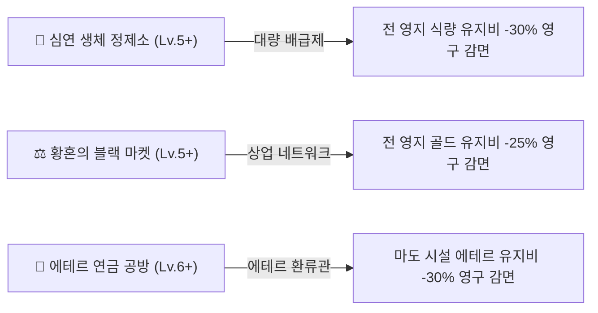

# 🏛️ Project: Limbo Tales - 영지 시설 종합 명세서 (Buildings Specification)

> **문서 버전**: v1.0.0 (게임 엔진 v0.9.6-rc4 기준 완벽 동기화)  
> **최종 갱신일**: 2026-09-16  
> **적용 대상**: 방주(Ark) 거점 13종 전체 건물 (Lv.1 ~ Lv.10)

---

## 📌 목차 (Table of Contents)

1. [📖 영지 인프라 & 경제 메커니즘 개요](#1-영지-인프라--경제-메커니즘-개요)
   - [1.1 계단식 유지비 부과 시스템](#11-계단식-유지비-부과-시스템-tier-0--tier-1--tier-2)
   - [1.2 방주 3대 핵심 인프라 테크 시너지](#12-방주-3대-핵심-인프라-테크-시너지)
   - [1.3 황혼의 블랙 마켓 유지비 주기 연장 공식](#13-황혼의-블랙-마켓-유지비-주기-연장-공식)
   - [1.4 방주의 성화(Bonfire) 온기 3대 버프 시스템](#14-방주의-성화bonfire-온기-3대-버프-시스템)
   - [1.5 시설 일시 정지(Pause) 및 유지비 체납/자동 복구 규칙](#15-시설-일시-정지pause-및-유지비-체납자동-복구-규칙)
2. [📊 13종 건물 전체 한눈에 보기 (종합 비교표)](#2-13종-건물-전체-한눈에-보기-종합-비교표)
3. [🏰 각 건물별 1~10레벨 상세 명세표](#3-각-건물별-110레벨-상세-명세표)
   - [3.1 🔥 방주의 성화 (Bonfire)](#31--방주의-성화-bonfire)
   - [3.2 🏕️ 생존자 안식처 (Survivor Cabin)](#32-️-생존자-안식처-survivor-cabin)
   - [3.3 🌲 영목 벌채소 (Lumber Camp)](#33--영목-벌채소-lumber-camp)
   - [3.4 ⛏️ 에테르 광맥 시추소 (Aether Quarry)](#34-️-에테르-광맥-시추소-aether-quarry)
   - [3.5 ⚗️ 심연 생체 정제소 (Abyssal Butchery)](#35-️-심연-생체-정제소-abyssal-butchery)
   - [3.6 🍺 방랑자의 라운지 (Wanderer Tavern)](#36--방랑자의-라운지-wanderer-tavern)
   - [3.7 ⚒️ 심연의 병기창 (Abyssal Forge)](#37-️-심연의-병기창-abyssal-forge)
   - [3.8 ✨ 영혼의 제단 (Soul Sanctuary)](#38--영혼의-제단-soul-sanctuary)
   - [3.9 🧪 에테르 연금 공방 (Aether Alchemy)](#39--에테르-연금-공방-aether-alchemy)
   - [3.10 🌀 차원 앵커 게이트 (Dimension Arena Gate)](#310--차원-앵커-게이트-dimension-arena-gate)
   - [3.11 🏛️ 방주 중앙 병참고 (Ark Central Depot)](#311-️-방주-중앙-병참고-ark-central-depot)
   - [3.12 🏥 생체 복원 병동 (Biorecovery Infirmary)](#312--생체-복원-병동-biorecovery-infirmary)
   - [3.13 ⚖️ 황혼의 블랙 마켓 (Twilight Black Market)](#313-️-황혼의-블랙-마켓-twilight-black-market)
4. [📦 부록 A: 방주 중앙 병참고(Storage) 27종 전 자원 레벨별 적재 한도표](#4-부록-a-방주-중앙-병참고storage-27종-전-자원-레벨별-적재-한도표)
5. [⚒️ 부록 B: 심연의 병기창(Blacksmith) 장비 티어 및 강화/인챈트 규칙](#5-부록-b-심연의-병기창blacksmith-장비-티어-및-강화인챈트-규칙)
6. [🌌 부록 C: 차원 앵커 게이트(Arena Gate) 명예 상점 및 컨텐츠 해금표](#6-부록-c-차원-앵커-게이트arena-gate-명예-상점-및-컨텐츠-해금표)

---

## 1. 영지 인프라 & 경제 메커니즘 개요

### 1.1 계단식 유지비 부과 시스템 (Tier 0 / Tier 1 / Tier 2)
방주의 모든 건물은 초반 성장을 방해하지 않고 중후반 테크 트리와 인프라 관리를 요구하도록 **3단계 계단식 유지비 계수(`lvFactor`)** 시스템을 따릅니다:

| 건물 레벨 구간 | 유지비 단계 (Tier) | 가중 계수 (`lvFactor`) | 특징 |
| :--- | :--- | :---: | :--- |
| **Lv.0 ~ Lv.3** | **Tier 0 (기초 발전기)** | **0 (완전 무료)** | 시설 유지비가 전혀 발생하지 않아 초반 거점 정착에 부담이 없음 |
| **Lv.4 ~ Lv.6** | **Tier 1 (안정 가동기)** | **Lv - 3 (1 ~ 3)** | `Lv.4=1`, `Lv.5=2`, `Lv.6=3`의 완만한 유지비가 부과됨 |
| **Lv.7 ~ Lv.10** | **Tier 2 (고도 증축기)** | **5, 7, 9, 12** | `Lv.7=5`, `Lv.8=7`, `Lv.9=9`, `Lv.10=12`로 계단식 점증 |

> [!NOTE]
> - **방주의 성화(Bonfire)** 및 **방주 중앙 병참고(Storage)**는 영구적으로 **유지비가 전면 면제(0)**됩니다.

---

### 1.2 방주 3대 핵심 인프라 테크 시너지
특정 핵심 생산/상업 시설을 특정 레벨까지 증축하면, 방주 전체 시설의 유지비를 영구적으로 대폭 감면해 주는 **3대 테크 시너지**가 발동합니다:

1. **🥩 대량 배급제 (Mass Rationing)**:
   - **달성 조건**: `butchery` (심연 생체 정제소) **Lv.5 이상**
   - **효과**: 피난민 안식처, 의료소, 블랙마켓, 연금공방 보조 유지비 등 **모든 식량(Food) 유지비 -30% 영구 감면** (`Math.ceil(amount * 0.70)`).
2. **⚖️ 상업 네트워크 (Commercial Network)**:
   - **달성 조건**: `market` (황혼의 블랙 마켓) **Lv.5 이상**
   - **효과**: 벌채소, 광산 시추소, 라운지, 정제소, 연금공방 등 **모든 골드(Gold) 유지비 -25% 영구 감면** (`Math.ceil(amount * 0.75)`).
3. **🧪 에테르 환류관 (Aether Feedback Pipe)**:
   - **달성 조건**: `alchemy` (에테르 연금 공방) **Lv.6 이상**
   - **효과**: 심연의 병기창, 영혼의 제단, 차원 앵커 게이트 등 **모든 에테르(Ether) 유지비 -30% 영구 감면** (`Math.ceil(amount * 0.70)`).

4. **🌲⛏️ 기초 생산 시설 자립 특화 (Resource Facility Specialization)**:
   - **대상 시설**: `lumberCamp` (영목 벌채소) 및 `quarry` (에테르 광맥 시추소)
   - **효과**: 5레벨부터 골드 유지비가 **레벨당 7%씩 점진 감면**되어 10레벨에는 **최대 42% 영구 감면**됩니다. (Lv.5: -7%, Lv.6: -14%, Lv.7: -21%, Lv.8: -28%, Lv.9: -35%, Lv.10: -42% 감면). 상업 네트워크(-25%) 시너지와 중첩 적용됩니다.

---

### 1.3 황혼의 블랙 마켓 유지비 주기 연장 공식
방주의 시설 유지비 지불 주기는 고정되어 있지 않으며, 블랙 마켓의 교역망이 발전할수록 주기가 늘어나 자원 지출 빈도가 완화됩니다:

$$\text{유지비 지불 주기(초)} = 20 + \text{BlackMarket Level}$$

- **마켓 미건설(Lv.0)**: 20초마다 유지비 차감
- **마켓 Lv.5**: 25초마다 유지비 차감
- **마켓 Lv.10 (최고 레벨)**: **30초마다 유지비 차감** (기본 대비 지출 빈도 50% 완화!)

---

### 1.4 방주의 성화(Bonfire) 온기 3대 버프 시스템
성화에 영목(목재)을 단계별(5 ➔ 10 ➔ 15 ➔ 20 ➔ 25개)로 공헌하여 5스택 완전 점화를 달성하면 5분(300초)간 다음 3대 온기 특권이 발동합니다:

1. **🏰 전 영지 시설 생산량 +15% 증폭** (목재, 석재, 철광석, 식량, 가죽, 골드, 에테르 등 전 품목 적용)
2. **⚔️ 모든 전투 경험치(EXP) +20% 추가 획득**
3. **💚 6초마다 영지 용병 전원 HP +1, MP +1 지속 재생** (복귀한 원정대 대원 및 병동 입원 환자, 체력 0으로 쓰러진 용병까지 자동 소생 및 회복 / 던전 내부 탐험 중인 출진 파티원만 제외)
- 점화 완료 후에는 **목재 5개 투입 시마다 지속 시간이 +30초씩 연장**(최대 300초 한도 유지)됩니다.

---

### 1.5 상시 가동 체제 및 유지비 체납/자동 복구 규칙
- **상시 가동 체제**: 모든 시설은 수동 일시 정지 없이 상시 가동되어 자원을 지속 생산하고 거점 기능을 수행합니다. (수동 가동 중단 버튼 전면 제거)
- **체납 시 안전 다운그레이드**: 유지비 결제 주기에 창고 자원이 부족할 경우, 건물이 파괴되지 않고 **임시 레벨 다운**됩니다.
- **자동 복구 시스템**: 필요한 자원이 다시 확보되면 지휘관의 조작 없이도 **원래 도달했던 최고 레벨(`maxLevel`)로 즉시 자동 무상 복구**됩니다.

---

## 2. 13종 건물 전체 한눈에 보기 (종합 비교표)

| 건물명 (영문 ID) | 역할 및 카테고리 | 주 생산품 (기본 주기) | 소모 유지비 자원 | 최대 레벨(Lv.10) 핵심 효과 |
| :--- | :--- | :--- | :--- | :--- |
| **🔥 방주의 성화** (`bonfire`) | 중앙 거점 / 온기 버프 | 온기 버프 (300초 지속) | **완전 무료** | 생산 +15%, 전투 EXP +20%, 6초당 HP/MP +1 재생 |
| **🏕️ 생존자 안식처** (`cabin`) | 인구 / 세금 골드 징수 | 🪙 골드 (13초마다) | 🌾 식량 | **Lv.10: 🪙 +119G/13초** (전 레벨 -3G 조정 & Lv.6+ 30% 복리 증산) |
| **🌲 영목 벌채소** (`lumberCamp`) | 원자재 / 목재 생산 | 🪵 목재 (9초마다) | 🪙 골드 | **Lv.10: 🪵 +20목재/9초** (Lv.5+ 유지비 점진 감면: Lv.10 -42% 감면) |
| **⛏️ 에테르 광맥 시추소** (`quarry`) | 원자재 / 석재 & 철광 채굴 | 🪨 석재 + ⚙️ 철광 (11초) | 🪙 골드 | **Lv.10: 🪨 +20석재 & ⚙️ +3철광/11초** (Lv.5+ 유지비 -42% 감면) |
| **⚗️ 심연 생체 정제소** (`butchery`) | 생체 가공 / 식량 & 가죽 | 🍖 식량 + 🧱 가죽 (13초) | 🪙 골드 | **Lv.10: 🍖 +16식량 & 🧱 +3가죽** / ★식량유지비 -30% |
| **🍺 방랑자의 라운지** (`tavern`) | 용병 영입 / 식량 조달 | 🌾 식량 (15초, Lv.5+) | 🪙 골드 | **전설 용병 출현** / 후보 6명 / 고용비 -20% / 🌾 +6식량 |
| **⚒️ 심연의 병기창** (`blacksmith`) | 장비 공방 / 단조 & 강화 | 장비 단조/강화/인챈트 | ✨ 에테르 | **+10강 최고 강화 / 순수석 인챈트 / 단조·강화비 -20%** |
| **✨ 영혼의 제단** (`sanctuary`) | 클래스 승격 / 각성 버프 | 전직 및 경험치 버프 | ✨ 에테르 | **전 파티원 올스탯 +10% 상시 버프** / 전직 EXP 대폭 증폭 |
| **🧪 에테르 연금 공방** (`alchemy`) | 마도 정제 / 에테르 생산 | ✨ 에테르 (15초마다) | 🪙 골드 + 🌾 식량 | **Lv.10: ✨ +14에테르/15초** (Lv.5 7개, Lv.10 14개) / ★에테르유지비 -30% |
| **🌀 차원 앵커 게이트** (`arenaGate`) | 차원 관문 / PVP & 레이드 | PVP 매칭 / 명예 상점 | ✨ 에테르 | **네메시스 레이드 / 5인 영지 침공 / 명예상점 10단계** |
| **🏛️ 방주 중앙 병참고** (`storage`) | 물류 보관 / 27종 적재 한도 | 27종 전 자원 용량 확장 | **완전 무료** | **기초 20,000 / 파밍 5,000 / 심연 1,000 / 골드 1억** |
| **🏥 생체 복원 병동** (`infirmary`) | 의료 복원 / HP & MP 치료 | HP(+5) 및 MP(+4) 충전 | 🌾 식량 | **병상 7개 / 1초당 HP+5 & MP+4 초고속 완치** |
| **⚖️ 황혼의 블랙 마켓** (`market`) | 교역 암시장 / 비전서 서고 | 🪙 골드 (15초마다) | 🌾 식량 | **유지비 주기 30초 (+10초 연장)** / ★골드유지비 -25% |

---

## 3. 각 건물별 1~10레벨 상세 명세표

### 3.1 🔥 방주의 성화 (Bonfire)

- **분류**: 중앙 거점 / 온기 버프
- **해금 조건**: 게임 시작 시 기본 보유 (Lv.1)
- **기본 설명**: 신성한 성화. 목재를 공헌하여 생산량 +15%, 전투 EXP +20%, 영지 용병 지속 재생 온기 버프를 활성화합니다.
- **생산 자원 및 주기**: 온기 버프 (생산 +15%, 전투 EXP +20%, 6초당 HP/MP +1 재생) (5분 지속 (목재 투입 연장))
- **유지비 자원 및 주기**: 없음 (유지비 완전 면제) (주기: -)
- **핵심 특화 메커니즘**: 0스택->5스택 완충 시 5분(300초)간 성화 온기 발동. 점화 후 목재 5개 투입 시 30초 연장(최대 300초).

| 레벨 | 핵심 기능 및 해금 혜택 | 생산력 (기본 / 성화온기+15%) | 정규 유지비 (시너지 감면 시) | 해당 레벨 증축 소모 비용 |
| :---: | :--- | :--- | :--- | :--- |
| **Lv.1** | 신성한 성화 개방. 목재 투입(5~25개)으로 성화 점화 및 온기 버프 활성화 | 온기 발동 시 생산 +15%, 전투 EXP +20%, 6초당 HP/MP +1 재생 | 없음 (0) | 기본 보유 |
| **Lv.2** | 성화 화력 유지력 증강 (온기 지속 효율 보전) | 온기 버프 생산 +15% / 전투 EXP +20% | 없음 (0) | 목재 16 |
| **Lv.3** | 영목 연소 효율 안정화 | 온기 버프 생산 +15% / 전투 EXP +20% | 없음 (0) | 목재 25 |
| **Lv.4** | 성화 열기 확산 (거점 전역 용병 회복 파동 안정화) | 온기 버프 생산 +15% / 전투 EXP +20% | 없음 (0) | 목재 40, 철광석 31 |
| **Lv.5** | 신성 화염 결계 강화 (부재 중 성화 온기 소진 완화) | 온기 버프 생산 +15% / 전투 EXP +20% | 없음 (0) | 목재 65, 철광석 50 |
| **Lv.6** | 에테르 불꽃 융합 (방주 거점 회복 가속) | 온기 버프 생산 +15% / 전투 EXP +20% | 없음 (0) | 목재 104, 철광석 79, 에테르 21 |
| **Lv.7** | 태고의 불꽃 점화 (한기 저항력 극대화) | 온기 버프 생산 +15% / 전투 EXP +20% | 없음 (0) | 목재 167, 철광석 128, 에테르 33 |
| **Lv.8** | 영구 불꽃 심장 형성 | 온기 버프 생산 +15% / 전투 EXP +20% | 없음 (0) | 목재 268, 철광석 205, 에테르 52, 가죽 42 |
| **Lv.9** | 신화의 성화 개방 (심연 침식 완전 차단) | 온기 버프 생산 +15% / 전투 EXP +20% | 없음 (0) | 목재 429, 철광석 329, 에테르 84, 가죽 67 |
| **Lv.10** | ★ 불멸의 태양 성화 (최고 단계 도달: 영구 신성 결계) | 온기 버프 생산 +15% / 전투 EXP +20% / 6초당 재생 | 없음 (0) | 목재 687, 철광석 527, 에테르 136, 가죽 107, 공허파편 10 |

---

### 3.2 🏕️ 생존자 안식처 (Survivor Cabin)

- **분류**: 인구 / 세금 골드 징수
- **해금 조건**: 메인 퀘스트 [생존자 안식처 증축 (Q_BUILD_CABIN)]
- **기본 설명**: 구출된 생존자 거주지. 방주에 세금(골드)을 정기 납부합니다. (전 레벨 -3G 조정, Lv.6 초과 시 레벨당 30% 추가 증산)
- **생산 자원 및 주기**: 골드 (Gold) (13초마다)
- **유지비 자원 및 주기**: 식량 (Food) (주기: 20초 + 마켓Lv (최대 30초))
- **핵심 특화 메커니즘**: 전 레벨 골드 생산량 -3G 및 식량 유지비 +2개 조정 적용 (Lv.1=4G, Lv.6=35G, Lv.7=47G, Lv.10=119G / 유지비 Lv.4=4, Lv.10=26).

| 레벨 | 핵심 기능 및 해금 혜택 | 생산력 (기본 / 성화온기+15%) | 정규 유지비 (시너지 감면 시) | 해당 레벨 증축 소모 비용 |
| :---: | :--- | :--- | :--- | :--- |
| **Lv.1** | 피난민 주거 구역 개설 (세금 징수 시작) | 🪙 +4 G / 13초 (온기: 5 G) | 무료 (Lv.1~3) | 목재 30, 석재 21 |
| **Lv.2** | 생존자 수용 시설 증축 | 🪙 +11 G / 13초 (온기: 13 G) | 무료 (Lv.1~3) | 목재 48, 석재 33 |
| **Lv.3** | 거주 구역 방한 작업 완료 | 🪙 +18 G / 13초 (온기: 21 G) | 무료 (Lv.1~3) | 목재 76, 석재 52 |
| **Lv.4** | 주민 자치회 구성 (식량 유지비 발생 시작) | 🪙 +24 G / 13초 (온기: 28 G) | 🌾 식량 4 (대량배급 시 3) | 목재 122, 석재 84, 철광석 31 |
| **Lv.5** | 방주 정주 인구 확대 | 🪙 +26 G / 13초 (온기: 30 G) | 🌾 식량 6 (대량배급 시 5) | 목재 196, 석재 136, 철광석 50 |
| **Lv.6** | 상업 거주 복합 단지 조성 (특화 증산 기준점 달성) | 🪙 +35 G / 13초 (온기: 41 G) | 🌾 식량 8 (대량배급 시 6) | 목재 314, 석재 218, 철광석 79, 에테르 21 |
| **Lv.7** | ★ 레벨당 30% 복리 증산 특화 가동! (생산량 급증) | 🪙 +47 G / 13초 (온기: 55 G) | 🌾 식량 12 (대량배급 시 9) | 목재 503, 석재 350, 철광석 128, 에테르 33 |
| **Lv.8** | 30% 증산 가속 (대규모 주민 세수 확보) | 🪙 +62 G / 13초 (온기: 72 G) | 🌾 식량 16 (대량배급 시 12) | 목재 805, 석재 562, 철광석 205, 에테르 52, 가죽 42 |
| **Lv.9** | 30% 증산 가속 (방주 중핵 신도시화) | 🪙 +81 G / 13초 (온기: 94 G) | 🌾 식량 20 (대량배급 시 14) | 목재 1,288, 석재 900, 철광석 329, 에테르 84, 가죽 67 |
| **Lv.10** | ★ 최고 번영도시 달성: 세금 징수 극대화 | 🪙 +119 G / 13초 (온기: 137 G) | 🌾 식량 26 (대량배급 시 19) | 목재 2,061, 석재 1,442, 철광석 527, 에테르 136, 가죽 107, 공허파편 10 |

---

### 3.3 🌲 영목 벌채소 (Lumber Camp)

- **분류**: 원자재 / 목재 생산
- **해금 조건**: 메인 퀘스트 [영목 벌채소 재건 (Q_BUILD_LUMBER)]
- **기본 설명**: 방주 외곽 목재 벌채 시설. 영지 증축과 성화 유지에 필요한 목재를 생산합니다. (Lv.5부터 골드 유지비 점진 감면: Lv.5 7% ~ Lv.10 42%)
- **생산 자원 및 주기**: 목재 (Wood) (9초마다)
- **유지비 자원 및 주기**: 골드 (Gold) (주기: 20초 + 마켓Lv (최대 30초))
- **핵심 특화 메커니즘**: 레벨당 목재 2개 생산. Lv.5부터 7%씩 유지비가 줄어들어 Lv.10에는 42% 영구 감면 (Lv.4=15G, Lv.5=28G, Lv.10=104G).

| 레벨 | 핵심 기능 및 해금 혜택 | 생산력 (기본 / 성화온기+15%) | 정규 유지비 (시너지 감면 시) | 해당 레벨 증축 소모 비용 |
| :---: | :--- | :--- | :--- | :--- |
| **Lv.1** | 영목 벌채소 재건. 방주 기본 목재 자동 생산 개시 | 🪵 +2 목재 / 9초 (온기: 3) | 무료 (Lv.1~3) | 목재 50, 골드 210 |
| **Lv.2** | 벌목 장비 강화 및 수송로 정비 | 🪵 +4 목재 / 9초 (온기: 5) | 무료 (Lv.1~3) | 목재 80, 골드 336 |
| **Lv.3** | 고목 심층 벌목 구역 개방 | 🪵 +6 목재 / 9초 (온기: 7) | 무료 (Lv.1~3) | 목재 128, 골드 537 |
| **Lv.4** | 자동 제재 기계 도입 (골드 유지비 발생 시작) | 🪵 +8 목재 / 9초 (온기: 10) | 🪙 골드 15 G (상업네트워크 시 12 G) | 목재 204, 골드 858, 철광석 31 |
| **Lv.5** | 영목 묘목 증식 온실 가동 (유지비 고유 7% 감면) | 🪵 +10 목재 / 9초 (온기: 12) | 🪙 골드 28 G (-7% 특화, 상업네트워크 시 21 G) | 목재 327, 골드 1,375, 철광석 50 |
| **Lv.6** | 고대 거목 제재 공정 확립 (유지비 고유 14% 감면) | 🪵 +12 목재 / 9초 (온기: 14) | 🪙 골드 39 G (-14% 특화, 상업네트워크 시 30 G) | 목재 524, 골드 2,200, 철광석 79, 에테르 21 |
| **Lv.7** | 증기 구동 톱날 및 운반차 도입 (유지비 고유 21% 감면) | 🪵 +14 목재 / 9초 (온기: 17) | 🪙 골드 59 G (-21% 특화, 상업네트워크 시 45 G) | 목재 838, 골드 3,521, 철광석 128, 에테르 33 |
| **Lv.8** | 심연 침식 저항 영목 벌목 (유지비 고유 28% 감면) | 🪵 +16 목재 / 9초 (온기: 19) | 🪙 골드 76 G (-28% 특화, 상업네트워크 시 57 G) | 목재 1,342, 골드 5,636, 철광석 205, 에테르 52, 가죽 42 |
| **Lv.9** | 에테르 영목 자동 벌채 시스템 (유지비 고유 35% 감면) | 🪵 +18 목재 / 9초 (온기: 21) | 🪙 골드 88 G (-35% 특화, 상업네트워크 시 66 G) | 목재 2,147, 골드 9,017, 철광석 329, 에테르 84, 가죽 67 |
| **Lv.10** | ★ 신성 영목 삼림원 완성: 목재 최대 생산 & 유지비 42% 최대 감면 | 🪵 +20 목재 / 9초 (온기: 23) | 🪙 골드 104 G (-42% 특화, 상업네트워크 시 78 G) | 목재 3,435, 골드 14,429, 철광석 527, 에테르 136, 가죽 107, 공허파편 10 |

---

### 3.4 ⛏️ 에테르 광맥 시추소 (Aether Quarry)

- **분류**: 원자재 / 석재 및 철광 채굴
- **해금 조건**: 메인 퀘스트 [에테르 시추소 가동 (Q_BUILD_QUARRY)]
- **기본 설명**: 부유성 지반 채굴 시설. 석재를 생산하며 Lv.3부터 철광석을 함께 발굴합니다. (Lv.5부터 골드 유지비 점진 감면: Lv.5 7% ~ Lv.10 42%)
- **생산 자원 및 주기**: 석재 (Stone) + 철광석 (Iron, Lv.3+) (11초마다)
- **유지비 자원 및 주기**: 골드 (Gold) (주기: 20초 + 마켓Lv (최대 30초))
- **핵심 특화 메커니즘**: 레벨당 석재 2개 생산. Lv.3부터 철광석 동시 채굴. Lv.5부터 7%씩 유지비가 줄어들어 Lv.10에는 42% 영구 감면 (Lv.4=15G, Lv.5=28G, Lv.10=104G).

| 레벨 | 핵심 기능 및 해금 혜택 | 생산력 (기본 / 성화온기+15%) | 정규 유지비 (시너지 감면 시) | 해당 레벨 증축 소모 비용 |
| :---: | :--- | :--- | :--- | :--- |
| **Lv.1** | 지반 채굴 시추탑 가동. 석재 생산 개시 | 🪨 +2 석재 / 11초 (온기: 3) | 무료 (Lv.1~3) | 목재 40, 석재 63, 골드 315 |
| **Lv.2** | 시추 드릴 보강 및 파쇄 효율 증대 | 🪨 +4 석재 / 11초 (온기: 5) | 무료 (Lv.1~3) | 목재 64, 석재 100, 골드 504 |
| **Lv.3** | ★ 룬 철광석 동시 채굴 해금! (철광 +1 동시 생산) | 🪨 +6 석재, ⚙️ +1 철광 / 11초 (온기: 🪨7, ⚙️2) | 무료 (Lv.1~3) | 목재 102, 석재 159, 골드 806 |
| **Lv.4** | 심층 암반 파쇄 드릴 가동 (골드 유지비 시작) | 🪨 +8 석재, ⚙️ +1 철광 / 11초 (온기: 🪨10, ⚙️2) | 🪙 골드 15 G (상업네트워크 시 12 G) | 목재 163, 석재 256, 골드 1,289, 철광석 31 |
| **Lv.5** | 철광맥 선별 분리기 증설 (유지비 고유 7% 감면) | 🪨 +10 석재, ⚙️ +1 철광 / 11초 (온기: 🪨12, ⚙️2) | 🪙 골드 28 G (-7% 특화, 상업네트워크 시 21 G) | 목재 262, 석재 411, 골드 2,064, 철광석 50 |
| **Lv.6** | ★ 철광석 채굴량 증산! (철광 +2 동시 생산 & 유지비 14% 감면) | 🪨 +12 석재, ⚙️ +2 철광 / 11초 (온기: 🪨14, ⚙️3) | 🪙 골드 39 G (-14% 특화, 상업네트워크 시 30 G) | 목재 419, 석재 659, 골드 3,301, 철광석 79, 에테르 21 |
| **Lv.7** | 마도 지반 고주파 굴착 시스템 (유지비 고유 21% 감면) | 🪨 +14 석재, ⚙️ +2 철광 / 11초 (온기: 🪨17, ⚙️3) | 🪙 골드 59 G (-21% 특화, 상업네트워크 시 45 G) | 목재 671, 석재 1,056, 골드 5,283, 철광석 128, 에테르 33 |
| **Lv.8** | 심연 심층 광맥 직통 터널 완공 (유지비 고유 28% 감면) | 🪨 +16 석재, ⚙️ +2 철광 / 11초 (온기: 🪨19, ⚙️3) | 🪙 골드 76 G (-28% 특화, 상업네트워크 시 57 G) | 목재 1,073, 석재 1,690, 골드 8,454, 철광석 205, 에테르 52, 가죽 42 |
| **Lv.9** | ★ 철광석 채굴량 극대화! (철광 +3 동시 생산 & 유지비 35% 감면) | 🪨 +18 석재, ⚙️ +3 철광 / 11초 (온기: 🪨21, ⚙️4) | 🪙 골드 88 G (-35% 특화, 상업네트워크 시 66 G) | 목재 1,717, 석재 2,704, 골드 13,528, 철광석 329, 에테르 84, 가죽 67 |
| **Lv.10** | ★ 에테르 대광맥 시추소 완성: 석재/철광 최대 생산 & 유지비 42% 최대 감면 | 🪨 +20 석재, ⚙️ +3 철광 / 11초 (온기: 🪨23, ⚙️4) | 🪙 골드 104 G (-42% 특화, 상업네트워크 시 78 G) | 목재 2,748, 석재 4,328, 골드 21,644, 철광석 527, 에테르 136, 가죽 107, 공허파편 10 |

---

### 3.5 ⚗️ 심연 생체 정제소 (Abyssal Butchery)

- **분류**: 생체 가공 / 식량·가죽 & 핵심 테크
- **해금 조건**: 메인 퀘스트 [마물 가공소 정비 (Q_MAIN_01)] / 기본 해금
- **기본 설명**: 식량 정제 시설. Lv.3부터 가죽 추출, Lv.5부터 식량 생산량 50% 대폭 증산(Lv.5: 9, Lv.10: 24) 및 [대량 배급제]로 전 시설 식량 유지비 30%를 영구 감면합니다.
- **생산 자원 및 주기**: 식량 (Food) + 가죽 (Leather, Lv.3+) (13초마다)
- **유지비 자원 및 주기**: 골드 (Gold) (주기: 20초 + 마켓Lv (최대 30초))
- **핵심 특화 메커니즘**: Lv.1~4는 Lv당 식량 1개, Lv.5+부터 50% 추가 증산(Lv.5=9, Lv.6=12, Lv.7=15, Lv.8=18, Lv.9=21, Lv.10=24). Lv.3부터 가죽 동시 생산. Lv.5 [대량 배급제] 테크 시너지 발동.

| 레벨 | 핵심 기능 및 해금 혜택 | 생산력 (기본 / 성화온기+15%) | 정규 유지비 (시너지 감면 시) | 해당 레벨 증축 소모 비용 |
| :---: | :--- | :--- | :--- | :--- |
| **Lv.1** | 마물 사체 정제조 가동. 보급 식량 생산 개시 | 🍖 +1 식량 / 13초 (온기: 2) | 무료 (Lv.1~3) | 목재 10, 석재 10 |
| **Lv.2** | 생체 독소 중화 필터 장착 | 🍖 +2 식량 / 13초 (온기: 3) | 무료 (Lv.1~3) | 목재 16, 석재 16 |
| **Lv.3** | ★ 무두질 공정 해금! (가죽 +1 동시 생산) | 🍖 +3 식량, 🧱 +1 가죽 / 13초 (온기: 🍖4, 🧱2) | 무료 (Lv.1~3) | 목재 25, 석재 25 |
| **Lv.4** | 대형 증기 훈제실 도입 (골드 유지비 시작) | 🍖 +4 식량, 🧱 +1 가죽 / 13초 (온기: 🍖5, 🧱2) | 🪙 골드 6 G (상업네트워크 시 5 G) | 목재 40, 석재 42, 철광석 31 |
| **Lv.5** | ★ [대량 배급제] 해금! (전 식량 유지비 -30% 감면 & 50% 식량 대폭 증산) | 🍖 +9 식량, 🧱 +1 가죽 / 13초 (온기: 🍖11, 🧱2) | 🪙 골드 12 G (상업네트워크 시 9 G) | 목재 65, 석재 67, 철광석 50 |
| **Lv.6** | ★ 가죽 무두질 및 식량 50% 증산! (식량 +12, 가죽 +2) | 🍖 +12 식량, 🧱 +2 가죽 / 13초 (온기: 🍖14, 🧱3) | 🪙 골드 18 G (상업네트워크 시 14 G) | 목재 104, 석재 109, 철광석 79, 에테르 21 |
| **Lv.7** | 마수 생체 농축 캡슐 라인 신설 (식량 +15, 가죽 +2) | 🍖 +15 식량, 🧱 +2 가죽 / 13초 (온기: 🍖18, 🧱3) | 🪙 골드 30 G (상업네트워크 시 23 G) | 목재 167, 석재 174, 철광석 128, 에테르 33 |
| **Lv.8** | 고농축 영양 배급제 정착 (식량 +18, 가죽 +2) | 🍖 +18 식량, 🧱 +2 가죽 / 13초 (온기: 🍖21, 🧱3) | 🪙 골드 42 G (상업네트워크 시 32 G) | 목재 268, 석재 281, 철광석 205, 에테르 52, 가죽 42 |
| **Lv.9** | ★ 가죽 무두질 극대화! (식량 +21, 가죽 +3) | 🍖 +21 식량, 🧱 +3 가죽 / 13초 (온기: 🍖25, 🧱4) | 🪙 골드 54 G (상업네트워크 시 41 G) | 목재 429, 석재 449, 철광석 329, 에테르 84, 가죽 67 |
| **Lv.10** | ★ 완전 생체 정제 플랜트 달성: 식량(+24)/가죽(+3) 최대 생산 | 🍖 +24 식량, 🧱 +3 가죽 / 13초 (온기: 🍖28, 🧱4) | 🪙 골드 72 G (상업네트워크 시 54 G) | 목재 687, 석재 720, 철광석 527, 에테르 136, 가죽 107, 공허파편 10 |

---

### 3.6 🍺 방랑자의 라운지 (Wanderer Tavern)

- **분류**: 용병 영입 / 서브 퀘스트 / 식량 조달
- **해금 조건**: 메인 퀘스트 [방랑자의 주점 재건 (Q_BUILD_TAVERN)]
- **기본 설명**: 용병 고용소. 방랑 용병을 계약 영입하며, 레벨이 오를수록 서브 퀘스트의 요구량과 보상(골드·에테르·마도석·보급품)이 강화되고 Lv.5부터 15초마다 식량을 생산합니다.
- **생산 자원 및 주기**: 식량 (Food, Lv.5+) (15초마다 (Lv.5+))
- **유지비 자원 및 주기**: 골드 (Gold) (주기: 20초 + 마켓Lv (최대 30초))
- **핵심 특화 메커니즘**: Lv.4 베테랑, Lv.6 히어로, Lv.8 에픽, Lv.10 전설 용병 출현. Lv.5+ 식량 생산(2~6개). 10분마다 후보군 자동 리셋.

| 레벨 | 핵심 기능 및 해금 혜택 | 생산력 (기본 / 성화온기+15%) | 정규 유지비 (시너지 감면 시) | 해당 레벨 증축 소모 비용 |
| :---: | :--- | :--- | :--- | :--- |
| **Lv.1** | 방랑 주점 개방. 용병 후보 3명 풀 & 서브 퀘스트 게시판 해금 | - | 무료 (Lv.1~3) | 목재 80, 석재 105, 골드 630 |
| **Lv.2** | 방랑자 입소문 확산 (서브 퀘스트 보상 강화) | - | 무료 (Lv.1~3) | 목재 128, 석재 168, 골드 1,008 |
| **Lv.3** | 정보원 네트워크 연결 (고급 의뢰 접수) | - | 무료 (Lv.1~3) | 목재 204, 석재 268, 골드 1,612 |
| **Lv.4** | 용병 풀 4명 증설 & [V] 베테랑 등급 용병 출현 해금! | - | 🪙 골드 5 G (상업네트워크 시 4 G) | 목재 327, 석재 428, 골드 2,578, 철광석 31 |
| **Lv.5** | ★ 식량 자체 조달 가동! (주점 자체 식량 🌾+2/15초 생산) | 🌾 +2 식량 / 15초 (온기: 3) | 🪙 골드 10 G (상업네트워크 시 8 G) | 목재 524, 석재 686, 골드 4,128, 철광석 50 |
| **Lv.6** | 용병 풀 5명 증설 & [H] 히어로 등급 용병 출현 해금! | 🌾 +2 식량 / 15초 (온기: 3) | 🪙 골드 15 G (상업네트워크 시 12 G) | 목재 838, 석재 1,100, 골드 6,604, 철광석 79, 에테르 21 |
| **Lv.7** | ★ 식량 증산(🌾+4/15초) & 일일 무료 새로고침 1회 해금! | 🌾 +4 식량 / 15초 (온기: 5) | 🪙 골드 25 G (상업네트워크 시 19 G) | 목재 1,342, 석재 1,759, 골드 10,569, 철광석 128, 에테르 33 |
| **Lv.8** | 용병 풀 6명 증설 & [E] 에픽 등급 용병 출현 해금! | 🌾 +4 식량 / 15초 (온기: 5) | 🪙 골드 35 G (상업네트워크 시 27 G) | 목재 2,147, 석재 2,818, 골드 16,911, 철광석 205, 에테르 52, 가죽 42 |
| **Lv.9** | ★ 식량 증산(🌾+6/15초) & 고용 계약금 안정화 | 🌾 +6 식량 / 15초 (온기: 7) | 🪙 골드 45 G (상업네트워크 시 34 G) | 목재 3,435, 석재 4,508, 골드 27,056, 철광석 329, 에테르 84, 가죽 67 |
| **Lv.10** | ★ [Legend] 전설 등급 출현 & 전 용병 영입 비용 -20% 영구 할인 | 🌾 +6 식량 / 15초 (온기: 7) | 🪙 골드 60 G (상업네트워크 시 45 G) | 목재 5,497, 석재 7,213, 골드 43,291, 철광석 527, 에테르 136, 가죽 107, 공허파편 10 |

---

### 3.7 ⚒️ 심연의 병기창 (Abyssal Forge)

- **분류**: 장비 공방 / 단조·강화·인챈트
- **해금 조건**: 메인 퀘스트 [심연의 병기창 재건 (Q_BUILD_FORGE)]
- **기본 설명**: 장비 공방. 전술 무기 및 방어구 단조, 장비 강화(+10강) 및 접두/접미 인챈트를 수행합니다.
- **생산 자원 및 주기**: 장비 단조/강화/인챈트 기능 해금 (-)
- **유지비 자원 및 주기**: 에테르 (Ether) (주기: 20초 + 마켓Lv (최대 30초))
- **핵심 특화 메커니즘**: Lv.1~2 기본 단조 & +5강, Lv.3 +7강 & 접두 인챈트, Lv.5 에픽 단조 & 접미 인챈트, Lv.7 +10강 & 순수석 인챈트, Lv.10 비용 -20% 할인.

| 레벨 | 핵심 기능 및 해금 혜택 | 생산력 (기본 / 성화온기+15%) | 정규 유지비 (시너지 감면 시) | 해당 레벨 증축 소모 비용 |
| :---: | :--- | :--- | :--- | :--- |
| **Lv.1** | 심연 대장간 재건. 1티어 순수 기본 장비 단조 해금 | 1티어 장비 단조 | 무료 (Lv.1~3) | 목재 100, 석재 168, 철광석 52, 골드 1,050 |
| **Lv.2** | 장비 +5강 강화 해금 & 단조 비용 10% 영구 할인 (2티어 장비) | +5강 강화 / 2티어 단조 | 무료 (Lv.1~3) | 목재 160, 석재 268, 철광석 84, 골드 1,680 |
| **Lv.3** | ★ 장비 +7강 & [접두어 인챈트] 슬롯 해금 (3티어 희귀 장비) | +7강 강화 / 접두어 부여 | 무료 (Lv.1~3) | 목재 256, 석재 428, 철광석 134, 골드 2,688 |
| **Lv.4** | 단조 할인율 상승 및 4티어 정예 흑요석 장비 단조 해금 | 4티어 흑요석 단조 | ✨ 에테르 3 (에테르환류 시 2) | 목재 409, 석재 686, 철광석 245, 골드 4,300 |
| **Lv.5** | ★ 상급 에픽 단조 레시피 & [접미어 인챈트] 슬롯 해금 (5티어 영웅 장비) | 5티어 에픽 / 접미어 부여 | ✨ 에테르 6 (에테르환류 시 5) | 목재 655, 석재 1,100, 철광석 392, 골드 6,879 |
| **Lv.6** | 6티어 진홍 혈염 장비 단조 해금 & 강화 성공 보정 | 6티어 결전 단조 | ✨ 에테르 9 (에테르환류 시 7) | 목재 1,048, 석재 1,759, 철광석 630, 골드 11,008, 에테르 21 |
| **Lv.7** | ★ +10강 최고 한계 돌파 & [순수 마도석] 인챈트 해금 (7티어 사신 장비) | +10강 강화 / 순수석 인챈트 | ✨ 에테르 15 (에테르환류 시 11) | 목재 1,677, 석재 2,818, 철광석 1,008, 골드 17,614, 에테르 33 |
| **Lv.8** | 전 제작 비용 16% 영구 할인 & 8티어 단죄의 맹세 장비 단조 | 8티어 단조 / 비용 -16% | ✨ 에테르 21 (에테르환류 시 15) | 목재 2,684, 석재 4,508, 철광석 1,614, 골드 28,184, 에테르 52, 가죽 42 |
| **Lv.9** | 전 제작 비용 18% 영구 할인 & 9티어 만화경 환영 장비 단조 | 9티어 단조 / 비용 -18% | ✨ 에테르 27 (에테르환류 시 19) | 목재 4,294, 석재 7,213, 철광석 2,583, 골드 45,095, 에테르 84, 가죽 67 |
| **Lv.10** | ★ 최고 명장: 전 단조/강화 비용 -20% 영구 할인 (10티어 종말 신화 장비) | 10티어 신화 단조 / 비용 -20% | ✨ 에테르 36 (에테르환류 시 26) | 목재 6,871, 석재 11,543, 철광석 4,132, 골드 72,153, 에테르 136, 가죽 107, 공허파편 10 |

---

### 3.8 ✨ 영혼의 제단 (Soul Sanctuary)

- **분류**: 클래스 전직 / 초월 각성 / 경험치 부스트
- **해금 조건**: 메인 퀘스트 [1층 보스 격파 (Q_SLAY_BOSS_01)]
- **기본 설명**: 클래스 승격 시설. 1/2차 전직을 수행하며 Lv.2~5는 기본 클래스 EXP를 최대 +50%, Lv.6~10은 1차 각성 클래스 EXP를 최대 +40% 증폭합니다.
- **생산 자원 및 주기**: 클래스 EXP 증폭 버프 & 전직/각성 등급 승격률 보너스 (상시 적용)
- **유지비 자원 및 주기**: 에테르 (Ether) (주기: 20초 + 마켓Lv (최대 30초))
- **핵심 특화 메커니즘**: Lv.1 1차 전직, Lv.5 2차 승격, Lv.10 올스탯 +10% 상시 각성 버프. 전직 시 등급 상승 확률 Lv*3% (Lv.10 시 +30%).

| 레벨 | 핵심 기능 및 해금 혜택 | 생산력 (기본 / 성화온기+15%) | 정규 유지비 (시너지 감면 시) | 해당 레벨 증축 소모 비용 |
| :---: | :--- | :--- | :--- | :--- |
| **Lv.1** | 영혼 제단 개방. 1차 상위 클래스 전직 해금 (성기사, 암살자, 대마도사 등) | 1차 전직 시스템 개방 | 무료 (Lv.1~3) | 석재 252, 철광석 105, 에테르 63, 골드 2,100 |
| **Lv.2** | ★ 기본 클래스 경험치 +20% 상시 증폭 (전직 시 등급상승 확률 6%) | 기본 EXP +20% 버프 | 무료 (Lv.1~3) | 석재 403, 철광석 168, 에테르 100, 골드 3,360 |
| **Lv.3** | 기본 클래스 경험치 +30% 증폭 (전직 시 등급상승 확률 9%) | 기본 EXP +30% 버프 | 무료 (Lv.1~3) | 석재 644, 철광석 268, 에테르 159, 골드 5,376 |
| **Lv.4** | 기본 클래스 경험치 +40% 증폭 (전직 시 등급상승 확률 12%) | 기본 EXP +40% 버프 | ✨ 에테르 2 (에테르환류 시 2) | 석재 1,031, 철광석 459, 에테르 256, 골드 8,601 |
| **Lv.5** | ★ 2차 심연 승격 해금! & 기본 클래스 EXP +50% (최대) (등급상승 확률 15%) | 2차 전직 해금 / 기본EXP +50% | ✨ 에테르 4 (에테르환류 시 3) | 석재 1,650, 철광석 737, 에테르 411, 골드 13,761 |
| **Lv.6** | ★ 1차 각성 클래스 경험치 +10% 획득 버프 가동! (등급상승 확률 18%) | 기본EXP +50% / 1차EXP +10% | ✨ 에테르 6 (에테르환류 시 5) | 석재 2,641, 철광석 1,180, 에테르 680, 골드 22,018 |
| **Lv.7** | 1차 각성 클래스 경험치 +20% 증폭 (등급상승 확률 21%) | 기본EXP +50% / 1차EXP +20% | ✨ 에테르 10 (에테르환류 시 7) | 석재 4,227, 철광석 1,887, 에테르 1,089, 골드 35,231 |
| **Lv.8** | 1차 각성 클래스 경험치 +30% 증폭 (등급상승 확률 24%) | 기본EXP +50% / 1차EXP +30% | ✨ 에테르 14 (에테르환류 시 10) | 석재 6,764, 철광석 3,024, 에테르 1,743, 골드 56,370, 가죽 42 |
| **Lv.9** | 1차 각성 클래스 경험치 +40% 증폭 (최대치 달성) (등급상승 확률 27%) | 기본EXP +50% / 1차EXP +40% | ✨ 에테르 18 (에테르환류 시 13) | 석재 10,821, 철광석 4,838, 에테르 2,788, 골드 90,192, 가죽 67 |
| **Lv.10** | ★ [완전 각성]: 전 파티원 올스탯 +10% 상시 각성 버프 & 등급상승 확률 +30% | 전 파티 올스탯 +10% / EXP 최대 | ✨ 에테르 24 (에테르환류 시 17) | 석재 17,316, 철광석 7,740, 에테르 4,464, 골드 144,309, 가죽 107, 공허파편 10 |

---

### 3.9 🧪 에테르 연금 공방 (Aether Alchemy)

- **분류**: 마도 정제 / 에테르 생산 & 핵심 테크
- **해금 조건**: 메인 퀘스트 [연금 공방 증축 (Q_BUILD_ALCHEMY)]
- **기본 설명**: 에테르 및 보급품 연금 시설. 에테르를 정제(Lv.5부터 50% 증산하여 Lv.5 틱당 11, Lv.10 틱당 21 생산)하며 Lv.6 시 [에테르 환류관]으로 에테르 유지비 30%를 영구 감면합니다.
- **생산 자원 및 주기**: 에테르 (Ether) (15초마다)
- **유지비 자원 및 주기**: 골드 (Gold) + 보조 식량 (Food) (주기: 20초 + 마켓Lv (최대 30초))
- **핵심 특화 메커니즘**: 에테르 정제 시설 (Lv.5부터 50% 증산: Lv.5=11, Lv.6=12, Lv.7=15, Lv.8=17, Lv.9=20, Lv.10=21). Lv.6 [에테르 환류관] 달성 시 마도 시설(병기창, 제단, 게이트 등) 에테르 유지비 30% 영구 감면.

| 레벨 | 핵심 기능 및 해금 혜택 | 생산력 (기본 / 성화온기+15%) | 정규 유지비 (시너지 감면 시) | 해당 레벨 증축 소모 비용 |
| :---: | :--- | :--- | :--- | :--- |
| **Lv.1** | 에테르 연금 공방 가동. 마도 에테르 정제 개시 | ✨ +1 에테르 / 15초 (온기: 2) | 무료 (Lv.1~3) | 석재 168, 에테르 84, 골드 1,260 |
| **Lv.2** | 정제 증류관 개량 (에테르 기류 응축) | ✨ +3 에테르 / 15초 (온기: 4) | 무료 (Lv.1~3) | 석재 268, 에테르 134, 골드 2,016 |
| **Lv.3** | 마나 촉매 반응로 설치 | ✨ +4 에테르 / 15초 (온기: 5) | 무료 (Lv.1~3) | 석재 428, 에테르 214, 골드 3,225 |
| **Lv.4** | 고압 에테르 추출 시스템 (골드/식량 유지비 시작) | ✨ +6 에테르 / 15초 (온기: 7) | 🪙 8 G + 🌾 1 (시너지 시 🪙 6 G + 🌾 1) | 석재 686, 에테르 342, 골드 5,159, 철광석 31 |
| **Lv.5** | ★ 에테르 50% 증산 가속 (틱당 ✨+11 에테르 정제 달성) | ✨ +11 에테르 / 15초 (온기: 13) | 🪙 16 G + 🌾 2 (시너지 시 🪙 12 G + 🌾 2) | 석재 1,100, 에테르 550, 골드 8,257, 철광석 50 |
| **Lv.6** | ★ [에테르 환류관] 해금! (마도 시설 에테르 유지비 -30% 영구 감면 & ✨+12 정제) | ✨ +12 에테르 / 15초 (온기: 14) | 🪙 24 G + 🌾 3 (시너지 시 🪙 18 G + 🌾 3) | 석재 1,759, 에테르 900, 골드 13,211, 철광석 79 |
| **Lv.7** | 순수 마나 환류 챔버 가동 (틱당 ✨+15 에테르) | ✨ +15 에테르 / 15초 (온기: 18) | 🪙 40 G + 🌾 5 (시너지 시 🪙 30 G + 🌾 4) | 석재 2,818, 에테르 1,442, 골드 21,138, 철광석 128 |
| **Lv.8** | 초전도 에테르 유로 연결 (틱당 ✨+17 에테르) | ✨ +17 에테르 / 15초 (온기: 20) | 🪙 56 G + 🌾 7 (시너지 시 🪙 42 G + 🌾 5) | 석재 4,508, 에테르 2,305, 골드 33,822, 철광석 205, 가죽 42 |
| **Lv.9** | 시공간 에테르 응축기 설치 (틱당 ✨+20 에테르) | ✨ +20 에테르 / 15초 (온기: 23) | 🪙 72 G + 🌾 9 (시너지 시 🪙 54 G + 🌾 7) | 석재 7,213, 에테르 3,689, 골드 54,114, 철광석 329, 가죽 67 |
| **Lv.10** | ★ 무한 에테르 코어 완성: 틱당 ✨+21 에테르 최대 정제! (50% 증산 특화) | ✨ +21 에테르 / 15초 (온기: 25) | 🪙 96 G + 🌾 12 (시너지 시 🪙 72 G + 🌾 9) | 석재 11,543, 에테르 5,907, 골드 86,585, 철광석 527, 가죽 107, 공허파편 10 |

---

### 3.10 🌀 차원 앵커 게이트 (Dimension Arena Gate)

- **분류**: 차원 관문 / 비동기 PVP · 월드 레이드 · 영지 침공
- **해금 조건**: 메인 퀘스트 [차원 앵커 게이트 건설 (Q_BUILD_ARENA)]
- **기본 설명**: PVP 차원 관문 및 월드 레이드. 비동기 랭킹 결투, Lv.3 시 『차원 네메시스』 레이드, Lv.6 증축 시 5인 차원 부대로 타 영지를 침공하는 『차원 영지 침공』이 해금됩니다.
- **생산 자원 및 주기**: PVP 매칭, 네메시스 레이드, 영지 침공, 명예 상점 (1~10단계) (-)
- **유지비 자원 및 주기**: 에테르 (Ether) (주기: 20초 + 마켓Lv (최대 30초))
- **핵심 특화 메커니즘**: Lv.1 비동기 PVP, Lv.3 차원 네메시스 레이드, Lv.6 영지 침공 약탈전, Lv.1~10 명예 상점 상품군 순차 해금.

| 레벨 | 핵심 기능 및 해금 혜택 | 생산력 (기본 / 성화온기+15%) | 정규 유지비 (시너지 감면 시) | 해당 레벨 증축 소모 비용 |
| :---: | :--- | :--- | :--- | :--- |
| **Lv.1** | 차원 관문 건설. 실시간 비동기 PVP 결투 & 명예 상점 1단계(보급품) 해금 | PVP 매칭 / 명예상점 1단계 | 무료 (Lv.1~3) | 석재 315, 철광석 168, 에테르 105, 골드 3,150 |
| **Lv.2** | 차원 앵커 동기화 & 명예 상점 2단계(인챈트 마도석) 해금 | 명예상점 2단계 | 무료 (Lv.1~3) | 석재 504, 철광석 268, 에테르 168, 골드 5,040 |
| **Lv.3** | ★ 🌌 [차원 네메시스 월드 레이드] 관문 개방 & 명예 상점 3단계 해금 | 월드 레이드 해금 / 3단계 | 무료 (Lv.1~3) | 석재 806, 철광석 428, 에테르 268, 골드 8,064 |
| **Lv.4** | 명예 상점 4단계(고급 장신구 [투사의 용맹 목걸이]) 해금 | 명예상점 4단계 | ✨ 에테르 4 (에테르환류 시 3) | 석재 1,289, 철광석 718, 에테르 428, 골드 12,902 |
| **Lv.5** | 명예 암시장 5단계(전설 장신구 [투사의 영광 반지]) 해금 | 명예상점 5단계 | ✨ 에테르 8 (에테르환류 시 6) | 석재 2,064, 철광석 1,150, 에테르 686, 골드 20,643 |
| **Lv.6** | ★ [차원 영지 침공] 해금! (5인 원정대로 타 영지 침공 및 30% 자원 약탈) | 영지 침공전 / 6단계 | ✨ 에테르 12 (에테르환류 시 9) | 석재 3,301, 철광석 1,839, 에테르 1,121, 골드 33,028 |
| **Lv.7** | 명예 상점 7단계(신화 전설 성유물 상자) 해금 | 명예상점 7단계 | ✨ 에테르 20 (에테르환류 시 14) | 석재 5,283, 철광석 2,946, 에테르 1,793, 골드 52,846 |
| **Lv.8** | 랭커 PVE 버프 강화 & 명예 상점 8단계(궁극의 마도석) 해금 | PVE 특권 강화 / 8단계 | ✨ 에테르 28 (에테르환류 시 20) | 석재 8,454, 철광석 4,714, 에테르 2,870, 골드 84,556, 가죽 42 |
| **Lv.9** | 랭커 PVE 버프 강화 & 명예 상점 9단계(초월의 전직 비전서) 해금 | PVE 특권 강화 / 9단계 | ✨ 에테르 36 (에테르환류 시 26) | 석재 13,528, 철광석 7,543, 에테르 4,592, 골드 135,290, 가죽 67 |
| **Lv.10** | ★ 랭커 달성 PVE 특권 버프 50% 증폭 & 10단계(차원 패왕의 보관함) 해금 | PVE 버프 +50% / 10단계 | ✨ 에테르 48 (에테르환류 시 34) | 석재 21,644, 철광석 12,070, 에테르 7,350, 골드 216,465, 가죽 107, 공허파편 10 |

---

### 3.11 🏛️ 방주 중앙 병참고 (Ark Central Depot)

- **분류**: 물류 보관 / 27종 전 자원 적재 한도 확장
- **해금 조건**: 게임 시작 시 기본 보유 (Lv.1)
- **기본 설명**: 물자 저장고. 레벨에 따라 27종의 모든 자원의 최대 적재 용량을 확장합니다. (시설 유지비 완전 면제)
- **생산 자원 및 주기**: 기초 원자재 20,000 / 파밍 5,000 / 심연·유물 1,000 / 골드 1억 적재 한도 (상시 적용)
- **유지비 자원 및 주기**: 없음 (유지비 완전 면제) (주기: -)
- **핵심 특화 메커니즘**: 유지비가 전혀 들지 않으며, 레벨 다운이 되지 않는 영구 안전 인프라. 카테고리별(영지생산/파밍/심연) 적재량 계단식 확장.

| 레벨 | 핵심 기능 및 해금 혜택 | 생산력 (기본 / 성화온기+15%) | 정규 유지비 (시너지 감면 시) | 해당 레벨 증축 소모 비용 |
| :---: | :--- | :--- | :--- | :--- |
| **Lv.1** | 기초 군수 보관 창고 가동 (유지비 완전 면제) | 🏰 영지 250 / 🌿 파밍 250 / 🔮 심연 50 / 🪙 1억 | 완전 면제 (0) | 목재 100, 석재 105, 골드 420 |
| **Lv.2** | 적재 랙 증설 (모든 자원 적재 한도 2배 확장) | 🏰 영지 500 / 🌿 파밍 500 / 🔮 심연 100 / 🪙 1억 | 완전 면제 (0) | 목재 160, 석재 168, 골드 672 |
| **Lv.3** | 물류 구획 확장 (기초·파밍 1,000개 확장) | 🏰 영지 1,000 / 🌿 파밍 1,000 / 🔮 심연 200 / 🪙 1억 | 완전 면제 (0) | 목재 256, 석재 268, 골드 1,075 |
| **Lv.4** | 에테르 항온 격납고 완공 (영지 생산물 2,000개 확장) | 🏰 영지 2,000 / 🌿 파밍 1,500 / 🔮 심연 350 / 🪙 1억 | 완전 면제 (0) | 목재 409, 석재 428, 골드 1,719, 철광석 31 |
| **Lv.5** | 카테고리별 전문 수납 시스템 구축 (심연 유물 500개 확장) | 🏰 영지 3,500 / 🌿 파밍 2,000 / 🔮 심연 500 / 🪙 1억 | 완전 면제 (0) | 목재 655, 석재 686, 골드 2,751, 철광석 50 |
| **Lv.6** | 대용량 격벽 창고 증축 (영지 생산물 6,000개 확장) | 🏰 영지 6,000 / 🌿 파밍 2,600 / 🔮 심연 600 / 🪙 1억 | 완전 면제 (0) | 목재 1,048, 석재 1,100, 골드 4,403, 철광석 79, 에테르 21 |
| **Lv.7** | 중앙 집중식 물류 타워 가동 (파밍 재료 3,200개 확장) | 🏰 영지 9,000 / 🌿 파밍 3,200 / 🔮 심연 700 / 🪙 1억 | 완전 면제 (0) | 목재 1,677, 석재 1,759, 골드 7,045, 철광석 128, 에테르 33 |
| **Lv.8** | 심연 유물 전용 차원 격리 금고 완공 | 🏰 영지 12,500 / 🌿 파밍 3,800 / 🔮 심연 800 / 🪙 1억 | 완전 면제 (0) | 목재 2,684, 석재 2,818, 골드 11,272, 철광석 205, 에테르 52, 가죽 42 |
| **Lv.9** | 대규모 군수 창고군 확충 (영지 16,000개 / 파밍 4,400개) | 🏰 영지 16,000 / 🌿 파밍 4,400 / 🔮 심연 900 / 🪙 1억 | 완전 면제 (0) | 목재 4,294, 석재 4,508, 골드 18,036, 철광석 329, 에테르 84, 가죽 67 |
| **Lv.10** | ★ 방주 중앙 병참고 완전 증축: 전 자원 최대 한도 달성! | 🏰 영지 20,000 / 🌿 파밍 5,000 / 🔮 심연 1,000 / 🪙 1억 | 완전 면제 (0) | 목재 6,871, 석재 7,213, 골드 28,860, 철광석 527, 에테르 136, 가죽 107, 공허파편 10 |

---

### 3.12 🏥 생체 복원 병동 (Biorecovery Infirmary)

- **분류**: 의료 복원 / 체력 치료 & MP 충전
- **해금 조건**: 메인 퀘스트 [방주 원정대 결성 (Q_MAIN_02)]
- **기본 설명**: 의료 시설. 부상당한 용병을 입원시켜 체력을 복원하며, Lv.4부터 마나(MP)도 함께 회복합니다.
- **생산 자원 및 주기**: 부상 용병 HP 치료 (+5/틱) 및 MP 충전 (+4/틱) (HP: 5초~1초 / MP: 5초~1초 (레벨 비례 단축))
- **유지비 자원 및 주기**: 식량 (Food) (주기: 20초 + 마켓Lv (최대 30초))
- **핵심 특화 메커니즘**: 병상 수 [0, 2, 2, 3, 3, 4, 5, 6, 6, 7, 7]. Lv.4부터 에테르 캡슐을 통한 MP 충전 가동. 치료 시 인당 식량1/에테르1 소모.

| 레벨 | 핵심 기능 및 해금 혜택 | 생산력 (기본 / 성화온기+15%) | 정규 유지비 (시너지 감면 시) | 해당 레벨 증축 소모 비용 |
| :---: | :--- | :--- | :--- | :--- |
| **Lv.1** | 생체 복원 병동 개설. 병상 2개 가동 & HP 치료 (+5/5초, 식량1 소모) | 병상 2개 / HP 치료 (5초당 +5) | 무료 (Lv.1~3) | 목재 120, 약초 20, 에테르 10 |
| **Lv.2** | 치료 주기 10% 단축 (4초당 HP +5 회복) | 병상 2개 / HP 치료 (4초당 +5) | 무료 (Lv.1~3) | 목재 192, 약초 32, 에테르 16 |
| **Lv.3** | 병상 3개로 증설 & 신체 재생 안정화 | 병상 3개 / HP 치료 (4초당 +5) | 무료 (Lv.1~3) | 목재 307, 약초 51, 에테르 25 |
| **Lv.4** | ★ MP 충전 캡슐 해금! (5초당 MP +4 충전, 에테르1 소모 / HP 3초) | 병상 3개 / HP(3s) + MP(5s) | 🌾 식량 2 (대량배급 시 2) | 목재 491, 약초 81, 에테르 40, 철광석 45 |
| **Lv.5** | 병상 4개 증설 & MP 충전 주기 단축 (4초당 MP +4) | 병상 4개 / HP(3s) + MP(4s) | 🌾 식량 4 (대량배급 시 3) | 목재 786, 약초 131, 에테르 65, 철광석 72 |
| **Lv.6** | 병상 5개 증설 & 에테르 생체 캡슐 가속 | 병상 5개 / HP(3s) + MP(4s) | 🌾 식량 6 (대량배급 시 5) | 목재 1,258, 약초 209, 에테르 114, 철광석 115 |
| **Lv.7** | 병상 6개 증설 & HP 치료 주기 단축 (2초당 HP +5, 3초당 MP +4) | 병상 6개 / HP(2s) + MP(3s) | 🌾 식량 10 (대량배급 시 7) | 목재 2,013, 약초 703, 에테르 384, 철광석 386 |
| **Lv.8** | MP 충전 주기 단축 (2초당 MP +4) | 병상 6개 / HP(2s) + MP(2s) | 🌾 식량 14 (대량배급 시 10) | 목재 3,221, 약초 1,125, 에테르 615, 철광석 617, 가죽 42 |
| **Lv.9** | ★ 전 대원 동시 수용 병상 7개 증설! & HP 1초 초고속 회복 | 병상 7개 / HP(1s) + MP(2s) | 🌾 식량 18 (대량배급 시 13) | 목재 5,153, 약초 1,801, 에테르 984, 철광석 989, 가죽 67 |
| **Lv.10** | ★ 궁극의 생체 챔버: 1초당 HP+5 / MP+4 동시 초고속 완치 (병상 7개) | 병상 7개 / HP(1s) + MP(1s) 초고속 완치 | 🌾 식량 24 (대량배급 시 17) | 목재 8,246, 약초 2,885, 에테르 1,579, 철광석 1,583, 가죽 107, 공허파편 10 |

---

### 3.13 ⚖️ 황혼의 블랙 마켓 (Twilight Black Market)

- **분류**: 교역 교환 / 암시장 거래 · 비전서 서고 · 유지비 주기 연장
- **해금 조건**: 메인 퀘스트 [황혼의 암시장 개설 (Q_BUILD_MARKET)]
- **기본 설명**: 암시장 교역소. 자원 거래 및 비전서를 교환하며 15초마다 2골드/Lv 수급, 유지비 주기를 연장하고 Lv.5 시 [상업 네트워크]로 골드 유지비 25%를 영구 감면합니다.
- **생산 자원 및 주기**: 골드 (Gold, 2G/Lv) & 유지비 주기 +1초/Lv 연장 & 비전서 거래 (15초마다)
- **유지비 자원 및 주기**: 식량 (Food) (주기: 20초 + 마켓Lv (최대 30초))
- **핵심 특화 메커니즘**: 기본 유지비 주기(20초)를 레벨당 +1초씩 연장(Lv.10=30초). Lv.5 [상업 네트워크] 테크 시너지(골드 유지비 -25%) 발동.

| 레벨 | 핵심 기능 및 해금 혜택 | 생산력 (기본 / 성화온기+15%) | 정규 유지비 (시너지 감면 시) | 해당 레벨 증축 소모 비용 |
| :---: | :--- | :--- | :--- | :--- |
| **Lv.1** | 암시장 교역소 개설. 15종 자원 환전 & 골드 수급 & 유지비 주기 21초 | 🪙 +2 G / 15초 (온기: 3 G) | 무료 (Lv.1~3) | 목재 150, 석재 315, 골드 1,050 |
| **Lv.2** | 거래 한도 확장 & 유지비 지불 주기 22초로 연장 | 🪙 +4 G / 15초 (온기: 5 G) | 무료 (Lv.1~3) | 목재 240, 석재 504, 골드 1,680 |
| **Lv.3** | 거래 수수료 -10% 인하 & 1티어 비전서 입고 & 유지비 주기 23초 | 🪙 +6 G / 15초 (온기: 7 G) | 무료 (Lv.1~3) | 목재 384, 석재 806, 골드 2,688 |
| **Lv.4** | 1티어 전술 비전서 품목 다양화 & 유지비 주기 24초 | 🪙 +8 G / 15초 (온기: 10 G) | 🌾 식량 4 (대량배급 시 3) | 목재 614, 석재 1,289, 골드 4,300, 철광석 31 |
| **Lv.5** | ★ [상업 네트워크] 해금! (전 골드 유지비 -25% 영구 감면 & 2티어 비전서) | 🪙 +10 G / 15초 (온기: 12 G) | 🌾 식량 8 (대량배급 시 6) | 목재 983, 석재 2,064, 골드 6,879, 철광석 50 |
| **Lv.6** | 인챈트 마도석 재고 확대 & 유지비 주기 26초로 연장 | 🪙 +12 G / 15초 (온기: 14 G) | 🌾 식량 12 (대량배급 시 9) | 목재 1,572, 석재 2,310, 골드 11,008, 철광석 79, 에테르 21 |
| **Lv.7** | 희귀 재료 및 마도석 공급선 확대 & 유지비 주기 27초 | 🪙 +14 G / 15초 (온기: 17 G) | 🌾 식량 20 (대량배급 시 14) | 목재 2,516, 석재 3,698, 골드 17,614, 철광석 128, 에테르 33 |
| **Lv.8** | 환율 우대율 추가 상향 & 유지비 주기 28초 | 🪙 +16 G / 15초 (온기: 19 G) | 🌾 식량 28 (대량배급 시 20) | 목재 4,026, 석재 5,917, 골드 28,184, 철광석 205, 에테르 52, 가죽 42 |
| **Lv.9** | 거래 수수료 추가 인하 & 유지비 주기 29초 | 🪙 +18 G / 15초 (온기: 21 G) | 🌾 식량 36 (대량배급 시 26) | 목재 6,442, 석재 9,469, 골드 45,095, 철광석 329, 에테르 84, 가죽 67 |
| **Lv.10** | ★ 황혼 암시장 완성: 최상위 비급서 출현 & 전 품목 -20% 특별할인 (유지비 30초) | 🪙 +20 G / 15초 (온기: 23 G) | 🌾 식량 48 (대량배급 시 34) | 목재 10,307, 석재 15,150, 골드 72,153, 철광석 527, 에테르 136, 가죽 107, 공허파편 10 |

---

## 4. 부록 A: 방주 중앙 병참고(Storage) 27종 전 자원 레벨별 적재 한도표

방주 중앙 병참고(`storage`)는 유지비가 들지 않으며, 레벨 증축에 따라 27종 모든 자원의 창고 보관 상한이 확장됩니다:

| 레벨 (Level) | 🪵 기초 생산품 한도 (목재/식량/석재/석탄/에테르) | 🌿 던전 파밍 재료 한도 (철광석/가죽/약초/실크/짐승뼈) | 🔮 심연 희귀 / 인챈트석 / 신화 유물 한도 (마력수정/공허파편/인챈트석 4종/보스유물 10종) | 🪙 골드 한도 |
| :---: | :---: | :---: | :---: | :---: |
| **Lv.0 ~ Lv.1** | 250 | 250 | 50 | 100,000,000 |
| **Lv.2** | 500 | 500 | 100 | 100,000,000 |
| **Lv.3** | 1,000 | 1,000 | 200 | 100,000,000 |
| **Lv.4** | 2,000 | 1,500 | 350 | 100,000,000 |
| **Lv.5** | 3,500 | 2,000 | 500 | 100,000,000 |
| **Lv.6** | 6,000 | 2,600 | 600 | 100,000,000 |
| **Lv.7** | 9,000 | 3,200 | 700 | 100,000,000 |
| **Lv.8** | 12,500 | 3,800 | 800 | 100,000,000 |
| **Lv.9** | 16,000 | 4,400 | 900 | 100,000,000 |
| **Lv.10** | **20,000** | **5,000** | **1,000** | **100,000,000** |

---

## 5. 부록 B: 심연의 병기창(Blacksmith) 장비 티어 및 강화/인챈트 규칙

심연의 병기창(`blacksmith`)은 레벨에 따라 단조 가능한 장비 등급, 최대 강화 수치, 접두/접미 인챈트 슬롯을 순차적으로 개방합니다:

| 병기창 레벨 | 단조 가능 장비 티어 & 명칭 | 최대 장비 강화 한도 | 인챈트 마도석 슬롯 개방 현황 | 단조 및 강화 비용 할인 |
| :---: | :--- | :---: | :--- | :---: |
| **Lv.1** | Tier 1 (수습 대장장이 시리즈 - 일반) | +3강 | 미개방 (기본 장비) | 기본 비용 |
| **Lv.2** | Tier 2 (단련된 강철 시리즈 - 일반) | **+5강 한계 돌파** | 미개방 | **단조 비용 -10%** |
| **Lv.3** | Tier 3 (마도 룬 각인 시리즈 - 희귀) | **+7강 한계 돌파** | **[접두어 인챈트] 슬롯 해금** (일반 접두석) | 단조 비용 -10% |
| **Lv.4** | Tier 4 (흑요석 정예 시리즈 - 희귀) | +7강 | 접두어 슬롯 가동 | 단조 비용 -12% |
| **Lv.5** | Tier 5 (심연 파멸 시리즈 - 영웅/에픽) | +7강 | **[접미어 인챈트] 슬롯 해금** (일반 접미석) | 단조 비용 -14% |
| **Lv.6** | Tier 6 (진홍 혈염 시리즈 - 영웅/에픽) | +7강 | 접두어 + 접미어 듀얼 슬롯 | 단조 비용 -15% |
| **Lv.7** | Tier 7 (망각 사신 시리즈 - 영웅/에픽) | **+10강 최고 강화** | **[순수 마도석] 최상급 인챈트 슬롯 해금** | 단조 비용 -15% |
| **Lv.8** | Tier 8 (단죄의 기사단 시리즈 - 신화) | +10강 | 순수 접두석 / 순수 접미석 가동 | **전 제작비용 -16%** |
| **Lv.9** | Tier 9 (만화경 환영 시리즈 - 신화) | +10강 | 순수 접두석 / 순수 접미석 가동 | **전 제작비용 -18%** |
| **Lv.10** | Tier 10 (종말의 심연 시리즈 - 신화) | **+10강 불멸 강화** | **최고 장인 마도석 인챈트 완성** | **전 제작/강화비 -20% 영구 할인** |

---

## 6. 부록 C: 차원 앵커 게이트(Arena Gate) 명예 상점 및 컨텐츠 해금표

차원 앵커 게이트(`arenaGate`)는 비동기 결투, 월드 보스 레이드, 타 영지 침공전과 함께 10단계 명예 상점을 제공합니다:

| 게이트 레벨 | 주요 개방 컨텐츠 | 명예 상점 상품군 (투사의 인장 교환) | PVE 랭커 특권 버프 |
| :---: | :--- | :--- | :--- |
| **Lv.1** | **실시간 비동기 PVP 결투장 개방** | 1단계: 기본 생체 포션, 붕대, 기초 보급품 상자 | 기본 랭킹 산정 |
| **Lv.2** | PVP 연승 보너스 강화 | 2단계: 일반 접두석, 일반 접미석 인챈트 상자 | 전투 골드 보너스 |
| **Lv.3** | **🌌 [차원 네메시스 월드 레이드] 관문 개방** | 3단계: 희귀 마력 수정 및 던전 파밍 고급 패키지 | PVE 공격력 +5% |
| **Lv.4** | 네메시스 기여도 보상 확대 | 4단계: 고급 영웅 장신구 **[투사의 용맹 목걸이]** | PVE 방어력 +5% |
| **Lv.5** | 네메시스 마일스톤 보상 강화 | 5단계: 전설 영웅 장신구 **[투사의 영광 반지]** | PVE 올스탯 +5% |
| **Lv.6** | **⚔️ [차원 영지 침공] 해금** (5인 부대 약탈전) | 6단계: 순수 접두석, 순수 접미석, 고대 비전서팩 | PVE 치명타율 +5% |
| **Lv.7** | 영지 방어 성공 보상 강화 | 7단계: 신화 전설 성유물 상자 및 공허 파편팩 | PVE 피해량 +8% |
| **Lv.8** | 랭커 PVE 버프 1차 강화 | 8단계: **궁극의 마도석** 및 룬 인챈트 제련석 | PVE 피해량 +12% |
| **Lv.9** | 랭커 PVE 버프 2차 강화 | 9단계: **초월의 전직 비전서** 및 고대 유물 상자 | PVE 피해량 +15% |
| **Lv.10** | **👑 랭커 PVE 특권 버프 +50% 궁극 증폭** | 10단계: 최고 영예 **[차원 패왕의 보관함]** | **전 PVE 버프 50% 증폭** |

---

> 본 명세서는 게임 클라이언트 소스코드 및 엔진 내 연산 로직과 100% 일치하도록 검증 및 작성되었습니다.
