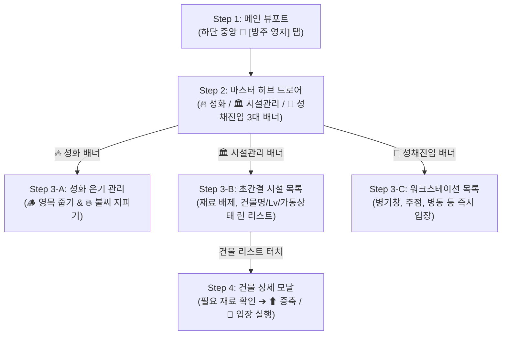

# 🏰 [신규 기획 명세서] 방주 영지 3대 마스터 배너 & 단계적 드로어 시스템
> **Project: Limbo Tales (심연의 생존자들)**  
> **문서 버전**: v3.0.0-PROPOSAL  
> **작업 브랜치**: `feature/territory-ui-renewal`  
> **작성 일자**: 2026-11-05  
> **핵심 설계**: **하단 [방주 영지] ➔ 3대 마스터 배너 (성화 / 시설관리 / 성채진입) ➔ 단계적 모달 (Progressive Disclosure)**

---

## 📌 목차 (Table of Contents)
1. [개편 배경 및 UX 문제의식](#1-개편-배경-및-ux-문제의식)
2. [핵심 설계 원칙: 점진적 정보 노출 (Progressive Disclosure)](#2-핵심-설계-원칙-점진적-정보-노출-progressive-disclosure)
3. [방주 영지 드로어 3대 마스터 배너 아키텍처](#3-방주-영지-드로어-3대-마스터-배너-아키텍처)
   - [3.1 🔥 【배너 1】 방주의 성화 (The Sacred Bonfire)](#31--배너-1-방주의-성화-the-sacred-bonfire)
   - [3.2 🏛️ 【배너 2】 시설 관리 (Infrastructure Management)](#32-️-배너-2-시설-관리-infrastructure-management)
   - [3.3 🏰 【배너 3】 성채 진입 (Citadel Workstations)](#33--배너-3-성채-진입-citadel-workstations)
4. [단계별 UI 레이아웃 및 와이어프레임](#4-단계별-ui-레이아웃-및-와이어프레임)
   - [4.1 영지 메인 뷰포트 (하단 3대 마스터 축 유지)](#41-영지-메인-뷰포트-하단-3대-마스터-축-유지)
   - [4.2 [방주 영지] 탭 시: 3대 마스터 배너 드로어](#42-방주-영지-탭-시-3대-마스터-배너-드로어)
   - [4.3 시설 관리 배너 탭 시: 초간결 린(Lean) 리스트 뷰](#43-시설-관리-배너-탭-시-초간결-린lean-리스트-뷰)
   - [4.4 리스트 항목 터치 시: 건설·증축·입장 통합 모달](#44-리스트-항목-터치-시-건설증축입장-통합-모달)
5. [기존 게임 시스템 및 로직 무손실 연동 매핑](#5-기존-게임-시스템-및-로직-무손실-연동-매핑)
6. [프론트엔드 컴포넌트 리팩토링 로드맵](#6-프론트엔드-컴포넌트-리팩토링-로드맵)

---

## 1. 개편 배경 및 UX 문제의식

### 1.1 기존 방식의 한계점
* 메인 화면 뷰포트에 모든 시설들을 카드로 주르륵 리스트업해 두면, 결국 **기존의 길고 지루했던 세로 스크롤 패널과 시각적 차별점이 없고 화면이 과밀화**됩니다.
* 특히 기존 영지 목록에서는 모든 건물마다 `목재 167개, 석재 128개, 철광석 50개, 에테르 21개...`와 같은 복잡한 건설 재료가 한 화면에 나열되어 시각적 피로도가 매우 높았습니다.

### 1.2 사용자 요구사항 요약
1. **메인 화면의 직관성 유지**:
   - 하단 중앙의 🏰 **[방주 영지]**를 눌렀을 때, 하단에서 위로 드로어가 매끄럽게 올라옴.
2. **3대 마스터 배너 카드로 1차 분류**:
   - 드로어 내부에 **① 성화 배너**, **② 시설 관리 배너**, **③ 성채 진입 배너** 3개의 큼직한 마스터 카드가 등장.
3. **배너별 명확한 2차 활동 분기**:
   - **성화 배너 클릭**: `[영목 줍기]`와 `[불씨 지피기]` 액션이 나타나 직관적으로 온기 관리.
   - **시설 관리 배너 클릭**: 복잡한 재료 나열을 배제한 **초간결 리스트형**으로 표시하고, 리스트를 눌렀을 때 **건설/증축/입장 전용 모달**이 뜨도록 분리.
   - **성채 진입 배너 클릭**: 대장간, 주점, 병동 등 **실제 내부 패널 진입이 가능한 시설 목록**이 떠서 즉시 입장.

---

## 2. 핵심 설계 원칙: 점진적 정보 노출 (Progressive Disclosure)

현대 모바일 및 웹게임 UI의 황금률인 **점진적 정보 노출(Progressive Disclosure)**을 적용합니다:



---

## 3. 방주 영지 드로어 3대 마스터 배너 아키텍처

하단 🏰 **[방주 영지]** 버튼을 터치했을 때 위로 슬라이드 업되는 3대 마스터 배너의 상세 명세입니다:

### 3.1 🔥 【배너 1】 방주의 성화 (The Sacred Bonfire)
* **배너 요약 정보**:
  - 현재 온기 상태: `🔥 온기 5/5 가동 중 (04:30)` 또는 `⚠️ 성화 꺼짐 (점화 필요)`
  - 생산량 +15%, 전투 EXP +20%, 영지 용병 초당 재생 특권 상태.
* **배너 터치 시 노출 액션 (Inline Workbench)**:
  1. **`[🪵 영목 줍기]`**: 성채 주변에서 즉시 목재를 채집하는 원터치 수급 버튼.
  2. **`[🔥 불씨 지피기]`**:
     - `[목재 5개 투입 (+30초 연장)]`
     - `[목재 25개 투입 (5스택 완전 점화)]`
  3. 원형 5단 룬 게이지로 현재 불씨 스택 시각화.

---

### 3.2 🏛️ 【배너 2】 시설 관리 (Infrastructure Management)
* **배너 요약 정보**:
  - 건설 현황: `건설 완료 9/13`, `증축 가능 2개`
  - 전 영지 유지비 수지 현황 요약.
* **배너 터치 시 노출 화면 (초간결 린 리스트 뷰)**:
  - **복잡한 재료 텍스트를 전면 배제**한 정갈한 다크 고딕 리스트.
  - 리스트 항목 구성:
    `[아이콘] [건물명]` | `[현재 레벨 / 최대 레벨]` | `[가동 상태 뱃지]` | `[상태: 증축가능 / 건설중 / 최고레벨]`
* **리스트 아이템 터치 시: 【건설·증축·입장 통합 모달】 오픈**:
  - 팝업 모달 형태로 해당 건물의 상세 스펙 노출:
    - 현재 레벨 효과 vs 다음 레벨 해금 효과
    - 소모 재화 현황: `목재 167/200, 철광석 128/150, 에테르 33/50` (보유 여부 색상 표기)
    - **실행 버튼**:
      - `[⬆ 시설 증축 실행]` (비용 충족 시 활성화)
      - `[🚪 시설 내부 입장]` (해당 시설이 병기창/주점 등 입장 가능한 건물일 때 활성화)

---

### 3.3 🏰 【배너 3】 성채 진입 (Citadel Workstations)
* **배너 요약 정보**:
  - 입장 가능한 핵심 워크스테이션 8종 요약 (`병기창`, `주점`, `병동`, `창고`, `연금`, `마켓`, `제단`, `묘지`).
  - 알림 뱃지: `[🍺 새 방랑자]`, `[💚 완치 환자]`, `[⚒️ 정화 대기]`.
* **배너 터치 시 노출 화면**:
  - 8대 인터랙티브 시설이 큼직한 가로형 카드로 정렬.
  - 카드를 누르면 즉시 해당 시설의 **시네마틱 무대 프레임 + 세부 워크벤치(기존 드로어)**로 직행!

---

## 4. 단계별 UI 레이아웃 및 와이어프레임

### 4.1 영지 메인 뷰포트 (하단 3대 마스터 축 유지)

```text
+-------------------------------------------------------------+
| [자원 헤더] 🪙 12.5k  🪵 450  🪨 280  ⚙️ 120  ✨ 45 [🔥04:30] |
+-------------------------------------------------------------+
|                                                             |
|           [ 방주 성채 2.5D 고딕 부유 거점 전경 아트 ]         |
|                                                             |
|        (흑무와 안개, 신성한 성화의 금빛 잔광이 감도는 거점)     |
|                                                             |
|   [👑 1차 재건 완성 마커]           [📜 도감 등록 마커]       |
|                                                             |
+-------------------------------------------------------------+
| [하단 슬라이드 퀵 바]  [⚒️병기창] [🍺주점] [🏥병동] [🏛️창고] ... |
+-------------------------------------------------------------+
| [하단 고정 3대 코어 축]                                     |
|   [🌌 심연 강하]    ★ [🏰 방주 영지] ★    [🌀 차원 게이트]   |
+-------------------------------------------------------------+
```

---

### 4.2 [방주 영지] 탭 시: 3대 마스터 배너 드로어 (Step 2)
하단 중앙의 **🏰 [방주 영지]**를 누르면 하단에서 위로 묵직한 바텀시트가 슬라이드 업되며 **3대 마스터 배너**가 나타납니다:

```text
+=============================================================+
| [=== Drag Handle ===]                               [ ✕ 닫기 ]|
| 🏰 방주 성채 종합 사령부 (Citadel Command Hub)                |
+=============================================================+
|                                                             |
| ┌─────────────────────────────────────────────────────────┐ |
| │ 🔥 【방주의 성화】            [ 온기 가동 중: 04:30 ] ▶  │ |
| │ 신성한 불꽃을 유지하여 전 거점 생산량 +15% 및 버프 가동    │ |
| └─────────────────────────────────────────────────────────┘ |
|                                                             |
| ┌─────────────────────────────────────────────────────────┐ |
| │ 🏛️ 【영지 시설 관리】        [ 완공 9/13 · 증축가능 2 ] ▶ │ |
| │ 13종 건물 건설 및 레벨 증축, 인프라 유지비 관리            │ |
| └─────────────────────────────────────────────────────────┘ |
|                                                             |
| ┌─────────────────────────────────────────────────────────┐ |
| │ 🏰 【성채 시설 진입】        [ 🍺NEW · 💚완치1 대기 ] ▶ │ |
| │ 대장간, 주점, 병동, 연금공방 등 실제 활동 거점 즉시 입장    │ |
| └─────────────────────────────────────────────────────────┘ |
|                                                             |
+=============================================================+
```

---

### 4.3 시설 관리 배너 탭 시: 초간결 린(Lean) 리스트 뷰 (Step 3-B)
기존처럼 복잡한 재료 숫자를 늘어놓지 않고, 한눈에 파악되는 **린 리스트**로 출력됩니다:

```text
+=============================================================+
| [← 뒤로가기] 🏛️ 영지 시설 관리 목록 (13종)                  |
| 총 유지비: 🪙 -820 G / 🌾 -460 Food (상업/배급 시너지 적용중) |
+=============================================================+
|                                                             |
| • 🌲 [영목 벌채소]        Lv.5 / Lv.10   [ 9s마다 🪵+12 ]   |
|   상태: 정상 가동 중                      [ ⬆ 증축 가능 ] >  |
|-------------------------------------------------------------|
| • ⛏️ [에테르 광맥 시추소] Lv.4 / Lv.10   [ 11s 🪨+10 ⚙️+2 ] |
|   상태: 정상 가동 중                      [ ⬆ 증축 가능 ] >  |
|-------------------------------------------------------------|
| • ⚒️ [심연의 병기창]      Lv.4 / Lv.10   [ 최고 강화 +7 ]   |
|   상태: 가동 중 (입장 가능)               [ 🚪 입장 / 증축 ]>|
|-------------------------------------------------------------|
| • 🍺 [방랑자의 라운지]    Lv.3 / Lv.10   [ 후보 3인 대기 ]  |
|   상태: 가동 중 (입장 가능)               [ 🚪 입장 / 증축 ]>|
|-------------------------------------------------------------|
| • ⚗️ [심연 생체 정제소]    Lv.5 / Lv.10   [ 대량배급제 ON ]  |
|   상태: 식량 유지비 -30% 영구 감면 발동  [ 증축 재료 부족 ]> |
+=============================================================+
```

---

### 4.4 리스트 항목 터치 시: 건설·증축·입장 통합 모달 (Step 4)
특정 건물(예: `심연의 병기창`)을 터치했을 때 비로소 상세 팝업이 떠서 의사결정을 수행합니다:

```text
+-------------------------------------------------------------+
| ⚒️ 심연의 병기창 (Abyssal Forge) Lv.4                [ ✕ ]   |
+-------------------------------------------------------------+
| [현재 효과]: 장비 강화 최고 한도 +7, 단조 도안 2티어 해금     |
| [증축 효과]: 장비 강화 한도 +8 확장, 단조/강화 비용 -10% 감면 |
|-------------------------------------------------------------|
| [Lv.5 증축 필요 재화]                                       |
| • 🪵 목재: 167 / 450   (충분)                               |
| • ⚙️ 철광석: 128 / 120 (부족 -8)                            |
| • ✨ 에테르: 33 / 45   (충분)                               |
|-------------------------------------------------------------|
| [🚪 시설 내부로 입장]             [ ⬆ 시설 증축 실행 (부족) ]|
+-------------------------------------------------------------+
```

---

## 5. 기존 게임 시스템 및 로직 무손실 연동 매핑

1. **성화 배너 로직**:
   - `gm.bonfireWarmthTime`, `gm.bonfireStacks` 상태 1:1 바인딩.
   - 영목 줍기: `gm.gatherWood()` 또는 기본 목재 채집 로직 호출.
   - 불씨 지피기: 기존 `state.bonfireStacks` 목재 소모 점화 함수 호출.
2. **시설 관리 린 리스트 & 모달 로직**:
   - 기존 `CitadelDrawer`의 `buildingsList`, `state.buildings[id]`.
   - 업그레이드 비용: `gm.getBuildingUpgradeCost(id, lv)`.
   - 선행 조건 검증: `gm.checkBuildingPrerequisites(id, lv + 1)`.
   - 증축 실행: `gm.startBuildingConstruction(id)` 또는 `gm.upgradeBuilding(id)`.
   - 시설 입장: 해당 건물의 `drawerKey`(예: `blacksmith -> forge`, `tavern -> tavern`)로 즉시 워크스테이션 호출.
3. **성채 진입 배너 로직**:
   - 기존의 `ForgeDrawer`, `TavernDrawer`, `InfirmaryDrawer`, `StorageDrawer`, `AlchemyDrawer`, `MarketDrawer`, `BarracksDrawer`, `CemeteryDrawer` 호출.

---

## 6. 프론트엔드 컴포넌트 리팩토링 로드맵

1. **`ArkCitadelHubDrawer.tsx` 신규 컴포넌트 개발 (`src/components/territory/`)**:
   - [3대 마스터 배너 메인 뷰] (성화 배너, 시설 관리 배너, 성채 진입 배너).
2. **`BonfireWorkbench.tsx` (배너 1 서브 뷰)**:
   - 영목 줍기 + 불씨 지피기 + 온기 링 게이지.
3. **`FacilityCleanListView.tsx` & `BuildingActionModal.tsx` (배너 2 서브 뷰)**:
   - 복잡한 재료를 숨긴 초간결 린 리스트 + 클릭 시 건설/증축/입장 통합 모달.
4. **`WorkstationPortalView.tsx` (배너 3 서브 뷰)**:
   - 입장 가능한 핵심 거점 8종 카드 리스트.
5. **하단 3대 축(`QuickFacilityDock`)과 결합**:
   - 하단 중앙의 🏰 **[방주 영지]** 버튼 탭 시 본 `ArkCitadelHubDrawer`가 즉시 오픈되도록 결합.
