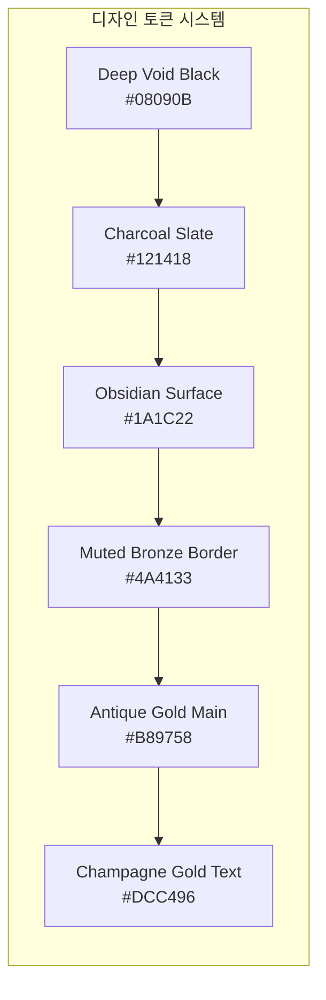
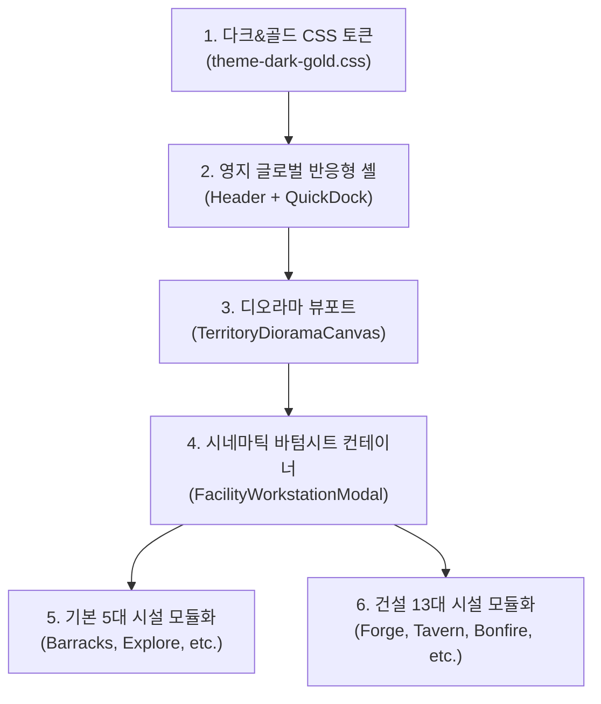

# 🏰 [최종 확정 기획안] 영지 및 시설 UI/UX 완전 개편 명세서
> **Project: Limbo Tales (프로젝트: 림보 테일즈 / 심연의 생존자들)**  
> **문서 버전**: v2.2.0-ABSOLUTE-FINAL  
> **작업 브랜치**: `feature/territory-ui-renewal`  
> **최종 갱신일**: 2026-11-05  
> **핵심 테마**: **Dark Gothic & Antique Gold (다크 고딕 & 앤티크 골드)**  
> **디자인 아키텍처**: **생동형 디오라마 거점(기획안 1) + 시네마틱 무대 및 서사 액션 덱(기획안 3)**  
> **엔진 규칙 준수**: **100% 자동 틱 생산 루프 보존 (수동 수확 버튼 전면 배제), 기존 게임 로직/알고리즘 1:1 승계**

---

## 📌 목차 (Table of Contents)
1. [기획 목적 및 핵심 개발 원칙](#1-기획-목적-및-핵심-개발-원칙)
2. [다크 & 앤티크 골드 디자인 시스템 (Dark & Antique Gold)](#2-다크--앤티크-골드-디자인-시스템-dark--antique-gold)
3. [영지 전체 시설 체계 (기본 시설 5종 + 건설 시설 13종)](#3-영지-전체-시설-체계-기본-시설-5종--건설-시설-13종)
4. [영지 메인 화면 UI/UX 아키텍처 (Living Citadel Diorama)](#4-영지-메인-화면-uiux-아키텍처-living-citadel-diorama)
   - [4.1 메인 뷰포트 와이어프레임](#41-메인-뷰포트-와이어프레임-mobile-portrait-기준)
   - [4.2 실시간 자동 틱 생산 루프 & 상태 알림 규칙](#42-실시간-자동-틱-생산-루프--상태-알림-규칙)
   - [4.3 오프라인 영지 운영 정산 보고서](#43-오프라인-영지-운영-정산-보고서-offline-territory-settlement-report)
5. [상시 개방 기본 시설 5종 내부 UI/UX 상세 설계](#5-상시-개방-기본-시설-5종-내부-uiux-상세-설계)
   - [5.1 ⚔️ 원정단 병영 & 작전실 (Barracks)](#51-️-원정단-병영--작전실-barracks)
   - [5.2 🌌 심연 탐험 채비실 (Explore)](#52--심연-탐험-채비실-explore)
   - [5.3 🪦 성채 묘지 (Cemetery)](#53--성채-묘지-cemetery)
   - [5.4 📜 심연의 백과 & 서고 / 도감 (Codex)](#54--심연의-백과--서고--도감-codex)
   - [5.5 📜 지휘관 퀘스트 본부 (Quests)](#55--지휘관-퀘스트-본부-quests)
6. [방주 건설 및 증축 시설 13종 내부 UI/UX 상세 설계](#6-방주-건설-및-증축-시설-13종-내부-uiux-상세-설계)
   - [6.1 🔥 방주의 성화 (Bonfire)](#61--방주의-성화-bonfire)
   - [6.2 🏛️ 방주 중앙 병참고 (Storage)](#62-️-방주-중앙-병참고-storage)
   - [6.3 ⚒️ 심연의 병기창 (Blacksmith / Forge)](#63-️-심연의-병기창-blacksmith--forge)
   - [6.4 🍺 방랑자의 라운지 (Tavern)](#64--방랑자의-라운지-tavern)
   - [6.5 🏥 생체 복원 병동 (Infirmary)](#65--생체-복원-병동-infirmary)
   - [6.6 🧪 에테르 연금 공방 (Alchemy)](#66--에테르-연금-공방-alchemy)
   - [6.7 ⚖️ 황혼의 블랙 마켓 (Market)](#67-️-황혼의-블랙-마켓-market)
   - [6.8 ✨ 영혼의 제단 (Sanctuary)](#68--영혼의-제단-sanctuary)
   - [6.9 🌀 차원 앵커 게이트 (Arena Gate)](#69--차원-앵커-게이트-arena-gate)
   - [6.10 🌲⛏️⚗️🏕️ 4대 원자재 생산 시설 (Lumber, Quarry, Butchery, Cabin)](#610-️️-4대-원자재-생산-시설-lumber-quarry-butchery-cabin)
7. [다크 고딕 AI 이미지 생성 프롬프트 명세](#7-다크-고딕-ai-이미지-생성-프롬프트-명세)
8. [프론트엔드 모듈 구현 로드맵](#8-프론트엔드-모듈-구현-로드맵)

---

## 1. 기획 목적 및 핵심 개발 원칙

1. **기존 게임 알고리즘 & 자동 틱 생산 메커니즘 100% 보존**:
   - **완전 자동 틱 생산(Auto-Tick Production)**: 본 게임의 모든 생산 시설(벌목장, 시추소, 정제소, 연금공방, 안식처)은 정해진 주기(9~15초)마다 **자원을 자동으로 생산하여 방주 중앙 병참고(창고)로 즉시 자동 입고**합니다.
   - 따라서 **별도의 수동 수확 버튼(`[수확]`, `[일괄 수확]`)은 일체 존재하지 않으며, 추가하지 않습니다.**
   - 기존의 `GameManager`, 자원 상태(`state.resources`), 시설 유지비 차감 주기, 3대 테크 시너지(대량 배급제, 상업 네트워크, 에테르 환류관) 공식과 100% 동일하게 연동됩니다.
2. **순수 UI/UX 레이아웃 & 비주얼 프레젠테이션의 혁신**:
   - 16,000줄 규모의 단일 파일(`CitadelScreen.tsx`)에 집중되어 있던 시설 접근 동선과 드로어를 모듈화합니다.
   - 기존의 길고 피로한 세로 스크롤 구조에서 벗어나, **살아 숨쉬는 거점 디오라마(기획안 1)**와 **서사적 시네마틱 무대 및 직관적 액션 덱(기획안 3)**의 결합으로 재설계합니다.
3. **모바일 및 크로스 플랫폼 최적화**:
   - 모바일 세로 뷰에서는 엄지손가락 조작이 용이한 **적응형 바텀시트(Adaptive Bottom Sheet)**로 구동됩니다.
   - 태블릿 / PC 와이드 뷰에서는 화면을 가리지 않는 **마스터-디테일 스플릿 뷰(Master-Detail Split View)**로 자동 확장됩니다.

---

## 2. 다크 & 앤티크 골드 디자인 시스템 (Dark & Antique Gold)

블루 아카이브풍의 파스텔/네온 발광 효과를 전면 퇴출하고, **다키스트 던전, 엘든 링, 중세 고딕 오컬트**의 묵직한 질감을 구현합니다:



### 2.1 색상 및 텍스처 규칙 (Visual Tokens)
* **배경 & 표면**: `#08090B` (심연 블랙), `#121418` (다크 챠콜), `#1A1C22` (흑요석 서피스).
* **보더 & 음각선**: `#2C303B` (무채색 스틸 라인), `#4A4133` (풍화된 브론즈 보더), `#7A6542` (음각 골드 베벨).
* **골드 액센트 (Antique Gold)**:
  - `--gold-main`: `#B89758` (주요 탭, 시설 활성화 림, 주요 CTA 버튼 테두리).
  - `--gold-bright`: `#DCC496` (샴페인 골드 텍스트 하이라이트, 성공 수치 표기).
* **네온 효과 전면 금지**: 기존의 사이버틱한 시안/마젠타 네온 발광(`box-shadow: 0 0 15px #00ffff`)을 전면 제거하고, 미세한 금박 광택(Subtle Metallic Sheen)과 외곽 스모키 비네팅(`radial-gradient`)만 허용합니다.

---

## 3. 영지 전체 시설 체계 (기본 시설 5종 + 건설 시설 13종)

현재 게임 엔진에 실제 존재하는 **총 18개 시설**을 그 성격과 진입 방식에 따라 명확히 2대 카테고리로 분류합니다:

```mermaid
graph TD
    CitadelHub[🏰 방주 성채 거점] --> DefaultOutposts[🪶 상시 개방 고유 시스템 - 기본 시설 5종]
    CitadelHub --> BuildFacilities[🏛️ 방주 건설 및 증축 - 13종 건물]

    DefaultOutposts --> B1[⚔️ 원정단 병영 & 작전실 - barracks]
    DefaultOutposts --> B2[🌌 심연 탐험 채비실 - explore]
    DefaultOutposts --> B3[🪦 성채 묘지 - cemetery]
    DefaultOutposts --> B4[📜 심연의 백과 & 도감 - codex]
    DefaultOutposts --> B5[📜 지휘관 퀘스트 본부 - quests]

    BuildFacilities --> C1[🔥 방주의 성화 - bonfire]
    BuildFacilities --> C2[🏛️ 방주 중앙 병참고 - storage]
    BuildFacilities --> C3[⚒️ 심연의 병기창 - blacksmith]
    BuildFacilities --> C4[🍺 방랑자의 라운지 - tavern]
    BuildFacilities --> C5[🏥 생체 복원 병동 - infirmary]
    BuildFacilities --> C6[🧪 에테르 연금 공방 - alchemy]
    BuildFacilities --> C7[⚖️ 황혼의 블랙 마켓 - market]
    BuildFacilities --> C8[✨ 영혼의 제단 - sanctuary]
    BuildFacilities --> C9[🌀 차원 앵커 게이트 - arenaGate]
    BuildFacilities --> C10[🌲⛏️⚗️🏕️ 4대 원자재 생산 시설]
```



### 시설 분류 일람표
| 구분 | 시설명 (ID / DrawerKey) | 역할 및 기존 게임 내 핵심 기능 | 유지비 여부 |
| :--- | :--- | :--- | :---: |
| **기본 시설 ①** | ⚔️ 원정단 병영 (`barracks`) | 던전 4인 파티(전열/후열) 편성, 차원 덱, 방어 덱, 전직/각성, 장비 탈착 | 상시 무료 |
| **기본 시설 ②** | 🌌 심연 탐험 채비실 (`explore`) | 배낭(규격/마차) 선택, 보급품(횃불/식량 등) 적재, 회랑 1~5층 출격 | 상시 무료 |
| **기본 시설 ③** | 🪦 성채 묘지 (`cemetery`) | 전사자 안식처, 영령 잠금, 추모 EXP 버프(+10~30%), 조상의 가호 결속 | 상시 무료 |
| **기본 시설 ④** | 📜 심연 도감 & 서고 (`codex`) | 오파츠/회고록/유물/몬스터 등록, 영구 패시브 보너스 열람 | 상시 무료 |
| **기본 시설 ⑤** | 📜 퀘스트 본부 (`quests`) | 메인 연계, 서브 의뢰, 에픽 퀘스트 관리 및 보상 수령 | 상시 무료 |
| **건설 시설 ①** | 🔥 방주의 성화 (`bonfire`) | 목재 투입 온기 3대 버프(생산+15%, EXP+20%, 지속재생), 성화 결계 | **영구 무료** |
| **건설 시설 ②** | 🏛️ 중앙 병참고 (`storage`) | 16~27종 자원 적재 한도 관리, 보급품/장비/유물 인벤토리 | **영구 무료** |
| **건설 시설 ③** | ⚒️ 심연의 병기창 (`blacksmith`/`forge`) | 장비 단조(도안 제작), 보급품 제작, 장비 강화(+1~+10), 침식 장비 정화 | 에테르 소모 |
| **건설 시설 ④** | 🍺 방랑자의 라운지 (`tavern`) | 주점 리롤(골드/광고), 용병 계약(N/V/H/E), Lv.5+ 식량 부가 생산 | 골드 소모 |
| **건설 시설 ⑤** | 🏥 생체 복원 병동 (`infirmary`) | 병상(1~7개) 입원, 초고속 HP 및 Lv.4+ MP 지속 완치 | 식량 소모 |
| **건설 시설 ⑥** | 🧪 에테르 연금 공방 (`alchemy`) | 에테르 자동 생산(15초), 스킬 비전서 강화, 마도 인챈트 | 골드+식량 소모 |
| **건설 시설 ⑦** | ⚖️ 황혼의 블랙 마켓 (`market`) | 17종 군수물자 거래(구매/판매), 유지비 주기 연장(최대 30초) | 식량 소모 |
| **건설 시설 ⑧** | ✨ 영혼의 제단 (`sanctuary`) | 1차·2차 클래스 승격/전직, 전 파티원 올스탯 영구 버프 | 에테르 소모 |
| **건설 시설 ⑨** | 🌀 차원 앵커 게이트 (`arenaGate`) | 차원 아레나(비동기 배틀), 네메시스 침공전, 명예 상점 | 에테르 소모 |
| **건설 시설 ⑩** | 🌲 영목 벌채소 (`lumberCamp`) | 9초마다 목재 자동 생산 (Lv.5+ 골드 유지비 점진 감면) | 골드 소모 |
| **건설 시설 ⑪** | ⛏️ 에테르 광맥 시추소 (`quarry`) | 11초마다 석재 & 철광 자동 채굴 (Lv.5+ 골드 유지비 감면) | 골드 소모 |
| **건설 시설 ⑫** | ⚗️ 심연 생체 정제소 (`butchery`) | 13초마다 식량 & 가죽 자동 정제 (Lv.5+ 대량 배급제 시너지) | 골드 소모 |
| **건설 시설 ⑬** | 🏕️ 생존자 안식처 (`cabin`) | 13초마다 피난민 세금 골드 자동 징수 | 식량 소모 |

---

## 4. 영지 메인 화면 UI/UX 아키텍처 (Living Citadel Diorama)

### 4.1 메인 뷰포트 와이어프레임 (Mobile Portrait 기준)

```text
+-------------------------------------------------------------+
| [글로벌 자원 바] 🪙 12,500 🪵 450 🪨 280 ⚙️ 120 ✨ 45 [🔥04:30] |
+-------------------------------------------------------------+
|                                                             |
|           [ 방주 성채 다크 고딕 디오라마 뷰포트 ]            |
|                                                             |
|    (흑무가 감도는 웅장한 부유 거점, 묵직한 고딕 석조 건물들)   |
|                                                             |
|       [🌲 벌채소] (자동가동: 9s)          [⚒️ 병기창]       |
|                                                             |
|               [🔥 방주의 성화] (온기 5/5 가동 중)           |
|                                                             |
|       [🍺 라운지] (🍺NEW 뱃지)           [🏥 병동] (치료 1) |
|                                                             |
|  [📊 영지 수지/생산 대시보드]                 [🌌 심연 즉시출격] |
+-------------------------------------------------------------+
| [앤티크 골드 림 퀵 독 (Quick Dock - 가로 스크롤 토큰 바)]   |
| [기본] ⚔️병영  🌌채비  🪦묘지  📜도감  📜퀘스트              |
| [건설] 🔥성화  ⚒️병기창 🍺주점  🏥병동  🧪연금  ⚖️마켓  🏛️창고 |
+-------------------------------------------------------------+
| [글로벌 하단 바]  [🏰 영지 전경]  [⚔️ 원정 파티]  [📜 퀘스트] |
+-------------------------------------------------------------+
```

### 4.2 실시간 자동 틱 생산 루프 & 상태 알림 규칙
1. **완전 자동 틱 생산 & 실시간 입고**:
   - 생산 시설(벌목장, 시추소, 정제소, 연금공방, 안식처)은 정해진 주기마다 자동으로 자원을 생산하여 중앙 창고로 자동 적재됩니다.
   - 플레이어가 직접 화면을 누르는 **수동 수확 버튼은 없으며**, 생산 건물의 뷰는 **현재 생산 주기 카운트다운 게이지와 시간당 순 생산량 모니터링**에 집중됩니다.
2. **이상 징후 및 이벤트 상태 뱃지 (Floating State Badges)**:
   - 건물 상단에는 조작이 필요한 **실제 이벤트/이상 상태**만 은은한 골드/버건디 뱃지로 표시됩니다:
     - `[🍺 NEW]`: 주점에 새로운 방랑 용병 후보가 도착함.
     - `[💚 완치]`: 병동에 입원 중이던 용병의 치료가 완료되어 퇴원 대기 중.
     - `[📦 만적]`: 특정 자원이 창고 적재 상한치에 도달하여 추가 생산이 중단됨.
     - `[⚠️ 체납]`: 유지비 부족으로 인해 시설이 임시 다운그레이드 상태임.

---

### 4.3 오프라인 영지 운영 정산 보고서 (Offline Territory Settlement Report)
- 플레이어가 게임을 종료한 뒤 다시 접속했을 때, 부재중 경과 시간 동안 누적된 자원 흐름을 요약 브리핑하는 모달입니다.
- **수확을 누르는 기능이 아니며**, 이미 백그라운드 틱 연산으로 창고에 입고/차감 완료된 내역을 투명하게 확인하는 **요약 정산표**입니다:

```text
+-------------------------------------------------------------+
| 🏰 방주 거점 운영 일지 (지휘관 부재중 정산 보고서)         |
| 부재 시간: 04시간 32분 경과                                 |
+-------------------------------------------------------------+
| [📦 부재중 자동 누적 생산량]                                 |
| • 🪵 목재: +1,813 (벌채소 Lv.5 가동)                         |
| • 🪨 석재: +980 / ⚙️ 철광석: +147 (시추소 Lv.4 가동)         |
| • 🍖 식량: +1,250 / 🥋 가죽: +234 (정제소 Lv.5 가동)         |
| • 🪙 골드: +1,248 (생존자 세금)                             |
|-------------------------------------------------------------|
| [⚖️ 차감된 시설 유지비 정산]                                 |
| • 소모 골드 유지비: -820 G  (상업 네트워크 25% 감면 적용)    |
| • 소모 식량 유지비: -460 Food (대량 배급제 30% 감면 적용)    |
|-------------------------------------------------------------|
| [✨ 최종 창고 순수 적재 결과]                               |
| • 🪵 +1,813  🪨 +980  ⚙️ +147  🍖 +790  🪙 +428 G            |
| (모든 자원은 방주 중앙 병참고에 안전하게 자동 보관되었습니다) |
+-------------------------------------------------------------+
| [                  확인 및 영지 지휘 복귀                   ] |
+-------------------------------------------------------------+
```

---

## 5. 상시 개방 기본 시설 5종 내부 UI/UX 상세 설계

### 5.1 ⚔️ 원정단 병영 & 작전실 (Barracks)
* **기존 코드 매핑**: `BarracksDrawer.tsx` (`initialCategory: 'dungeon' | 'dimensional' | 'defense'`)
* **시네마틱 무대 프레임**: 어두운 전략 작전실, 낡은 심연 지도와 목재 테이블, 전술 고문관 스탠딩.
* **고딕 액션 카드 덱 (3대 카테고리 탭)**:
  1. `[🗡️ 던전 원정대 (Dungeon)]`:
     - 4인 파티(전열 1,2열 / 후열 3,4열) 슬롯 드래그 & 배치.
     - 용병 상세: 기본 스탯(HP/MP/ATK/DEF/SPD), 장비 3슬롯(무기/방어구/장신구), 스킬 비전서 장착.
     - 1차·2차 전직 및 각성, 용병 해고/시너지.
  2. `[🌀 차원 침공 스쿼드 (Dimensional)]`:
     - 메인 3인 + 오퍼레이터(또는 리더) 배치, 주간 속성 친화도 확인.
  3. `[🛡️ 영지 방어 진형 (Defense)]`:
     - 침공 방어 덱 용병 배치 (아레나 침공 대비).

---

### 5.2 🌌 심연 탐험 채비실 (Explore)
* **기존 코드 매핑**: `ExploreDrawer.tsx` (`step: 'prep' | 'zone'`)
* **시네마틱 무대 프레임**: 침묵의 회랑으로 향하는 거대한 고딕 석조 아치 관문, 관문 수호자 NPC.
* **2단계 인터랙션 플로우**:
  1. `[1단계: 원정 채비실 (Prep)]`:
     - **배낭 규격 선택**: 가벼운 백팩, 표준 군장, 중형 배낭, 대형 군장, 전술 짐수레.
     - **보급품 적재 슬롯**: 횃불(`torch`), 던전 식량(`dungeon_food`), 곡괭이(`pickaxe`), 귀환석(`rift_anchor`), 만능 열쇠(`key`), 붕대(`bandage`), 성수(`holy_water`).
     - 파티 4인 출전 상태 점검.
  2. `[2단계: 구역 및 층수 선택 (Zone)]`:
     - 침묵의 회랑 1층 ~ 5층 선택 카드.
     - 계층별 심연 침식도, 출현 보스 표기 및 `[🌌 심연 강하 시작]` 실행.

---

### 5.3 🪦 성채 묘지 (Cemetery)
* **기존 코드 매핑**: `CemeteryDrawer.tsx` (`FallenHero[]`)
* **시네마틱 무대 프레임**: 비 내리는 어두운 묘역, 이끼 낀 고딕 묘비들과 은은한 촛불, 묘지기 수녀 스탠딩.
* **핵심 워크벤치 UI**:
  - **영령 안치 슬롯 리스트**: 전사한 용병 초상화, 사망 층수, 묘비명.
  - **영령 잠금/보호 기능**: `[🔒 잠금 토글]` (정원 초과 소멸 방지).
  - **추모 예배 및 경험치 버프**: 안치 수에 따른 `+10% ~ +30% EXP 버프` 활성화.
  - **조상의 가호 결속 (Ancestral Blessing)**: 고등급 영령 영혼 결속을 통한 영구 가호.

---

### 5.4 📜 심연의 백과 & 서고 / 도감 (Codex)
* **기존 코드 매핑**: `CodexModal.tsx` (`CODEX_COLLECTIONS`)
* **시네마틱 무대 프레임**: 거대한 고딕 도서관 서고, 대도서관 서지학자 스탠딩.
* **핵심 워크벤치 UI**:
  - 도감 수집률(`%`) 및 영구 패시브 보너스 헤더.
  - 카테고리 탭: `[전체]`, `[오파츠]`, `[회고록]`, `[유물]`, `[촉매]`.
  - 미등록 발견 아이템 `[📜 서고 등록]` 원터치 버튼.

---

### 5.5 📜 지휘관 퀘스트 본부 (Quests)
* **기존 코드 매핑**: `QuestsDrawer.tsx` (`catTab: 'chain' | 'sub' | 'epic' | 'completed'`)
* **시네마틱 무대 프레임**: 작전 지령서가 펼쳐진 성채 사령탑 지휘소.
* **4대 퀘스트 탭**:
  1. `[메인 연계 (Chain)]`: 챕터 시나리오 및 시설 건설 연계.
  2. `[서브 의뢰 (Sub)]`: 던전 파밍 및 토벌 의뢰.
  3. `[에픽 임무 (Epic)]`: 영혼의 제단 및 고대 전직 서사.
  4. `[완료 기록 (Completed)]`: 수행 완료 기록 열람.
  - 완료된 퀘스트의 명확한 `[보상 수령]` 앤티크 골드 버튼.

---

## 6. 방주 건설 및 증축 시설 13종 내부 UI/UX 상세 설계

### 6.1 🔥 방주의 성화 (Bonfire)
* **기존 코드 매핑**: `bonfire` (Lv.1~Lv.10, 유지비 0)
* **시네마틱 무대 프레임**: 성채 옥상 제단, 타오르는 신성한 푸른/금빛 불꽃.
* **핵심 워크벤치 UI**:
  - 5단 온기 링 게이지(`0/5 ~ 5/5`) 및 지속 잔여시간(`04:30`) 시각화.
  - 생산 +15%, 전투 EXP +20%, 영지 용병 지속 재생 특권 안내.
  - `[🪵 목재 5개 투입 (+30초)]` / `[🪵 목재 25개 완전 점화 (300초)]`.
  - 상단 `[⬆ 성화 증축]` 버튼.

---

### 6.2 🏛️ 방주 중앙 병참고 (Storage)
* **기존 코드 매핑**: `StorageDrawer.tsx` (`storageTab: 'resources' | 'supplies' | 'equipment' | 'quest'`, 유지비 0)
* **시네마틱 무대 프레임**: 끝없이 쌓인 거대한 지하 군수 창고.
* **4대 인벤토리 탭**:
  1. `[자원 보관고]`: 16~27종 자원별 보유량 / 적재 상한치 프로그레스 바.
  2. `[원정 보급품]`: 횃불, 식량, 곡괭이, 붕대, 성수 등 보유 현황.
  3. `[장비 보관고]`: 무기, 방어구, 장신구 인벤토리 필터링.
  4. `[퀘스트/오파츠]`: 스토리 수집품 및 미확인 유물 보관.

---

### 6.3 ⚒️ 심연의 병기창 (Blacksmith / Forge)
* **기존 코드 매핑**: `ForgeDrawer.tsx` (`mainTab: 'craft' | 'supplies' | 'enhance' | 'curse'`)
* **시네마틱 무대 프레임**: 흑철 모루와 마도 화로, 대장장이 헤파이 스탠딩.
* **4대 공방 탭**:
  1. `[장비 제작 (Craft)]`: 무기/방어구/장신구 도안 선택 및 제작.
  2. `[보급품 제작 (Supplies)]`: 탐험 횃불, 던전 식량, 곡괭이, 붕대 제작.
  3. `[장비 강화 (Enhance)]`: +1 ~ +10강 장비 강화 워크벤치 (확률, 재화 표시, 파괴 없음).
  4. `[침식 장비 정화 (Curse)]`: 저주받은 장비 신성 정화 (5분 타이머 연출).

---

### 6.4 🍺 방랑자의 라운지 (Tavern)
* **기존 코드 매핑**: `TavernDrawer.tsx` (`state.tavernCandidates`, Lv.5+ 식량 자동 생산)
* **시네마틱 무대 프레임**: 아늑한 촛불 펍, 바텐더 벨로나 스탠딩.
* **핵심 워크벤치 UI**:
  - 금일 방문한 방랑 용병 목록 (등급 N/V/H/E, 직업, 스탯, 고유 특성, 계약금).
  - 용병 선택 시 상세 프로필 팝업 및 `[🤝 고용 계약 체결]`.
  - `[🔄 모험가 풀 갱신 (200 Gold)]` / `[🎬 광고 보고 즉시 갱신]`.

---

### 6.5 🏥 생체 복원 병동 (Infirmary)
* **기존 코드 매핑**: `InfirmaryDrawer.tsx` (`capacity: 1~7`, `admitToInfirmary`, `dischargeFromInfirmary`)
* **시네마틱 무대 프레임**: 에테르 치료 캡슐과 붕대, 군의관 수녀 소피아 스탠딩.
* **핵심 워크벤치 UI**:
  - 1~7개 병상 슬롯 그리드 (입원 용병 회복률 프로그레스, `[즉시 퇴원]`).
  - 빈 병상 터치 시 부상 용병 선택 및 `[입원 치료 시작]`.
  - 초당 HP 및 Lv.4+ MP 회복 효율 표기.

---

### 6.6 🧪 에테르 연금 공방 (Alchemy)
* **기존 코드 매핑**: `AlchemyDrawer.tsx` (`activeTab: 'enhance' | 'enchant'`, 15초마다 에테르 자동 생산)
* **시네마틱 무대 프레임**: 푸른 에테르 플라스크와 비전 룬 서클이 회전하는 연금 공방.
* **2대 비전 탭**:
  1. `[스킬 비전 강화 (Enhance)]`: 마도 스킬 비전서 강화 워크벤치.
  2. `[마도 인챈트 (Enchant)]`: 접두석, 접미석, 순수석을 장비에 부여하여 추가 옵션 각인.

---

### 6.7 ⚖️ 황혼의 블랙 마켓 (Market)
* **기존 코드 매핑**: `MarketDrawer.tsx` (`filterCat: 'all' | 'basic' | 'farming' | 'rare'`)
* **시네마틱 무대 프레임**: 베일에 싸인 암시장 상인의 비밀 교역소.
* **핵심 워크벤치 UI**:
  - 17종 군수 물자 거래 그리드 (구매/판매 수량 조절).
  - 유지비 주기 연장(최대 30초) 및 골드 유지비 -25% 상업 네트워크 상태 표시.

---

### 6.8 ✨ 영혼의 제단 (Sanctuary)
* **기존 코드 매핑**: `sanctuary` (1차·2차 전직 승격, 올스탯 버프)
* **시네마틱 무대 프레임**: 천상과 심연이 교차하는 고대 각성 제단.
* **핵심 워크벤치 UI**:
  - 전직 대상 용병 표시 및 1차(8종) / 2차(16종) 전직 트리 열람.
  - 전직 촉매 소모 후 각성 의식 거행.
  - 영구 올스탯 패시브 버프 표기.

---

### 6.9 🌀 차원 앵커 게이트 (Arena Gate)
* **기존 코드 매핑**: `arenaGate` (PVP 아레나, 영지 침공전, 네메시스 레이드, 명예 상점)
* **시네마틱 무대 프레임**: 차원의 균열이 소용돌이치는 거대한 오벨리스크 게이트.
* **핵심 워크벤치 UI**:
  - `[차원 아레나]`: 비동기 PVP 상대 매칭 및 랭킹전.
  - `[영지 침공/방어]`: 침공 출격 및 방어 기록 열람.
  - `[네메시스 레이드]`: 시즌 보스 토벌.
  - `[명예의 암시장]`: 명예 코인 전용 상점.

---

### 6.10 🌲⛏️⚗️🏕️ 4대 원자재 생산 시설 (Lumber, Quarry, Butchery, Cabin)
* **벌목장 (`lumberCamp`)**: 9초마다 목재 자동 생산. Lv.5+ 유지비 점진 감면.
* **시추소 (`quarry`)**: 11초마다 석재 및 철광 자동 채굴. Lv.5+ 유지비 감면.
* **정제소 (`butchery`)**: 13초마다 식량 및 가죽 자동 정제. Lv.5+ 대량 배급제(식량유지비 -30%).
* **안식처 (`cabin`)**: 13초마다 세금 골드 자동 징수.
* **공통 UI 구성**:
  - 상단: **실시간 가동 현황 모니터링** (생산 주기 프로그레스 바, 틱당 생산량, 초당 환산 생산률).
  - 소비 유지비 현황 및 시너지 감면 적용 상태 표기.
  - 중앙: 해당 자원의 **현재 창고 적재량 및 적재 한도(Storage Capacity)** 현황 바.
  - 하단: `[⬆ 시설 증축]` 버튼 (다음 레벨 생산량 증가분 및 소모 자원 안내).
  - *(수동 수확 버튼은 존재하지 않으며, 틱마다 자동으로 창고에 누적 입고됨)*

---

## 7. 다크 고딕 AI 이미지 생성 프롬프트 명세

게임 내에 새로 배치될 비주얼 프레임용 다크 판타지 마스터 프롬프트입니다:

* **공통 마스터 수식어**:  
  `dark fantasy, gothic art style, muted colors, deep blacks and charcoal, subtle antique gold highlights, moody atmospheric lighting, chiaroscuro, intricate medieval textures, cinematic digital painting, masterpiece, 8k resolution`
* **네거티브 키워드**:  
  `bright colors, neon lights, glowing cyan, pastel, anime kawaii, blue archive style, cheerful, flat 2d, bad hands, lowres, blurry, watermark, 3d render`

| 대상 에셋 | 에셋 규격 | 프롬프트 명세 |
| :--- | :--- | :--- |
| **방주 성채 전경**<br>(Citadel Diorama) | 16:9<br>(1920×1080) | `masterpiece, scenery, epic colossal gothic ark citadel fortress floating above an endless sea of dark mist and black fog, dark basalt stone towers, intricate gargoyles, glowing dim gold brazier fire at highest spire, dark fantasy matte painting, moody twilight sky, 8k` |
| **병영 작전실 배경**<br>(Barracks Interior) | 16:9<br>(1920×1080) | `masterpiece, scenery, dark gothic fantasy strategy war room, heavy dark oak round table with parchment maps and iron daggers, candlelight casting long shadows on cold stone walls, banners of fallen knightly order, solemn tactical atmosphere, 8k` |
| **성채 묘지 배경**<br>(Cemetery Scenery) | 16:9<br>(1920×1080) | `masterpiece, scenery, solemn gothic citadel graveyard cemetery, weathered ancient gravestones overgrown with withered dark ivy, gentle rain, dim amber lanterns on iron fences, faint ethereal embers rising, sorrowful and peaceful, dark fantasy painting, 8k` |
| **심연 서고 도감 배경**<br>(Codex Archives) | 16:9<br>(1920×1080) | `masterpiece, scenery, vast towering dark gothic library archive, immense shelves packed with ancient leather grimoires, dust motes in dim candlelight, heavy gothic arches, mysterious occult sanctuary, dark academia aesthetic, 8k` |

---

## 8. 프론트엔드 모듈 구현 로드맵

새 브랜치 `feature/territory-ui-renewal`에서 실제 컴포넌트 개발에 착수할 모듈 구조입니다:



1. **Phase 1: 디자인 시스템 정립**
   - `src/styles/theme-dark-gold.css`: 흑연, 흑요석, 앤티크 골드 컬러 토큰, 엠보싱 보더 클래스 정의.
2. **Phase 2: 공통 셸 컴포넌트 분리 (`src/components/territory/`)**
   - `TerritoryHeader.tsx`: 슬림 다크 자원 바 + 성화 온기 카운트다운.
   - `QuickFacilityDock.tsx`: 18개 시설을 가로 슬라이드로 탐색하는 앤티크 골드 토큰 바.
3. **Phase 3: 디오라마 메인 뷰포트 (`src/screens/CitadelScreen.tsx` 리팩토링)**
   - 2.5D 고딕 부유 성채 캔버스 렌더링 + 상태 뱃지 오버레이.
4. **Phase 4: 시네마틱 워크스테이션 컨테이너 (`FacilityWorkstationModal.tsx`)**
   - 모바일 바텀시트(드래그 제스처) & PC 스플릿 뷰 반응형 분기.
   - 상단 40% 시네마틱 무대 프레임 + NPC 대화창 표준화.
5. **Phase 5: 기존 18개 시설 기능 1:1 무손실 연결**
   - 기존의 `gm.upgradeBuilding`, `ForgeDrawer`, `TavernDrawer`, `ExploreDrawer`, `CemeteryDrawer` 로직을 새로운 다크 & 골드 워크스테이션 컴포넌트로 깔끔하게 재배치.
