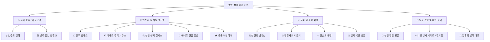

# 🏰 [기획안] 영지 및 시설 UI/UX 완전 개편 제안서
> **Project: Limbo Tales (림보 아카데미아 / 심연의 생존자들)**  
> **문서 버전**: v1.0.0-PROPOSAL  
> **작업 브랜치**: `feature/territory-ui-renewal`  
> **작성 일자**: 2026-11-05  
> **대상 플랫폼**: 모바일 웹/앱(세로/가로) 및 데스크탑/태블릿 반응형 크로스 플랫폼

---

## 📌 목차 (Table of Contents)
1. [기획 배경 및 현대적 웹게임 UI/UX 설계 원칙](#1-기획-배경-및-현대적-웹게임-uiux-설계-원칙)
2. [영지 시설 분류 및 공통 정보 계층 구조](#2-영지-시설-분류-및-공통-정보-계층-구조)
3. [【기획안 1】 Living Citadel Diorama & Adaptive Bottom Sheet (생동형 디오라마 & 적응형 바텀시트)](#3-기획안-1-living-citadel-diorama--adaptive-bottom-sheet)
4. [【기획안 2】 Tactical Command Dashboard & Modular Glass Tiles (전술 지휘 콘솔 & 모듈러 타일 허브)](#4-기획안-2-tactical-command-dashboard--modular-glass-tiles)
5. [【기획안 3】 Cinematic Theater Stage & Focus Carousel (시네마틱 시어터 & 무대형 캐러셀)](#5-기획안-3-cinematic-theater-stage--focus-carousel)
6. [3가지 기획안 종합 비교 매트릭스](#6-3가지-기획안-종합-비교-매트릭스)
7. [에셋 프레임 규격 및 AI 이미지 생성 프롬프트 가이드라인](#7-에셋-프레임-규격-및-ai-이미지-생성-프롬프트-가이드라인)
8. [단계별 개발 로드맵 및 권장 의사결정 방향](#8-단계별-개발-로드맵-및-권장-의사결정-방향)

---

## 1. 기획 배경 및 현대적 웹게임 UI/UX 설계 원칙

### 1.1 개편 배경
- 기존의 영지(Citadel) 화면은 단일 세로 스크롤 페이지에 모든 건물과 기능이 길게 나열되어 있어, 시설이 많아질수록(총 13종) **스크롤 피로도**가 가중되고 직관적인 상황 인지가 어려웠습니다.
- 던전 외부 활동(생산 수확, 장비 강화, 용병 고용, 치료, 전직, 성화 버프 등)의 종류가 다양함에도 불구하고, 시설별 고유한 시각적 아이덴티티와 집중도가 부족했습니다.
- 따라서 **기존의 낡은 UI 레이아웃을 전면 백지화**하고, 2026년 최신 웹/모바일 게임 트렌드(블루 아카이브, 명일방주, AFK 저니 등)에 부합하는 **직관적이고 미려한 반응형 크로스 플랫폼 영지 UI**를 새롭게 기획합니다.

### 1.2 핵심 설계 철학 (Modern Web Game & Cross-Platform UX)
1. **엄지손가락 존(Thumb Zone) 최적화 & 한 손 플레이 보장**:
   - 모바일 세로 뷰에서 주요 조작 버튼(수확, 진입, 강화, 닫기)을 화면 하단 40% 영역(내추럴 탭 존)에 집중 배치.
   - 최소 터치 타깃 크기 48×48dp 보장, 모바일 기기의 노치/Dynamic Island 및 하단 홈 바(Safe Area Insets: `env(safe-area-inset-bottom)`) 완벽 대응.
2. **반응형 스케일링 & 멀티 디스플레이 레이아웃**:
   - **모바일 세로 모드 (Portrait, < 768px)**: 1열 스마트 캐러셀 / 바텀시트 오버레이 구조.
   - **태블릿 / 폴더블 / PC 가로 모드 (Landscape/Desktop, ≥ 768px)**: 화면 분할 스플릿 뷰(Master-Detail Split View). 좌측 영지 맵/대시보드 + 우측 시설 워크스테이션이 분리되어 팝업을 열고 닫는 피로감 제거.
3. **정보 계층(Visual Hierarchy)과 마이크로 인터랙션**:
   - **Lv.1 영지 전경**: 건물의 생산 상태(게이지), 완료 여부(바운싱 아이콘 뱃지), 이상 상태(유지비 체납 경고)가 0.5초 안에 눈에 들어오는 직관성.
   - **Lv.2 시설 진입**: 부드러운 스프링 트랜지션(0.25s)으로 진입. 시설 마스터 NPC의 인사말과 함께 시설의 2~3대 핵심 기능이 대형 카드 탭으로 제시.
   - **원터치 편의성(One-Touch QoL)**: "일괄 수확(Harvest All)", "원터치 보급/치료" 등의 편의 기능을 영지 최상위 레벨에 항상 제공.

---

## 2. 영지 시설 분류 및 공통 정보 계층 구조

방주의 13개 시설과 출격 포털은 목적과 상호작용 빈도에 따라 **4대 군집(Hub Clusters)**으로 체계화됩니다:



### 상시 노출 헤더 (Global Resource Strip)
- 화면 최상단에는 플레이어의 핵심 보유 자원이 깔끔한 글래스모피즘 바 형태로 상시 고정됩니다.
- 표시 항목: 🪙 골드 | 🪵 목재 | 🪨 석재 | ⚙️ 철광석 | 🍖 식량 | ✨ 에테르 | 🔥 성화 온기 버프 타이머
- 우측 상단: [👑 랭커 버프 / 프로필] [⚙️ 설정]

---

## 3. 【기획안 1】 Living Citadel Diorama & Adaptive Bottom Sheet
> **컨셉명**: **생동형 디오라마 거점 & 적응형 바텀시트**  
> **핵심 키워드**: `#서브컬쳐감성` `#인터랙티브맵` `#한손조작` `#바텀시트` `#블루아카이브샬레오피스풍`

### 3.1 컨셉 개요 및 특징
- 방주 성채를 한 폭의 아름다운 일러스트/2.5D 디오라마 맵으로 연출하고, 화면 중앙에 배치된 각 시설 오브젝트를 터치하여 인터랙션합니다.
- 시설을 탭하면 전체 화면이 전환되는 대신 **세련된 모바일 바텀시트(Bottom Sheet)**가 부드럽게 위로 슬라이드되어 시설 내부 작업을 수행할 수 있습니다.
- 맵 위를 일일이 터치하지 않고도 즉시 시설을 전환할 수 있도록 화면 하단에 **‘퀵 네비게이션 독(Quick Facility Dock)’**을 기본 제공합니다.
- 시설 건물 위에 **‘말풍선 뱃지(Floating Bubble Badge)’**가 떠올라 수확 가능(`🪵+40`), 고용 대기(`🍺NEW`), 치료 완료(`💚100%`) 등을 직관적으로 알려줍니다.

### 3.2 UI 와이어프레임 구조

#### [모바일 세로 모드 (Portrait)]
```text
+-------------------------------------------------------------+
| [Header] 🪙 12.5k  🪵 450  🪨 280  ⚙️ 120  ✨ 45  [🔥04:21]   |
+-------------------------------------------------------------+
|                                                             |
|           [ 살아 숨쉬는 방주 디오라마 전경 뷰포트 ]           |
|                                                             |
|   (구름/연기 파티클, 성화의 불꽃 애니메이션, 시설 미니어처)       |
|                                                             |
|      [🌲 벌채소] (🪵+45 뱃지)        [⚒️ 병기창]             |
|                                                             |
|             [🔥 방주의 성화] (점화 5/5 온기 가동)            |
|                                                             |
|      [🍺 라운지] (✨NEW 뱃지)        [🏥 병동] (치료중 2)     |
|                                                             |
| [⚡ 원터치 일괄 수확]                         [🌌 탐험 즉시출격] |
+-------------------------------------------------------------+
| [Quick Dock] (하단 고정 슬라이드 탭)                         |
| [🔥성화] [⚒️병기창] [🍺주점] [🏕️병동] [✨제단] [⚖️마켓] [더보기+] |
+-------------------------------------------------------------+
```

#### [시설 터치 시: 적응형 바텀시트 오픈 뷰 (Bottom Sheet Mode)]
```text
+-------------------------------------------------------------+
| [Header] 🪙 12.5k  🪵 450  🪨 280  ⚙️ 120  ✨ 45  [🔥04:21]   |
+=============================================================+
| (배경 디오라마는 어두운 딤드 블러 처리)                      |
|                                                             |
| +---------------------------------------------------------+ |
| |  === [Drag Handle Bar] ===                              | |
| |  [⚒️ 심연의 병기창 Lv.4]         [시설 증축 Lv.5 ⬆] [ ✕ ]| |
| |  "단장님, 새로 발굴한 심연 광석을 벼릴 준비가 끝났습니다."  | |
| +---------------------------------------------------------+ |
| |  [ 서브 탭:  1. 장비 단조  |  ★ 2. 장비 강화  |  3. 인챈트 ] | |
| +---------------------------------------------------------+ |
| |  +--------------------+  +----------------------------+ | |
| |  | [장비 슬롯 선택]   |  | [강화 대상 워크벤치]       | | |
| |  | • 발키리 대검 (+3) |  |   ⚔️ 심연의 칠흑검 (+4)      | | |
| |  | • 성기사의 방패(+2)|  |   공격력: 120 -> 138 (+15%)  | | |
| |  | • 에테르 반지 (+5) |  |   성공 확률: 85%              | | |
| |  | • [장비 추가 +]    |  |   필요: 🪙 500  ⚙️ 12  ✨ 3   | | |
| |  +--------------------+  +----------------------------+ | |
| |  [    ⚡ 100% 안전 강화 시도 (원터치 강화)    ]           | |
| +---------------------------------------------------------+ |
+-------------------------------------------------------------+
```

#### [PC / 태블릿 가로 모드 (Split View)]
- 좌측 50%: 영지 인터랙티브 디오라마 맵 상시 유지.
- 우측 50%: 선택된 시설의 워크스테이션이 사이드 패널로 확장되어 맵과 시설을 동시에 보며 플레이 가능.

### 3.3 사용자 상호작용(UX) 특징
1. **스마트 바텀시트 3단 높이 조절**:
   - `Peek View (30%)`: 시설 요약 정보 및 즉시 수확/연장 버튼만 빠르게 조작.
   - `Standard View (75%)`: 기본 모드로, 시설의 탭 메뉴와 상세 활동(단조, 용병 고용 등) 수행.
   - `Full View (95%)`: 장비 인벤토리 대조, 대량 용병 관리 등 데이터가 많을 때 원터치 확장.
2. **원터치 일괄 수확(Quick Harvest Floating Button)**:
   - 디오라마 우측 하단 플로팅 버튼을 누르면 모든 생산 시설에서 자원이 팝콘처럼 튀어 올라오며 상단 자원바로 흡수되는 상쾌한 연출.

---

## 4. 【기획안 2】 Tactical Command Dashboard & Modular Glass Tiles
> **컨셉명**: **전술 지휘 콘솔 & 모듈러 카드 허브**  
> **핵심 키워드**: `#정보밀도극대화` `#전술콘솔` `#모듈러그리드` `#명일방주인프라감성` `#제로프릭션`

### 4.1 컨셉 개요 및 특징
- 불필요한 이동이나 로딩을 철저히 배제하고, 지휘관의 **스마트 전술 통제 모니터** 콘셉트로 영지의 모든 상태를 타일형 카드 대시보드로 구성합니다.
- 각 시설 카드마다 **현재 생산 진행률(프로그레스 링/바)**, **유지비 상태**, **현재 배치된 인원/활동**이 실시간 데이터로 표기됩니다.
- 모바일 화면에서는 스와이프 가능한 2열 그리드로 정돈되고, 데스크탑에서는 3~4열의 와이드 대시보드로 자동 확장되어 극강의 효율성을 자랑합니다.
- 시설 카드를 클릭하면 카드가 화면 중앙으로 매끄럽게 확장(Card Flip/Expand)되며 상세 제어 콘솔로 즉시 진입합니다.

### 4.2 UI 와이어프레임 구조

#### [모바일 세로 모드 (Portrait Dashboard)]
```text
+-------------------------------------------------------------+
| [Ark Command Center]  지휘관 Lv.14  |  [🔥 성화 버프 ON 04:30] |
| 🪙 12,500  | 🪵 450  | 🪨 280  | ⚙️ 120  | ✨ 45  | 🌾 80     |
+-------------------------------------------------------------+
| [⚡ 영지 상황 요약 알림 바]                                    |
| • 🌲 벌채소/⛏️ 광산 수확 대기  • 🏥 병동 환자 1명 완치 대기   |
| [  >>> ⚡ 전 영지 원터치 생산물 일괄 회수 (Harvest All) <<<  ]  |
+-------------------------------------------------------------+
| [시설 모듈 그리드 (2열 반응형 스마트 카드)]                   |
| +-------------------------+ +-------------------------+     |
| | 🔥 방주의 성화    [Lv.3]| | 🌲 영목 벌채소    [Lv.5]|     |
| | 온기 5/5 [300s 가동중]  | | 🪵 +12/9s [■■■■■■ 100%]|     |
| | [목재 투입 +30초 연장]  | | [즉시 수확: +36 목재]   |     |
| +-------------------------+ +-------------------------+     |
| | ⚒️ 심연 병기창    [Lv.4]| | 🍺 방랑자 라운지  [Lv.3]|     |
| | 단조 대기: 0/1          | | 새로운 방랑자: 3명 대기 |     |
| | [공방 바로가기 >>]      | | [용병 영입풀 열기 >>]   |     |
| +-------------------------+ +-------------------------+     |
| | 🏥 복원 병동      [Lv.2]| | ✨ 영혼의 제단    [Lv.2]|     |
| | 입원: [1/3] 세이라 치료중| | 1차 전직 대기: 1명 가능 |     |
| | [치료 현황 보기 >>]     | | [승격 의식실 입장 >>]   |     |
| +-------------------------+ +-------------------------+     |
| | 🌀 차원 앵커 게이트     | | 🏛️ 방주 중앙 병참고     |     |
| | PVP 시즌 1 (Rank 4위)   | | 적재 용량: 72%          |     |
| +-------------------------+ +-------------------------+     |
+-------------------------------------------------------------+
| [Global Bottom Nav]  [🏰영지콘솔] [⚔️파티관리] [🌌심연출격]   |
+-------------------------------------------------------------+
```

#### [시설 모듈 클릭 시: 전술 콘솔 상세 뷰 (확장 팝업 / 인라인 익스팬션)]
```text
+-------------------------------------------------------------+
| 🍺 방랑자의 라운지 (Wanderer Lounge) Lv.3           [ ✕ 닫기 ] |
| 시설 효과: 용병 고용 비용 -10% 감면, 특수 클래스 출현율 +5%  |
+-------------------------------------------------------------+
| [시설 관리자: 바텐더 벨로나]                                 |
| "오늘 심연의 안개를 뚫고 들어온 자들입니다. 눈빛이 살아있군요."|
| [ 🔄 라운지 후보 갱신 (200 Gold) - 남은 갱신: 3회 ]          |
+-------------------------------------------------------------+
| [금일 방문한 용병 후보 목록 (3 Slot)]                       |
| +---------------------------------------------------------+ |
| | [★3 일러스트] 세이라 (실버 세이버)              Lv.1    | |
| | 직업: 검사  |  성향: 용맹함 (치명타 +5%)                 | |
| | 주 스탯: ATK 34 / HP 240 / SPD 14                       | |
| | 고용 비용: 🪙 500 Gold               [ 🤝 계약 체결 ]    | |
| +---------------------------------------------------------+ |
| | [★2 일러스트] 레오나 (룬 메이지)                Lv.1    | |
| | 직업: 원소 학도  |  성향: 침착함 (MP 회복 +10%)          | |
| | 주 스탯: ATK 42 / HP 160 / SPD 10                       | |
| | 고용 비용: 🪙 350 Gold               [ 🤝 계약 체결 ]    | |
| +---------------------------------------------------------+ |
| [시설 증축: Lv.4 업그레이드 비용: 🪵 120, 🪨 80] [ ⬆ 증축 ] |
+-------------------------------------------------------------+
```

### 4.3 사용자 상호작용(UX) 특징
1. **상태 기반 시각 피드백**:
   - 카드의 테두리 LED 라이트가 시설 상태를 표시: 가동 중(청록색 Neon), 수확 가능(황금색 Blink), 유지비 부족 경고(붉은색 펄스).
2. **제로 뎁스(Zero-Depth) 즉시 액션**:
   - 모듈 카드 내부의 작은 서브 버튼(`[+30s 연장]`, `[수확]`)을 누르면 시설에 굳이 들어가지 않고도 메인 화면에서 1초 만에 일상 루틴 완료.
3. **크로스 플랫폼 반응형 그리드**:
   - CSS Grid(`grid-template-columns: repeat(auto-fit, minmax(280px, 1fr))`)를 채택하여 스마트폰(2열), 아이패드(3열), 4K PC(4~5열)까지 빈 공간 없이 완벽 밀착.

---

## 5. 【기획안 3】 Cinematic Theater Stage & Focus Carousel
> **컨셉명**: **시네마틱 시어터 & 무대형 캐러셀**  
> **핵심 키워드**: `#서사몰입형` `#고해상도비주얼` `#캐러셀내비게이션` `#NPC스토리텔링` `#다키스트던전2감성`

### 5.1 컨셉 개요 및 특징
- 고전 MUD 텍스트 서사의 깊이와 고화질 서브컬쳐 일러스트의 매력을 극대화한 **‘극장형(Theater Stage)’ UI**.
- 화면 상단 절반(50%)에 각 시설의 웅장한 내부 배경과 전담 NPC 일러스트가 살아 움직이는 듯한 비주얼 프레임으로 상시 연출됩니다.
- 화면 하단에는 시설 카드들이 **3D 회전 캐러셀(Cover Flow / Carousel Wheel)** 형태로 배치되어, 좌우로 스와이프할 때마다 배경 아트와 NPC 대사가 매끄럽게 교체(Cross-fade Parallax)됩니다.
- 시설 내부로 진입하면 화면이 **‘워크스테이션 모드’**로 전환되며 시설별 3대 액션이 큼직한 타로 카드 스타일의 커맨드 버튼으로 제공됩니다.

### 5.2 UI 와이어프레임 구조

#### [모바일 세로 모드 (Portrait Theater)]
```text
+-------------------------------------------------------------+
| [Header] 🪙 12.5k  🪵 450  🪨 280  ⚙️ 120  ✨ 45  [⚙️] [👑]  |
+-------------------------------------------------------------+
|                                                             |
|           [ 상단 시네마틱 무대 프레임 (45% 높이) ]          |
|                                                             |
|      +-----------------------------------------------+      |
|      | 🖼️ 심연의 병기창 대장간 배경 (화로의 붉은 불꽃)  |      |
|      |                                               |      |
|      |        [ 👩‍🏭 대장장이 '헤파이' Live 일러스트 ]  |      |
|      |                                               |      |
|      | 💬 "심연의 쇠붙이는 차가울수록 단단해지는 법이지. |      |
|      |     단장, 어떤 장비를 손볼 텐가?"             |      |
|      +-----------------------------------------------+      |
|                                                             |
+-------------------------------------------------------------+
| [현재 시설: ⚒️ 심연의 병기창 Lv.4]           [ ⬆ 시설 증축 ]  |
+-------------------------------------------------------------+
| [중단: 시설 핵심 3대 커맨드 카드 (Direct Action Deck)]        |
|  +---------------+  +---------------+  +---------------+    |
|  |   ⚔️ 단조      |  |   ⚡ 강화     |  |   🔮 인챈트    |    |
|  |  신규 무기제작 |  |  +1~+10 수치업|  |  순수석 속성부여|    |
|  |  [제작실 입장] |  |  [대장간 입장]|  |  [마도실 입장] |    |
|  +---------------+  +---------------+  +---------------+    |
+-------------------------------------------------------------+
| [하단: 시설 스와이프 캐러셀 휠 내비게이터 (Swipe Left/Right)] |
|  <<< [🏕️안식처] - [🔥성화] - [⚒️병기창] - [🍺라운지] - [🏥병동] >>>  |
+-------------------------------------------------------------+
```

#### [커맨드 카드 탭 후: 전체 액션 인터페이스 (Action Interface)]
```text
+-------------------------------------------------------------+
| [← 돌아가기] ⚒️ 심연의 병기창 > ⚡ 장비 강화 모드            |
+-------------------------------------------------------------+
| [상단 미니 핀업] 헤파이: "부서질 확률은 없으니 안심해라."   |
| +---------------------------------------------------------+ |
| | [선택 장비]                                              | |
| | [★4 검 아이콘] 황혼의 서리검 (+6 -> +7 도전)             | |
| | • 물리 공격력: 245 -> 281 (+36)                         | |
| | • 빙결 속성 대미지: +15%                                | |
| +---------------------------------------------------------+ |
| | [소모 재화 현황]                                         | |
| | • 철광석: ⚙️ 24 / 120 (충분)                             | |
| | • 심연 에테르: ✨ 8 / 45 (충분)                          | |
| | • 소모 골드: 🪙 1,200 / 12,500                          | |
| | • 성공 확률: 70%  (실패 시 강화 수치 하락 없음)         | |
| +---------------------------------------------------------+ |
| [            🔥 장비 강화 시작 (HAMMER STRIKE)           ] |
+-------------------------------------------------------------+
```

### 5.3 사용자 상호작용(UX) 특징
1. **스토리 및 캐릭터성 중심 인터랙션**:
   - 각 시설마다 매력적인 NPC 캐릭터(바텐더, 수녀, 대장장이, 연금술사 등)가 상주하여 호감도 대사 및 영지 운영 조언을 건넴.
2. **모바일 제스처 내비게이션**:
   - 화면 하단 캐러셀을 좌우로 가볍게 튕기면(Fling 제스처) 부드러운 관성과 함께 다음 시설로 무대가 즉시 회전.
3. **몰입감 있는 사운드 & 비주얼 피드백**:
   - 시설 전환 시마다 앰비언트 사운드(대장간 망치 소리, 주점 웅성거림, 병동의 잔잔한 심박음)가 교체되어 공간감 부여.

---

## 6. 3가지 기획안 종합 비교 매트릭스

| 평가 항목 | 【기획안 1】 생동형 디오라마 & 바텀시트 | 【기획안 2】 전술 지휘 콘솔 & 모듈러 카드 | 【기획안 3】 시네마틱 무대 & 포커스 캐러셀 |
| :--- | :--- | :--- | :--- |
| **핵심 감성** | 서브컬쳐 거점 + 아기자기한 미니어처 | SF-판타지 사령관 콘솔 + 고효율성 | 다크 서브컬쳐 드라마 + 고해상도 아트 |
| **정보 인지성** | ★★★★☆ (상태 뱃지 & 직관적 맵) | ★★★★★ (수치/타이머/게이지 최적화) | ★★★☆☆ (선택된 단일 시설 집중형) |
| **조작 편의성** | ★★★★☆ (한손 바텀시트 & 퀵독) | ★★★★★ (제로 뎁스 즉시 수확/연장) | ★★★☆☆ (캐러셀 스와이프 탐색) |
| **반응형 확장성** | ★★★★☆ (모바일 바텀시트 ↔ PC 스플릿) | ★★★★★ (CSS 그리드 자동 정렬 최적화) | ★★★★☆ (상단 뷰포트 종횡비 고정 필요) |
| **아트 에셋 요구도** | 보통 (거점 맵 1종 + 시설 미니어처) | 낮음 (모듈형 카드 프레임 + 아이콘 위주) | **높음** (시설별 대형 배경 13종 + NPC) |
| **개발 난이도** | 보통 (인터랙티브 디오라마 맵 + 시트) | **낮음/안정적** (순수 웹 컴포넌트 구조) | 보통~다소 높음 (캐러셀 트랜지션 연출) |
| **추천 타겟 유저** | 살아있는 거점 감성을 원하는 대중적 유저 | 빠른 일일 루틴과 성장을 즐기는 코어 게이머 | 스토리와 캐릭터 비주얼을 아끼는 서브컬쳐 팬 |

---

## 7. 에셋 프레임 규격 및 AI 이미지 생성 프롬프트 가이드라인

모든 기획안에서 일러스트 적용 전 와이어프레임 박스로 자리표시자(Placeholder)를 두고, 정식 에셋 제작 시 아래 규격과 블루 아카이브풍 프롬프트 템플릿을 적용합니다.

### 7.1 에셋 규격 가이드 (Image Asset Aspect Ratios)

```text
[Frame Type A] 시설 내부 대형 시네마틱 배경 (Aspect Ratio 16:9 / 4:3)
+-------------------------------------------------------------+
|  16:9 (1920x1080) or 4:3 (1600x1200)                         |
|  - 기획안 3의 상단 무대 및 기획안 1의 전체 맵 배경에 적용   |
+-------------------------------------------------------------+

[Frame Type B] 시설 담당 NPC 캐릭터 하프바디/스탠딩 (Aspect Ratio 3:4 / 1:1)
+-------------------------------+
|  3:4 (900x1200)               |
|  - 투명 PNG 알파 채널 지원     |
|  - 시설 마스터 핀업/대화 씬   |
+-------------------------------+

[Frame Type C] 모듈러 시설 대표 썸네일 카드 (Aspect Ratio 1:1 / 16:10)
+-----------------------+
|  1:1 (512x512)        |
|  - 기획안 2의 카드 헤더|
+-----------------------+
```

---

### 7.2 대표 시설 4종 상세 프레임 레이아웃 & 프롬프트 명세

#### ① ⚒️ 심연의 병기창 (Abyssal Forge)
- **프레임 배치**: 
  - 배경: 상단 40% 영역에 어둡고 묵직한 고대 드워프 마도 대장간 배경.
  - NPC: 화면 우측 35%에 팔을 걷어붙인 천재 아니메 소녀 대장장이 스탠딩.
  - UI 레이아웃: 하단 60%에 `[단조]`, `[강화]`, `[인챈트]` 3대 탭과 강화 확률 게이지.
- **🎨 AI 이미지 생성 프롬프트**:
  - **배경 (Forge Background)**:  
    `masterpiece, best quality, scenery, interior of a high-tech arcane magitech blacksmith forge, glowing cyan ether furnaces, mystical blue fire, floating rune anvils, dark fantasy gothic stone architecture mixed with modern clean anime laboratory aesthetic, cinematic volumetric lighting, 8k resolution, Blue Archive style concept art --no lowres, messy, realistic photo, 3d render`
  - **NPC 마스터 (헤파이 - 천재 마도 대장장이)**:  
    `masterpiece, best quality, 1girl, solo, cute anime genius blacksmith girl, silver hair in twin tails, bright amber eyes, wearing a stylish tactical sleeveless leather work apron over a black techwear bodysuit, protective welder goggles on head, holding a glowing ether mechanical hammer, wiping sweat with a confident smile, sharp cel shading, anime style, Blue Archive aesthetic, clean lineart, transparent background --no bad hands, deformed, blurry`

---

#### ② 🍺 방랑자의 라운지 (Wanderer Tavern)
- **프레임 배치**:
  - 배경: 따스한 랜턴 불빛이 흑무를 밀어내는 아늑한 판타지 펍 전경.
  - NPC: 카운터 너머에서 칵테일/맥주잔을 닦으며 윙크하는 미모의 정보상 바텐더.
  - UI 레이아웃: 하단에 3~4개의 방문 용병 영입 카드(직업, 스탯, 성향, 영입비) 가로 스와이프 리스트.
- **🎨 AI 이미지 생성 프롬프트**:
  - **배경 (Tavern Background)**:  
    `masterpiece, best quality, scenery, cozy anime fantasy tavern lounge, warm golden lantern light, wooden counter, illuminated shelves with glowing potion bottles and rare liquors, rain and black fog visible outside gothic stained glass window, comfortable booth seats, clean anime game background, Blue Archive aesthetic, depth of field, 8k --no lowres, dark messy, 3d`
  - **NPC 마스터 (벨로나 - 비밀 정보상 바텐더)**:  
    `masterpiece, best quality, 1girl, solo, alluring anime bartender woman, elegant wavy dark violet hair, crimson eyes, gentle mysterious smile, wearing a neat tactical bartender vest with bowtie and white dress shirt, holding a crystalline cocktail glass with blue glowing ether drink, soft ambient lighting, anime style, Blue Archive aesthetic, transparent background --no bad hands, deformed`

---

#### ③ 🔥 방주의 성화 (The Bonfire of Ark)
- **프레임 배치**:
  - 배경: 부유 성채의 가장 높은 첨탑 제단, 밤하늘의 차원 균열 아래 타오르는 신성한 푸른 불꽃.
  - 제단 인터랙션 UI: 5개의 온기 스택 링 게이지(Ring Meter)와 목재 투입 슬라이더.
- **🎨 AI 이미지 생성 프롬프트**:
  - **배경 (Bonfire Sanctuary)**:  
    `masterpiece, best quality, scenery, colossal ancient sacred bonfire floating on a high marble citadel rooftop, radiant pure blue and golden holy flame blazing into the twilight sky, mystical rune circle carved into white stone floor, floating ancient monolith pillars, stars and deep purple dimensional nebula rift in background, epic cinematic lighting, anime background, Blue Archive aesthetic, 8k --no lowres, blurry`

---

#### ④ 🏥 생체 복원 병동 (Biorecovery Infirmary)
- **프레임 배치**:
  - 배경: 최첨단 에테르 치료 캡슐과 붕대, 약병이 정돈된 청결한 서브컬쳐풍 야전 병원.
  - NPC: 상냥하지만 엄격한 힐러 수녀 장교 NPC.
  - UI 레이아웃: 1~7개 병상(Bed Slot) 현황 및 부상 용병 치료 진행률(1초당 HP/MP 회복 게이지).
- **🎨 AI 이미지 생성 프롬프트**:
  - **배경 (Infirmary Background)**:  
    `masterpiece, best quality, scenery, futuristic anime medical infirmary clinic, glowing cyan healing fluid incubation capsules, clean white and pastel teal interior, tactical medical equipment, soft morning sunlight through large windows, peaceful and sterile atmosphere, Blue Archive style, 8k --no dirty, dark, realistic photo`
  - **NPC 마스터 (수녀장 소피아)**:  
    `masterpiece, best quality, 1girl, solo, gentle anime combat medic sister, long blonde hair, soft green eyes, wearing a modernized tactical white nun habit with red cross medical insignia and tactical holster belt, holding an ether injection syringe and clipboard, warm welcoming smile, clean anime cel shading, Blue Archive aesthetic, transparent background --no bad anatomy, blurry`

---

## 8. 단계별 개발 로드맵 및 권장 의사결정 방향

### 8.1 3가지 기획안에 대한 추천 의견
- **최우선 권장 (Best Recommendation)**: **【기획안 1】 Living Citadel Diorama + Adaptive Bottom Sheet**
  - **추천 이유**: 모바일 세로 화면에서 **‘한 손 조작’의 편리함(바텀시트)**을 가장 완벽히 살리면서도, PC/태블릿 환경에서는 **‘스플릿 뷰(좌측 맵 + 우측 작업창)’**로 손쉽게 반응형 확장이 가능합니다. 또한 영지가 실제로 살아 움직이는 공간감을 주어 플레이어의 거점 애착도를 극대화합니다.
- **차선 권장 (Alternative for Fast Development)**: **【기획안 2】 Tactical Command Dashboard**
  - 데이터와 수치 중심의 빠른 파밍 루틴을 원하는 경우, 개발 공수가 가장 적고 컴포넌트 재사용성이 뛰어납니다.

### 8.2 후속 구현 마일스톤 (Next Steps)
1. **[Step 1] 기획안 확정**: 사용자의 3가지 기획안 중 선호 방향 피드백 접수 (또는 장점 절충안 도출).
2. **[Step 2] 공통 반응형 레이아웃 셸 구축**:
   - 상단 자원바 컴포넌트(`GlobalResourceHeader.tsx`) 반응형 정돈.
   - 바텀 네비게이션 / 퀵독 컴포넌트 구조화.
3. **[Step 3] 영지 시설 메인 뷰 구현**:
   - 선택된 기획안 기반의 메인 뷰포트(디오라마/모듈러 그리드/캐러셀) 컴포넌트 개발.
4. **[Step 4] 시설 내부 워크스테이션 모달/시트 표준화**:
   - 시설 공통 헤더(증축 버튼, 레벨, 유지비) 및 탭 시스템 모듈화.
   - 대표 시설(성화, 병기창, 라운지, 병동) 실시간 인터랙션 로직 결합.
5. **[Step 5] 에셋 프레임 자리표시자 및 스타일 폴리싱**:
   - 규격에 맞춘 와이어프레임 박스 배치 및 CSS 모던 글래스모피즘 테마 적용.
